Let's Follow One C Program All the Way Down

Instead of talking about compilers theoretically, we're going to take one tiny C program and follow it all the way down.

Our program is going to be:

```c
#include <stdio.h>

int add(int x, int y) {
    return x + y;
}

int main() {
    int a = 10;
    int b = 20;

    int result = add(a, b);

    printf("Result = %d\n", result);

    return 0;
}
```

It's tiny. But hidden inside these few lines are:

- a function
- local variables
- integer arithmetic
- a function call
- a standard library function
- a return value
- a string literal

That's more than enough to take us from:

```
characters
```

all the way to:

```
machine instructions
```

and eventually:

```
electrical signals inside a CPU
```

So let's begin.

### What Do We Actually Have?

We save the program as:

```
main.c
```

At this point, nothing has been compiled. We have a file containing text. If you open it in a hex editor, you don't see:

```
CPU instruction
CPU instruction
CPU instruction
```

You see bytes representing characters. For example:

```c
#include
```

is stored as bytes corresponding to those characters.

Even this:

```c
int a = 10;
```

is initially nothing more than encoded text. That's an important distinction: **Source code is data too.**

The operating system stores the source file as bytes. Our editor reads those bytes and displays them as characters. The compiler reads those bytes and interprets them as C source code. Same bytes. Different interpretation. And that idea is going to come back again and again.

### Ask GCC to Do One Thing at a Time

Normally we write:

```bash
gcc main.c -o main
```

and GCC appears to magically produce an executable. But that command hides a lot. So instead, we're going to deliberately split the journey apart. Our first command:

```
gcc -E main.c -o main.i
```

The `-E` option tells GCC: "Stop after preprocessing."

Now we have:

```
main.c
   ↓
preprocessor
   ↓
main.i
```

So...**What just happened?**

### 1. The Preprocessor

Our source contains:

```c
#include <stdio.h>
```

That line is not a normal C statement. It is a **preprocessor directive**. The preprocessor handles things such as:

```c
#include
#define
#if
#ifdef
#ifndef
#endif
```

Let's focus on:

```c
#include <stdio.h>
```

You can think of `stdio.h` as a header containing declarations that allow our source code to know about functions such as:

```c
printf()
```

The preprocessor processes the `#include`. If you've never looked at preprocessor output before, try:

```
gcc -E main.c -o main.i
```

Then:

```
less main.i
```

You may be surprised. Our tiny program has suddenly become **much larger**. Why? Because the preprocessing stage has expanded the included header information and processed the preprocessor directives. The exact output depends on the platform and compiler, but the important point is:

```
main.c
```

was not directly converted into machine code. Instead:

```
 main.c
    ↓
preprocessor
    ↓
preprocessed C source
```

We're still dealing with C. We're nowhere near the CPU yet. So, **Compilation doesn't immediately mean machine code.** There are several representations in between.

#### Now Remove the C Syntax From the Picture

Our compiler still sees something like:

```c
int result = add(a, b);
```

But computers don't naturally think in terms of C statements. The compiler needs a representation that's easier to reason about. So it starts breaking the source into smaller pieces.

### 2. Lexical Analysis

Take this:

```c
int result = add(a, b);
```

A lexer can conceptually break it into:

```
int        → keyword

result     → identifier

=          → operator

add        → identifier

(          → punctuation

a          → identifier

,          → punctuation

b          → identifier

)          → punctuation

;          → punctuation
```

These pieces are called **tokens**. So we're moving from:

```
characters
```

to:

```
tokens
```

The compiler now doesn't need to repeatedly think: "Is this sequence of characters `a`, `d`, `d` a function name?" It already knows:

```
IDENTIFIER("add")
```

That's a much cleaner representation.

#### But Knowing the Words Isn't Enough

Imagine someone gives you:

```
I
the
dog
chased
```

You recognize all the words. But you don't know the intended structure. The compiler has the same problem. Knowing:

```c
int
result
=
add
(
a
,
b
)
;
```

isn't enough. It needs to understand the relationships between them. That's the parser's job.

### 3. Parsing and the AST

The parser takes the tokens and constructs a structural representation.

Consider:

```c
result = add(a, b);
```

Conceptually, we can imagine:

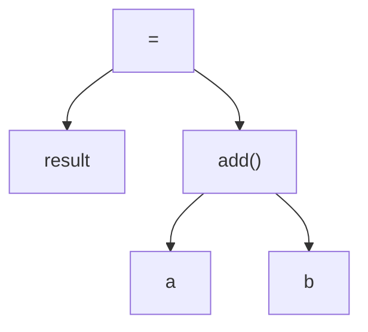

The exact AST is more detailed, but the idea is what matters. The compiler now understands:

```
result
   =
the result of calling add
   with
a and b
```

That's completely different from simply seeing a sequence of characters. And this is why an AST is so useful. It captures the **meaningful structure** of the source code.

#### You Can Actually See an AST

One of the coolest things about compilers is that many of these concepts aren't theoretical. You can inspect them. For example, Python makes this particularly easy:

```python
import ast

tree = ast.parse("result = add(a, b)")

print(ast.dump(tree, indent=2))
```

C compilers have their own internal representations and tools for inspecting them. You don't normally see the compiler's internal AST just by running GCC, but conceptually, this is what is happening.

#### What Happens If the Syntax Is Correct But the Program Is Wrong?

Consider:

```c
int x = "hello";
```

The parser can understand the structure. There's nothing fundamentally broken about:

```c
int
x
=
"hello"
```

But something is wrong with the types. We're trying to initialize an integer with a string literal. This brings us to another stage. 

### 4. Semantic Analysis

Now the compiler starts asking questions about meaning. For our program:

```c
int a = 10;
int b = 20;

int result = add(a, b);
```

the compiler needs to understand things like:

```c
a → int
b → int
add → function
add(int, int) → int
result → int
```

It checks things such as:

```
Was the variable declared?

Does the function exist?

Are the argument types correct?

Does the return type make sense?

Is the variable accessible here?
```

The parser answers: "Is this structurally valid?"

Semantic analysis asks: "Does this make sense?"

#### Now Something Interesting Happens

The compiler understands our source. But it still doesn't want to immediately produce x86 (suppose) instructions.
Why?
Because the compiler may want to optimise our program first. And this is where we need another representation. 

### 5. Intermediate Representation

Imagine the compiler takes:

```c
int result = add(a, b);
```

and represents it in a lower-level intermediate form.

Conceptually:

```nasm
t1 = load a
t2 = load b
t3 = call add(t1, t2)
store result, t3
```

This isn't necessarily the exact IR produced by GCC. It's a mental model. Real compiler IRs are much more sophisticated. The important thing is that we've created a representation that is:

- lower-level than C
- higher-level than machine code
- easier for the compiler to analyze

Think of IR as a meeting point between high-level language and hardware.

#### Now Give the Compiler Something to Optimize

Our original function is:

```c
int add(int x, int y) {
    return x + y;
}
```

And we're calling it here:

```c
int result = add(a, b);
```

At runtime, we really need the function call. But compilers are allowed to transform the program as long as the observable behavior remains correct. Let's make that obvious.

Add this:

```c
int x = 10;
int y = 20;
int z = x + y;
```

The answer to 10 + 20 is always 30.

The compiler doesn't need to make the CPU perform the addition at runtime. It can calculate it while compiling. This is called **constant folding.**

#### Actually Compare Optimisation Levels

Compile our program without optimization:

```bash
gcc -O0 -S main.c -o main-O0.s
```

Now compile it with optimization:

```bash
gcc -O2 -S main.c -o main-O2.s
```

We've just asked GCC to generate assembly twice. Once with almost no optimization. Once with a significant optimisation level. Now compare them:

```bash
diff -u main-O0.s main-O2.s
```

And suddenly you can see something fascinating. **The compiler may produce substantially different assembly for the same source code.**

Why? Because the compiler isn't translating source line-by-line.

It's asking "What is the most efficient way to preserve the behaviour of this program?"

#### A Function Can Literally Disappear

Suppose we write:

```c
int add(int x, int y) {
    return x + y;
}

int main() {
    int result = add(10, 20);
    return result;
}
```

A compiler with optimization enabled may realize:

```c
add(10, 20)
```

always produces:

```
30
```

So instead of generating:

```
call add
```

it may effectively reduce the work to:

```
return 30
```

The function we wrote is still present in our source code. But the optimized machine code may no longer contain a normal call to it. This is one of the most beautiful things about optimisation. **The source code describes what you want. It does not dictate exactly what instructions the CPU must execute.**

### 6. Assembly

Eventually the compiler needs to target a real CPU. Let's say we're targeting x86-64. The compiler might produce assembly resembling:

```nasm
movl    $10, -4(%rbp)
movl    $20, -8(%rbp)

movl    -8(%rbp), %esi
movl    -4(%rbp), %edi

call    add
```

Don't worry if this looks intimidating. We aren't going to memorize assembly. We're going to read it like a story. For example:

```nasm
movl $10, ...
```

roughly means put the value `10` somewhere.

Then:

```nasm
movl $20, ...
```

means put `20` somewhere.

Then:

```nasm
call add
```

means transfer control to the function `add`. And after the function finishes, execution returns to the caller. But there is a huge question, **Where Is `add`?**

Look at:

```nasm
call add
```

The compiler has generated a call to `add`. But how does the CPU know where `add` lives? And what about:

```c
printf(...)
```

Where does that function live? We haven't written it. This is where object files and linking become interesting.

### 7. Assembly Is Still Text

Our assembly file:

```
main.s
```

is still a text file. If you open it, you'll see:

```nasm
call add
```

The CPU does **not** receive the letters:

```
c a l l
```

The assembly has to be encoded into actual machine instructions. That's the assembler's job.

### 8. The Assembler

Run:

```bash
gcc -c main.c -o main.o
```

The `-c` option tells GCC, compile and assemble, but don't link.

Now we have:

```
main.o
```

This is an **object file**. And this is one of the most interesting files. Because `main.o` contains machine code. But it isn't necessarily a complete executable.

Try:

```bash
file main.o
```

Then:

```bash
objdump -d main.o
```

You'll see something resembling:

```
0000000000000000 <add>:
   0:   ...
   ...
```

The exact output depends on your architecture and compiler. But now we're looking at something fundamentally different. We are no longer looking at C. We're no longer looking at assembly text. We're looking at **machine instructions**. And `objdump` is showing them to us in a human-readable assembly representation.

This distinction matters:

```
Assembly source
```

is text.

```
Machine code
```

is binary data. `objdump` takes that binary data and gives our human eyes a readable representation again.

#### So What Do Machine-Code Bytes Look Like?

Suppose we have an instruction such as:

```bash
add eax, 20
```

The CPU doesn't receive:

```bash
add eax, 20
```

It receives an encoding. For x86, that encoding can be represented as bytes such as:

```
83 C0 14
```

And those hexadecimal values are just a convenient representation of:

```
10000011 11000000 00010100
```

Now we're finally at the level where we can honestly say t**hese are bytes encoding CPU instructions.**

But it is not finished. Because our object file still has unresolved pieces.

### 9. Symbols

Let's look at:

```c
int add(int x, int y) {
    return x + y;
}
```

The function `add` is something our program defines. So the object file needs to contain information allowing other parts of the program to refer to it. This is where **symbols** enter the story. You can inspect them with:

```bash
nm main.o
```

You may see entries corresponding to symbols such as:

```
add
main
printf
```

The exact output and symbol names vary by platform/toolchain. A symbol gives a name to something the linker may need to locate.

So when the compiler emitted:

```nasm
call add
```

the object file can effectively say "I need to call the symbol named `add`." The assembler doesn't necessarily know the final address yet. And that's okay. Because the linker will handle that later.

### 10. Relocation: The Address We Don't Know Yet

We have our object file:

```
main.o
```

It contains machine code. But something feels strange. Remember our function:

```c
int add(int x, int y) {
    return x + y;
}
```

and our call:

```c
int result = add(a, b);
```

At the assembly level, the compiler might generate something conceptually like:

```nasm
call add
```

Eventually, that has to become a real machine instruction.

But here's the problem, **Where is `add`?** What address should the CPU jump to?

Maybe:

```
0x401120
```

Or:

```
0x401180
```

Or something completely different. At this point, the compiler doesn't necessarily know. And that's not a bug. It's because we're compiling a **piece of a program**, not the final program yet.

#### **Think About It Like Building a City**

Imagine you're building a huge city. You have one blueprint that says:

```
Build a road to:

"Central Station"
```

But Central Station hasn't been placed on the final map yet. You can't write:

```
Go to coordinates (51, 73)
```

because you don't know where the station will eventually be. So instead, you write:

```
Go to "Central Station"
```

Then, once the entire city is assembled, someone can say:

```
Central Station = (51, 73)
```

and replace the placeholder with the actual location. That's roughly the idea behind **symbols and relocations**.

#### Object File Doesn't Know Everything Yet

When we compile:

```bash
gcc -c main.c -o main.o
```

we're telling GCC, compile this source file, but don't produce the final executable yet. So `main.o` is only one piece of the final program.

It may contain:

```
machine code
+
data
+
symbols
+
relocation information
```

Think of the object file as saying "Here's the code I generated. Here are the things I define. Here are the things I still need someone else to resolve." And this is where the concept of a **symbol** becomes important.

#### What Is a Symbol?

Consider:

```c
int add(int x, int y) {
    return x + y;
}
```

The function:

```
add
```

is a symbol. Likewise:

```c
int main()
```

creates another symbol:

```c
main
```

But when we write:

```c
printf(...)
```

we're referring to a symbol that our source file doesn't define. The object file can therefore contain information roughly like:

| Symbol | Defined here? |
|---|---|
| `add` | yes |
| `main` | yes |
| `printf` | no |

The exact representation is more complicated, but this mental model is useful. We can inspect symbols ourselves. On many Unix-like systems:

```bash
nm main.o
```

You might see something resembling:

```
0000000000000000 T add
0000000000000014 T main
                 U printf
```

The exact addresses and formatting depend on your compiler and platform.

But notice something fascinating. You might see:

```
T add
```

and:

```
U printf
```

`T` broadly indicates that `add` is defined in the object's text/code section.

`U` means **undefined.**

In other words "This object needs `printf`, but `printf` isn't defined inside this object."

That is a huge clue about what the linker will eventually have to do.

#### But What About the `call` Instruction?

Let's go back to:

```c
int result = add(a, b);
```

The compiler wants something like:

```nasm
call add
```

But machine code cannot simply contain the English word:

```
add
```

The CPU needs an encoded instruction containing the information necessary to transfer control.

And usually, the exact value needed for that transfer depends on where `add` ends up in the final executable. But we don't know that yet.

Why?

Because we haven't linked the program.

So instead of pretending that the compiler knows the final answer, the assembler leaves information behind saying, essentially "There is a reference here that needs to be fixed later." That information is a **relocation entry**.

#### What Exactly Is a Relocation?

A relocation is metadata that tells the linker "This particular location in the generated machine code depends on an address or symbol that isn't fully known yet." You can think of it as a TODO left inside the object file. Something conceptually like:

```
Instruction at offset 0x20:

    call ???

Relocation:

    resolve this reference using symbol "add"
```

The actual data structures are much more precise than this, but the idea is surprisingly simple.

The compiler/assembler says:

```
"I know what I'm trying to reference."

"I don't know the final address yet."

"Please fix this later."
```

And the linker says:

```
"Don't worry. I'll handle it."
```

#### Actually Inspect Relocations

On Linux, you can often inspect them with:

```bash
readelf -r main.o
```

You may see output containing something like:

```
Relocation section '.rela.text' ...

Offset
Info
Type
Symbol
Addend
```

The exact output depends on your architecture and toolchain. But conceptually, you're looking at information like:


| Offset | Symbol | Type |
|---|---|---|
| `0x00000015` | `add` | `...` |
| `0x0000002A` | `printf` | `...` |


Again, the real format is more complicated. But imagine the linker being handed a list saying:

```
At this location:
    I need "add"

At this location:
    I need "printf"
```

Now the linker has something it can work with.

#### Why Can't the Compiler Just Put the Address There?

This is a very reasonable question. Why not just say:

```
add = 0x401120
```

and be done with it? Because the compiler is not necessarily compiling the entire program. Imagine we have:

```
main.c
math.c
network.c
database.c
```

We might compile them independently:

```
gcc -c main.c
gcc -c math.c
gcc -c network.c
gcc -c database.c
```

Now we have:

```
main.o
math.o
network.o
database.o
```

Each object file was created independently. The compiler generating `main.o` doesn't necessarily know where the linker will eventually place code from:

```
math.o
network.o
database.o
```

The final executable layout hasn't been decided. So instead of requiring every compiler invocation to know the final memory layout, object files are designed to be **relocatable**. That's why we call them **relocatable object files.** The machine code can be placed into a final address space later.

#### A Simple Example

Imagine the compiler creates this conceptual machine code:

```
Offset     Instruction

0x00       ...
0x04       ...
0x08       CALL ???
0x0C       ...
```

At offset:

```
0x08
```

there's a call that depends on `add`. The object file can say:

```
Relocation:
    offset = 0x08
    symbol = add
```

Later, suppose the linker decides:

```
add → 0x401150
```

Now the linker can calculate whatever value the particular instruction encoding requires and patch the appropriate bytes. The final machine code becomes something like:

```
0x00       ...
0x04       ...
0x08       CALL <encoded target>
0x0C       ...
```

The CPU doesn't see:

```
add
```

anymore. It sees the final encoded instruction.

#### One More Subtlety: It's Not Always a Simple Absolute Address

Here's where we should avoid oversimplifying. A relocation doesn't always mean:

```
"put the absolute address of add here."
```

Different CPU architectures and instruction encodings use different ways of representing addresses. For example, a call may use a **relative displacement** rather than an absolute address.

Conceptually:

```
target address - address of next instruction
```

might be what needs to be encoded. This is useful because programs can sometimes be moved in memory without every reference needing an absolute address baked into it. The exact relocation type depends on things such as:

```
CPU architecture
instruction encoding
object-file format
linking model
static vs dynamic linking
```

This is why real relocation tables contain a `Type` field. That field tells the linker "What kind of calculation should I perform when fixing this reference?" So relocation isn't simply:

```
replace X with address Y
```

It's more accurately a**pply the appropriate architecture-specific transformation at this location using the final address/value of this symbol.**

#### Now We Have Everything the Linker Needs

At this point, we have:

```
main.o
```

which contains:

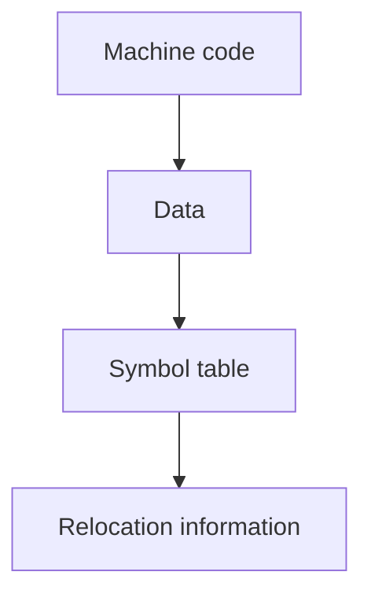

But our program may depend on other object files and libraries. And that's where Stage 11 begins.

### 11. Linking: Putting the Program Together

Now run:

```bash
gcc main.o -o main
```

This time, something different happens. The linker gets involved.

Its job is roughly take all these separately compiled pieces and produce something that can be loaded and executed as one program.

Imagine our program consists of:

```
main.o
math.o
network.o
```

and some libraries. The linker receives all of them. 

Conceptually:

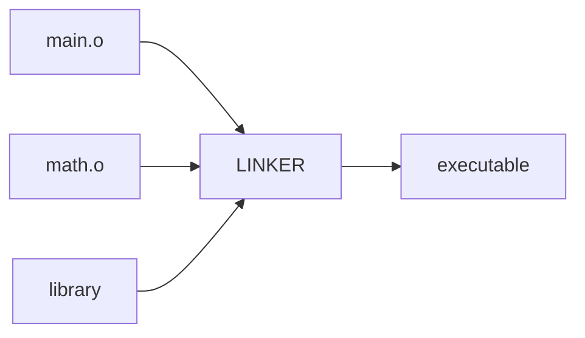

But what exactly does it do? Quite a lot.

#### First Job: Symbol Resolution

Suppose `main.o` says:

```
I need:
    add
```

And `math.o` says:

```
I provide:
    add
```

The linker matches them.

Conceptually:

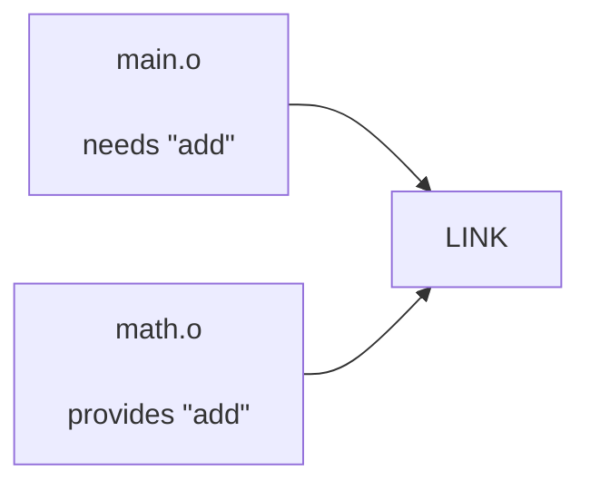

The linker now knows:

```
"Ah, when main.o refers to add,
it means the add function defined in math.o."
```

This process is called **symbol resolution**. And this is one of the core jobs of the linker.

#### What About `printf`?

Our program contains:

```c
printf("Result = %d\n", result);
```

But:

```
printf
```

isn't defined in `main.c`. So where does it come from? The C standard library. On a typical Linux system, the final program may depend on a shared library such as:

```
libc.so
```

The exact library arrangement depends on the platform and build configuration. So the linker has to deal with this external dependency too.

It may arrange for the final executable to contain the appropriate dynamic-linking information so that the runtime loader can resolve `printf` when the program starts.

#### Linking Doesn't Always Mean "Copy Everything Into the Executable"

There are two broad approaches worth understanding.

#### Static linking

The required library code is incorporated into the executable.

Conceptually:

```
main.o
   +
library code
   ↓
executable
```

The resulting executable can become larger because it contains more code.

#### Dynamic linking

Instead of copying the library implementation into our executable, the executable can depend on a shared library.

Conceptually:

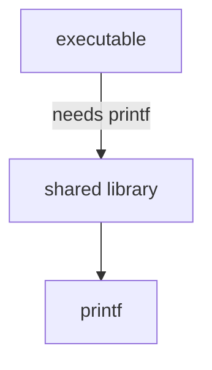

The shared library can be loaded into the process at runtime. This is why you can have many programs using the same system library rather than every executable carrying a completely separate copy.

#### Second Job: Layout

Now here's another thing the linker has to figure out. Where should everything go? Our final executable needs a layout.

Conceptually:

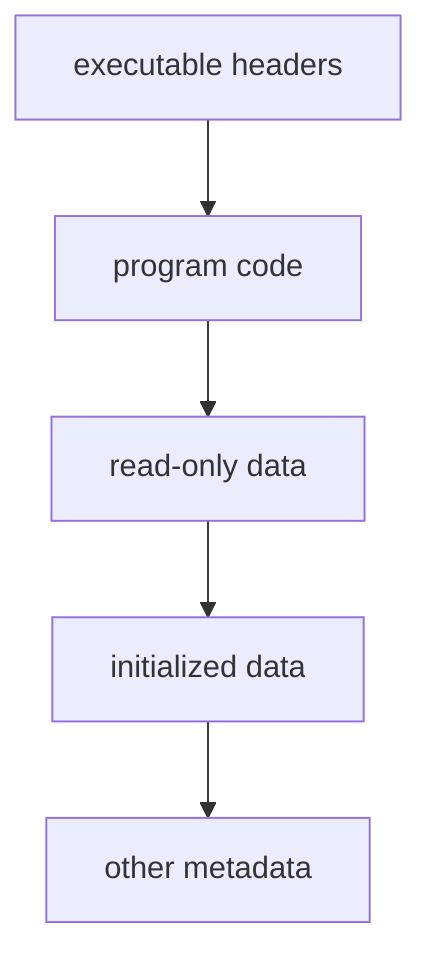

The exact structure depends on the executable format. On ELF systems, the linker works with sections and creates loadable segments appropriate for the operating system's loader.

The important point is the linker is no longer just matching names. It's constructing the final binary layout.

#### Third Job: Fixing Relocations

Remember the TODO we left earlier? We had something like:

```
At offset 0x08:

    reference to "add"
```

Now the linker has resolved the symbol. Suppose it determines:

```
add → final address/value
```

Now it can apply the relocation.

Conceptually:

```
Before linking:

CALL ???

        ↓

Linker resolves "add"

        ↓

After linking:

CALL <actual encoded target>
```

The placeholder is gone. The machine-code bytes are now complete for that reference. This is one of the most important moments in the entire compilation story. The compiler knew "I want to call `add`."

The assembler encoded that request into the object file and recorded what needed to be fixed. The linker finally knows "I know where `add` ended up."

So it can produce the final machine-code encoding.

#### Visualise the Whole Thing

Before linking:

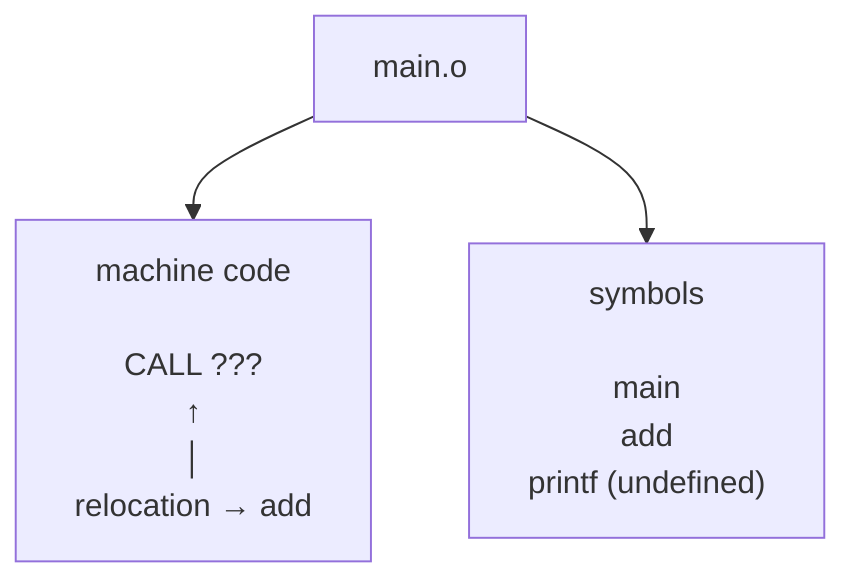

Another object file:

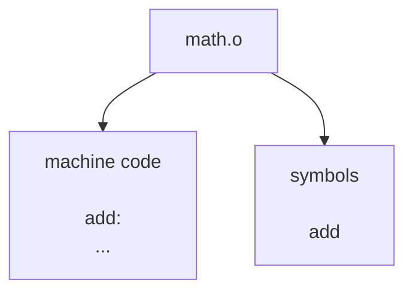

The linker sees:

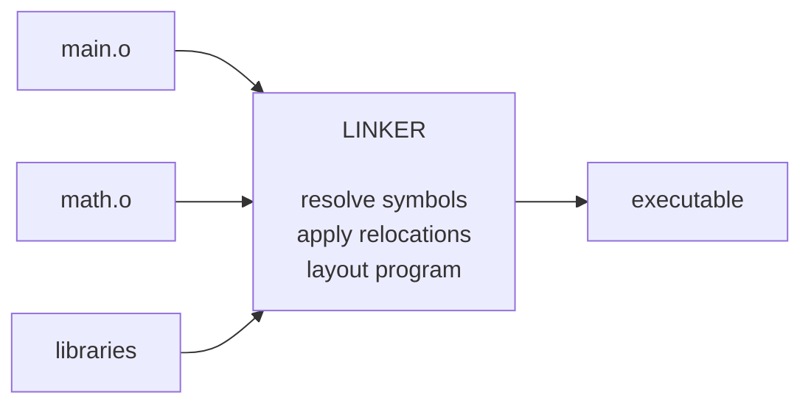

And the final executable contains a coherent program image.

#### But What About `printf`?

This is where things get even more interesting. For `add`, the linker can find the definition in another object file we supplied. But `printf` may come from a shared library. So the final executable can contain information saying, in effect:

```
I depend on this shared library.

I need this symbol:

    printf
```

Then, when the program starts, the runtime dynamic linker/loader can help resolve that dependency. So the complete story may actually look like:

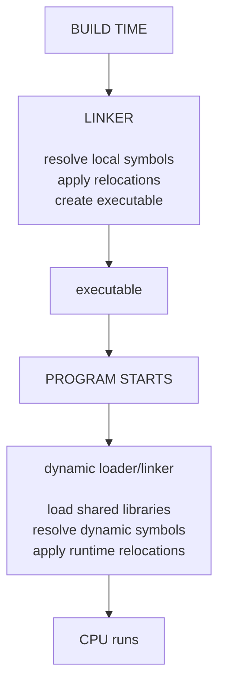

This is why "linking" can actually involve more than one moment. Some work happens during the build. Some work can happen when the program starts. And depending on the linking model, some symbol resolution can even be deferred until a function is actually called.

### 12. The Executable

Now we can finally run:

```bash
gcc main.o -o main
```

And we get:

```
main
```

This is no longer an object file. It's an executable. On Linux, it will typically use the ELF format. On macOS, Mach-O. On Windows, PE. These formats describe how the operating system should understand the binary. So the executable isn't simply:

```
random machine-code bytes
```

It's a structured binary containing things such as:

```
machine code
data
metadata
symbols
sections/segments
dynamic linking information
entry-point information
```

Now we can inspect it:

```
file main
```

And:

```bash
readelf -h main
```

on Linux. You can also inspect its sections:

```bash
readelf -S main
```

Now we're looking at the actual binary produced by our compilation process.

### 13. Open the Binary as Raw Bytes

Run:

```bash
xxd main | head
```

You might see something like:

```
00000000: 7f45 4c46 0201 0100 ...
```

The first bytes:

```
7f 45 4c 46
```

are the ELF magic number on Linux. Those bytes tell the operating system "This file is an ELF executable." And somewhere later in the file are the machine-code bytes. Now think about what just happened. We started with:

```c
int result = add(a, b);
```

And eventually, somewhere inside this binary, that high-level idea has become encoded machine instructions.

Not:

```
int
result
add
```

Not:

```
function call
```

But actual bytes.

#### But We Still Haven't Run It

We have:

```
main
```

sitting on disk. We execute:

```
./main
```

Now the operating system gets involved. The OS reads the executable's format. It sees the information describing the program. It creates a process. It maps the appropriate executable segments into the process's virtual address space. It sets up memory. It loads or maps required shared libraries if necessary. It prepares the process to begin execution. Eventually execution reaches the program's entry point. And after runtime initialisation:

```c
main()
```

starts running.

### 14. The CPU Finally Enters the Story

At this point, our CPU doesn't know:

```
C
```

It doesn't know:

```
GCC
```

It doesn't know:

```
add()
```

It doesn't know:

```
main.c
```

It sees machine instructions.

Very roughly:

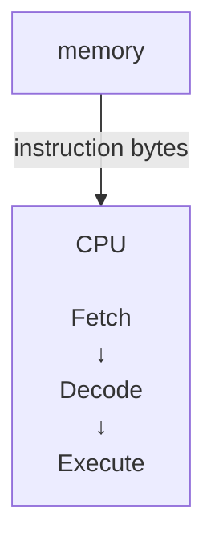

The CPU fetches bytes from memory. It interprets them according to its instruction set architecture. It executes them. Then it moves to the next instruction.

And eventually:

```
10 + 20
```

becomes:

```
30
```

and:

```
printf("Result = %d\n", result);
```

causes the program to produce:

```
Result = 30
```

on your terminal.

### What Happens to Python?

We've just followed a C program all the way down.

We started with:

```c
int result = add(a, b);
```

and eventually reached: machine-code bytes to CPU.

Along the way, we saw:

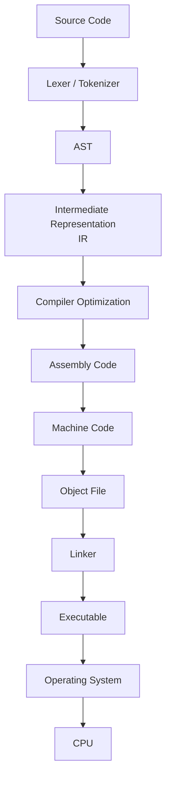

Now let's take python language and use almost the same program:

```python
def add(x, y):
    return x + y

a = 10
b = 20

result = add(a, b)

print(result)
```

At first glance, you might think:

> "Well, Python is interpreted. So there isn't really a compilation process."

That is a misconception an it is also incomplete.

If we're talking about **CPython**, the standard Python implementation, there absolutely is a compilation step. But the target is different and that's where things get interesting.

---

### The C and Python Roads Split

For C, we had a simplified journey:

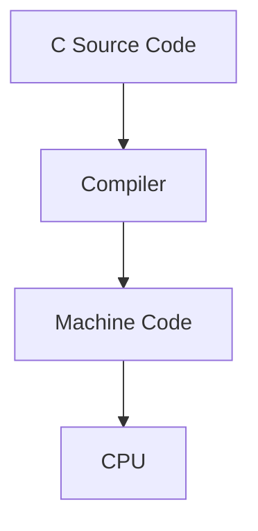

For CPython, we can initially think of it as:

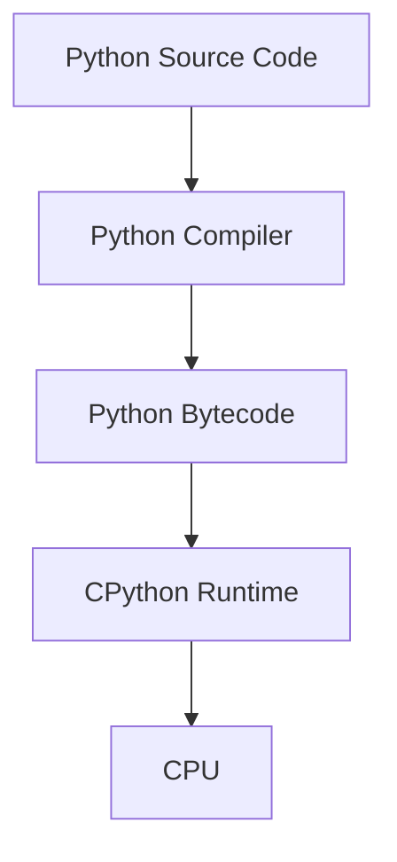

Notice the difference. C is generally compiled toward **native instructions for a particular CPU architecture**.

CPython compiles Python into **instructions for a virtual machine implemented by CPython**.

---

### So What exactly is Python bytecode?

We save:

```text
main.py
```

with:

```python
def add(x, y):
    return x + y

a = 10
b = 20

result = add(a, b)

print(result)
```

Just like `main.c`, this file is initially nothing special to the CPU.

It's a file containing encoded characters. For example:

```python
a = 10
```

is stored as bytes representing characters. The CPU doesn't look at those bytes and understand:

```text
variable a
assignment
integer 10
```

It can't. Those bytes only become meaningful when a program decides how to interpret them.

For C, GCC interprets them as C source. For Python, CPython interprets them as Python source and we're about to watch CPython do exactly that.

---

### 1. Python Starts Reading the Source

When we run:

```bash
python main.py
```

CPython starts processing the source file. The first thing to understand is that CPython doesn't simply read the file and immediately execute each line as raw text.

It analyzes the source. Just like we saw with C, the source has to be broken down and understood.

And that starts with tokens.

---

### 2. Tokenization

Take:

```python
result = add(a, b)
```

Conceptually, the source can be broken into tokens like:

```text
NAME       result

OP         =

NAME       add

OP         (

NAME       a

OP         ,

NAME       b

OP         )
```

And:

```python
return x + y
```

becomes something conceptually like:

```text
RETURN
NAME       x
OP         +
NAME       y
```

Again, we're moving from:

```text
characters
```

to:

```text
tokens
```

This should look familiar.

But remember something from the C section. Knowing the individual pieces isn't enough. The compiler needs to know how those pieces relate to one another.

---

### 3. Parsing and the AST

Consider:

```python
result = add(a, b)
```

The parser needs to understand that:

```text
result
```

is being assigned the result of:

```text
add(a, b)
```

Conceptually:

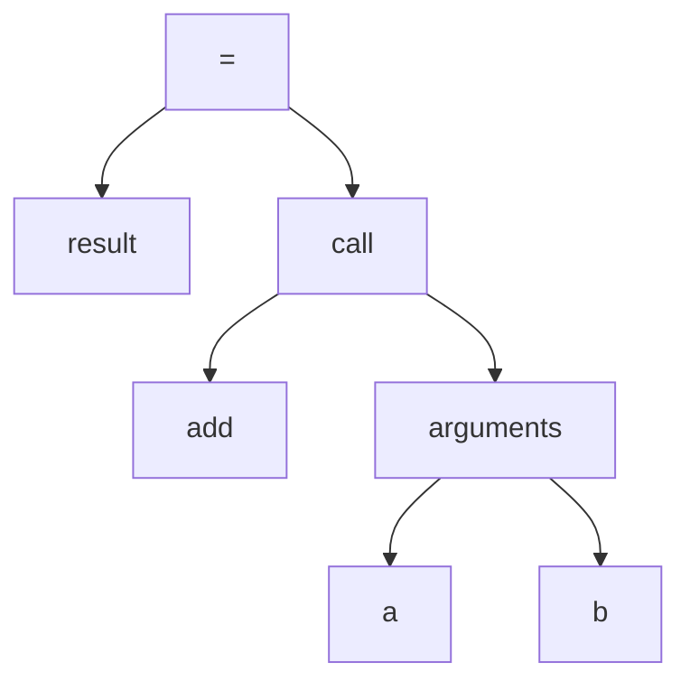

That's an **Abstract Syntax Tree**.

The AST represents the structure of the program and here's where Python gives us a fantastic little tool. We can actually ask Python to show us.

Create:

```python
import ast

source = """
result = add(a, b)
"""

tree = ast.parse(source)

print(ast.dump(tree, indent=2))
```

Run it.

You'll get a structure describing things such as:

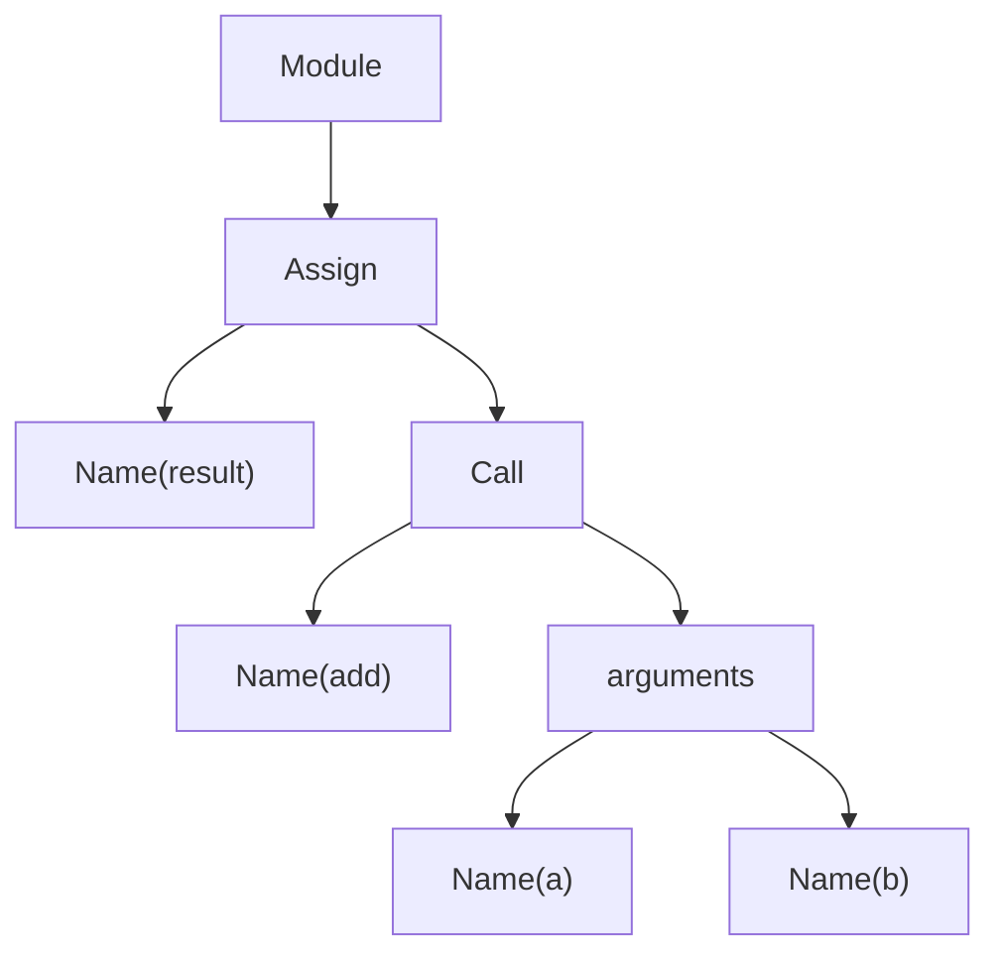

The exact output is more verbose, but that's the important idea.

Python isn't thinking:

```text
r e s u l t = a d d ( a , b )
```

anymore.

It understands:

> "Assign the result of calling `add` with `a` and `b` to the variable `result`."

That's a massive jump in understanding.

---

#### Now Something Important

At this point, someone might say:

> "Okay, so Python has an AST. Just like C."

Correct. But what happens next?

Does Python generate x86-64 assembly?

No.

At least, that's not the normal path in CPython. Instead, CPython compiles the AST into something called: **bytecode.**

And this is where it takes a completely different turn from C.

---

### 4. Python Bytecode

Let's use our function:

```python
def add(x, y):
    return x + y
```

We can ask Python to show us the bytecode.

Python has a built-in module for this:

```python
import dis

def add(x, y):
    return x + y

dis.dis(add)
```

Depending on your Python version, you'll see something along the lines of:

```text
LOAD_FAST
LOAD_FAST
BINARY_OP
RETURN_VALUE
```

The exact instructions and formatting can change between Python versions. And that's okay. We're interested in the idea.

Look at this:

```text
LOAD_FAST
LOAD_FAST
BINARY_OP
RETURN_VALUE
```

Does your CPU understand any of these?

No.

An x86-64 CPU doesn't have an instruction called:

```text
LOAD_FAST
```

An ARM CPU doesn't either.

So what exactly are we looking at?

---

#### Meet the Python Virtual Machine

This is one of the easiest ways to understand Python's bytecode.

Imagine Python has a tiny imaginary CPU and we call it `The Python Virtual Machine`

This isn't a physical CPU. It's a machine implemented in software and this imaginary machine understands instructions such as:

```text
LOAD_FAST
STORE_FAST
LOAD_CONST
CALL
BINARY_OP
RETURN_VALUE
```

Now our Python compiler can target this virtual machine.

So:

```python
return x + y
```

can become something conceptually like:

```text
load x
load y
perform addition
return result
```

In Python bytecode:

```text
LOAD_FAST
LOAD_FAST
BINARY_OP
RETURN_VALUE
```

The important point is:

> **Python bytecode is not machine code for your physical CPU.**

**It is code for the Python runtime.**

This distinction is so important that it's worth drawing.

For C:

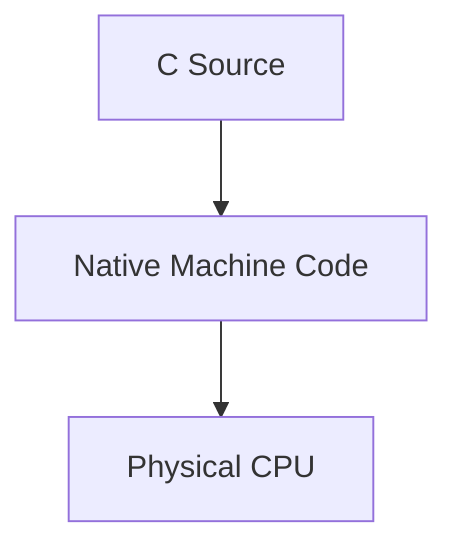

For CPython:

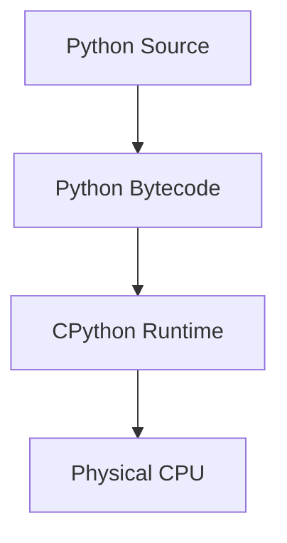

The CPU executes the **CPython runtime**.

The runtime executes your **Python bytecode**.

That's the key point.

---

#### But What Does "Bytecode" Actually Mean?

If it's called bytecode, does that mean it's literally just:

```text
10101010
```

Not quite. Bytecode is a sequence of encoded instructions used by a virtual machine.

conceptually:

```text
opcode
argument
opcode
argument
opcode
argument
```

The exact encoding is an implementation detail of the Python version.

You can inspect some of it using Python itself.

For example:

```python
import dis

def add(x, y):
    return x + y

print(add.__code__.co_code)
```

You may get something like:

```text
b'...'
```

The exact bytes will depend on your Python version. Those bytes are part of the compiled code representation. Now we're getting closer to our original question:

> **How does code become bytes?**

Python gives us another example.

---

#### Python Source Is Bytes

Initially:

```text
main.py
```

contains bytes representing characters. Then CPython interprets those bytes as Python source. The source is transformed into:

```text
tokens
```

then:

```text
AST
```

then:

```text
bytecode
```

And that bytecode itself is represented as binary data.

So we now have:

```text
Python source bytes
        ↓
Python syntax
        ↓
AST
        ↓
Python bytecode
        ↓
bytecode data
```

We're still not at the physical CPU.

---

### 5. Code Objects

When Python compiles a function, it creates a **code object**.

Try:

```python
def add(x, y):
    return x + y

print(add.__code__)
```

You'll see something representing the compiled code associated with the function.

You can inspect parts of it:

```python
print(add.__code__.co_code)
print(add.__code__.co_consts)
print(add.__code__.co_varnames)
```

The code object contains information needed by the runtime to execute that function.

Conceptually, you can think of it as carrying things such as:

```text
bytecode
constants
variable information
names
metadata
```

So our function isn't simply stored as the original text anymore. The runtime has a compiled representation of it.

---

#### What Happens to `10` and `20`?

Let's go back to:

```python
a = 10
b = 20
```

The compiler needs to represent those constants too.

Python's compiled representation keeps information about constants used by the code.

You can inspect them:

```python
def example():
    a = 10
    b = 20

print(example.__code__.co_consts)
```

You'll see constants associated with the function.

> The compiler isn't just generating instructions. It's building a complete representation of what the runtime needs.

---

### 6. The `.pyc` File

Now comes another thing you've probably seen:

```text
__pycache__/
```

Inside it, you may find something like:

```text
main.cpython-314.pyc
```

The exact filename depends on your Python version and environment.

What's going on here?

CPython can store a cached, compiled representation of Python source in a `.pyc` file.

So instead of repeatedly doing all the compilation work every time the source is imported, Python can sometimes reuse the cached compiled representation when appropriate.

Conceptually:

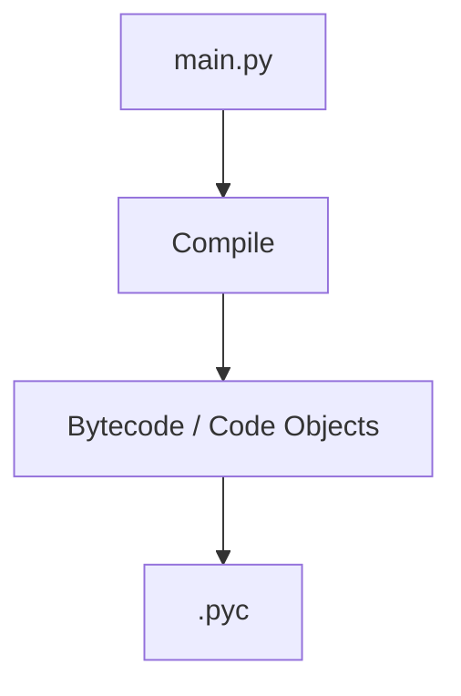

This is important that a `.pyc` file is **not a native executable**. It is not something your CPU can directly run. It's a representation intended for the Python runtime.

---

#### Look at the `.pyc`

A `.pyc` file is binary data.

If you open it with a hex viewer, you won't see:

```python
def add(x, y):
```

as normal source code. You'll see bytes. It contains a header and a serialized representation of Python's compiled objects.

The exact layout is implementation-specific and can change. But the important conceptual pipeline is:

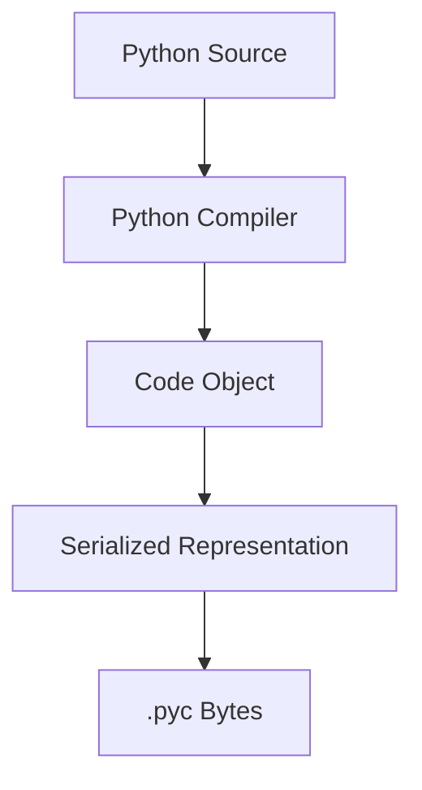

The bytes inside a `.pyc` file are **not the same kind of bytes as native CPU instruction bytes**. They're bytes representing Python's compiled representation.

Same underlying concept:

```text
bits
```

Different interpretation.

---

#### Let's Make That Concrete

Remember our C example. Eventually we could have bytes like:

```text
83 C0 14
```

which, depending on the architecture and context, can encode a native CPU instruction. The CPU's instruction decoder understands those bytes.

Now consider Python bytecode. Its bytes are interpreted according to CPython's bytecode format. The CPU doesn't look at those bytes and execute them as x86 instructions.

Instead:

```mermaid
flowchart TD
    A["Python Bytecode"] --> B["CPython Reads Bytecode"]
    B --> C["CPython Performs the Operation"]
```

That's a crucial distinction.

---

### 7. Who Executes the Bytecode?

We have:

```mermaid
flowchart TD
    A["Python Source"] --> B["Python Bytecode"]
```

But the CPU can't execute:

```text
LOAD_FAST
BINARY_OP
RETURN_VALUE
```

So who does?

**CPython.**

The CPython runtime contains native machine code. That runtime knows how to interpret Python bytecode.

Imagine something like:

```text
while (there_are_instructions) {

    instruction = get_next_python_instruction();

    switch (instruction) {

        case LOAD_FAST:
            ...
            break;

        case BINARY_OP:
            ...
            break;

        case RETURN_VALUE:
            ...
            break;
    }
}
```

This is a simplified model, not the literal implementation.

The runtime repeatedly:

```mermaid
flowchart TD
    A["Fetches a Python Bytecode Instruction"]
    --> B["Decodes It"]
    --> C["Performs the Corresponding Operation"]
```

And those operations are implemented by native code inside CPython.

---

#### Let's Follow `x + y`

Suppose our Python function contains:

```python
return x + y
```

The Python compiler might produce bytecode conceptually like:

```text
LOAD_FAST x
LOAD_FAST y
BINARY_OP +
RETURN_VALUE
```

Now CPython executes the bytecode.

For:

```text
LOAD_FAST x
```

the runtime retrieves the appropriate local value.

Then:

```text
LOAD_FAST y
```

retrieves the other value.

Then:

```text
BINARY_OP +
```

tells the runtime to perform Python's addition semantics and this is where Python becomes much more interesting than C.

---

#### Python's `+` Isn't Just CPU Addition

Consider:

```python
10 + 20
```

That's straightforward.

But Python also allows:

```python
"hello" + "world"
```

And:

```python
[1, 2] + [3, 4]
```

And objects can define their own behavior for addition.

So when Python sees:

```python
a + b
```

the runtime can't simply assume:

```text
CPU integer ADD instruction
```

It has to determine what operation Python's semantics require for the objects involved.

This is one reason Python's runtime has considerably more work to do than a simple statically typed C integer addition.

The compiler and runtime have to preserve Python's dynamic behavior.

---

#### The Stack

Python bytecode traditionally uses a virtual evaluation stack. Once the equation is converted into postfix equation, the actual evaluation starts. 

Imagine:

```text
x + y
```

Conceptually becoming:

```text
LOAD_FAST x
```

Stack:

```mermaid
flowchart TD
    A["x"]

    style A fill:none,stroke:#333,stroke-width:1px
```

Then:

```text
LOAD_FAST y
```

Stack:

```mermaid
flowchart TD
    A["y"] --> B["x"]

    style A fill:none,stroke:#333,stroke-width:1px
    style B fill:none,stroke:#333,stroke-width:1px
```

Then:

```text
BINARY_OP
```

takes the relevant operands and produces the result.

Then:

```text
RETURN_VALUE
```

returns that value.

The exact details of CPython's evaluation machinery evolve across Python versions, but the virtual-machine model is extremely useful for understanding what bytecode means.

---

### Now the CPU Comes Back

We've been talking about Python's virtual machine.

But eventually something has to execute the virtual machine itself and that something is the physical CPU.

Remember, `CPython` is itself a program. CPython is implemented primarily in C.

So CPython itself has been compiled into native machine code.

Which means our full picture is actually:

```mermaid
    flowchart TD
    A["Python Source Code"]
    --> B["Python Compiler"]
    --> C["Python Bytecode"]
    --> D["CPython Runtime"]
    --> E["Native Machine Code"]
    --> F["CPU"]
```

This is the part people often miss.

The CPU isn't executing your Python bytecode directly. The CPU is executing **CPython**, and CPython is executing your Python bytecode.

---

#### Compare This With C

Now put the two side by side.

#### C

```mermaid
flowchart TD
    A["main.c"]
    --> B["C Compiler"]
    --> C["Assembly"]
    --> D["Machine Code"]
    --> E["Object File"]
    --> F["Linker"]
    --> G["Executable"]
    --> H["Operating System"]
    --> I["CPU"]
```

#### CPython

```mermaid
flowchart TD
    A["main.py"]
    --> B["Python Compiler"]
    --> C["AST"]
    --> D["Python Bytecode"]
    --> E["Code Object"]
    --> F["CPython Runtime"]
    --> G["Native CPython Code"]
    --> H["CPU"]
```

There is a very important difference. C generally moves the source program itself toward native instructions. CPython moves the source program toward instructions for a **virtual machine**.

---

### But Does Python Never Produce Native Machine Code?

Python implementations don't all work exactly the same way.

And even within the Python ecosystem, there are implementations and technologies that can use native compilation techniques.

One important technique is:

**JIT: Just-In-Time compilation.**

The basic idea is fascinating. Instead of only interpreting bytecode, a runtime can watch the program while it runs.

Suppose it notices that some piece of code executes thousands or millions of times.

It can effectively say:

> "I've seen this code enough times. Maybe it's worth compiling this hot path into native machine code."

Then the pipeline can become:

```mermaid
flowchart TD
    A["Python Source"]
    --> B["Python Bytecode"]
    --> C["Runtime Execution"]
    --> D["Hot Code Detected"]
    --> E["JIT Compiler"]
    --> F["Native Machine Code"]
    --> G["CPU"]
```

Now Python code can end up producing actual CPU instructions during execution.

This is why the simple statement:

> "C is compiled and Python is interpreted"

doesn't tell the whole story. Real language implementations are much more interesting.

---

### So... Is Python Compiled or Interpreted?

The honest answer is: **Both concepts can be involved.**

For CPython, Python source is compiled into bytecode. That bytecode is then executed by the Python runtime.

And depending on the implementation and execution technology, native machine code may also be generated.

So instead of thinking:

```text
compiled OR interpreted
```

it's much more useful to think:

```text
What representation is produced?

Who executes that representation?

And where does native machine code enter the picture?
```

The difference isn't:

```text
C = compiled
Python = not compiled
```

The more useful distinction is:

```text
C → native machine instructions
```

versus:

```text
Python → virtual-machine instructions
```

with the runtime sitting between those instructions and the physical CPU.

---

### Back to Bytes

**A byte doesn't have one universal meaning.**

The bytes:

```text
41
```

could represent the character:

```text
A
```

under ASCII/UTF-8.

Some other sequence of bytes can encode a CPU instruction. Another sequence can be part of a `.pyc` file. Another can represent an integer. Another can represent an image pixel.

The bits themselves don't tell you what they mean. **The system interpreting them does.**

---

### The Same Bits, Different Worlds

Think about these three situations:

```mermaid
flowchart TD
    A["Source File"] --> B["&quot;41&quot;"] --> C["Character 'A'"]
```

Then:

```mermaid
flowchart TD
    A["Machine-Code Section"] --> B["Some Bytes"] --> C["CPU Instruction"]
```

And:

```mermaid
flowchart TD
    A["Python Bytecode"] --> B["Some Bytes"] --> C["CPython Instruction"]
```

The physical storage mechanism is the same:

```text
bits
```

But the interpreter is different.

For source code:

```text
compiler
```

For Python bytecode:

```text
CPython runtime
```

For native machine code:

```text
CPU
```

And that gives us perhaps the most important idea:

> **Every layer has a language, and something has to interpret that language.**

C source has a compiler. Python source has a compiler. Python bytecode has a runtime. Machine code has a CPU.

Each layer translates or interprets the representation it receives and passes the computation down to another layer.

--- 
### Conclusion

Python doesn't magically skip all the compilation steps.

Python source code still has to be **tokenized, parsed, understood, and transformed into an executable representation**. It still goes through concepts such as **tokens, syntax analysis, an AST, semantic/compile-time analysis, and code generation**.

The big difference is **what comes out at the end**.

With C, the compiler eventually produces **native machine code**, which is placed into object files, linked, and then executed directly by the CPU.

With Python, CPython normally compiles the source into **Python bytecode**. That bytecode is then executed by the **CPython runtime**, which is itself native machine code running on the CPU.

So the paths look roughly like this:

```mermaid
flowchart TD
    A["C Source"]
    --> B["Tokens"]
    --> C["AST"]
    --> D["Semantic Analysis"]
    --> E["IR"]
    --> F["Optimization"]
    --> G["Assembly"]
    --> H["Machine Code"]
    --> I["Object File"]
    --> J["Linker"]
    --> K["Executable"]
    --> L["CPU"]
```

Whereas Python takes a different route after compilation:

```mermaid
flowchart TD
    A["Python Source"]
    --> B["Tokens"]
    --> C["AST"]
    --> D["Semantic / Compile Analysis"]
    --> E["Python Bytecode"]
    --> F["Code Object"]
    --> G["CPython Runtime"]
    --> H["Native Machine Code"]
    --> I["CPU"]
```

So **the compilation story doesn't disappear in Python.** The stages are still there. What changes is **the target of compilation**.

C ultimately targets the **physical CPU**. CPython normally targets a **virtual machine implemented by CPython**.
