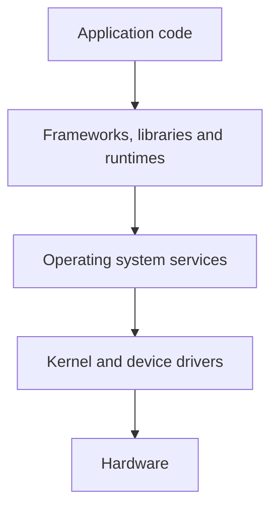
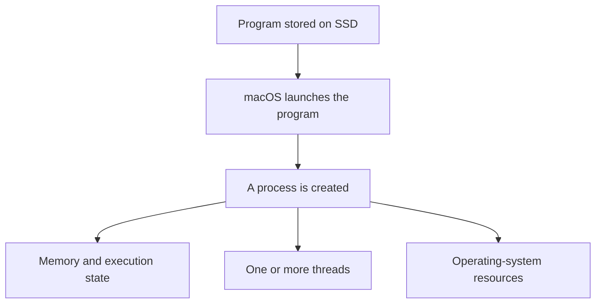
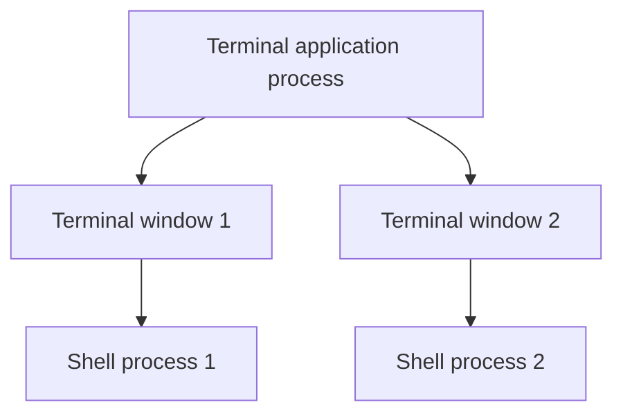
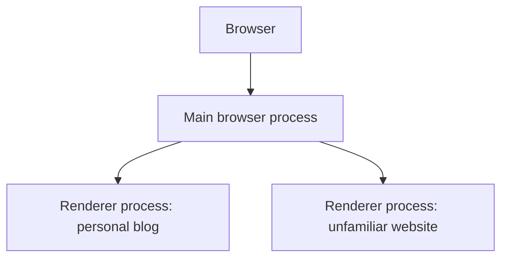
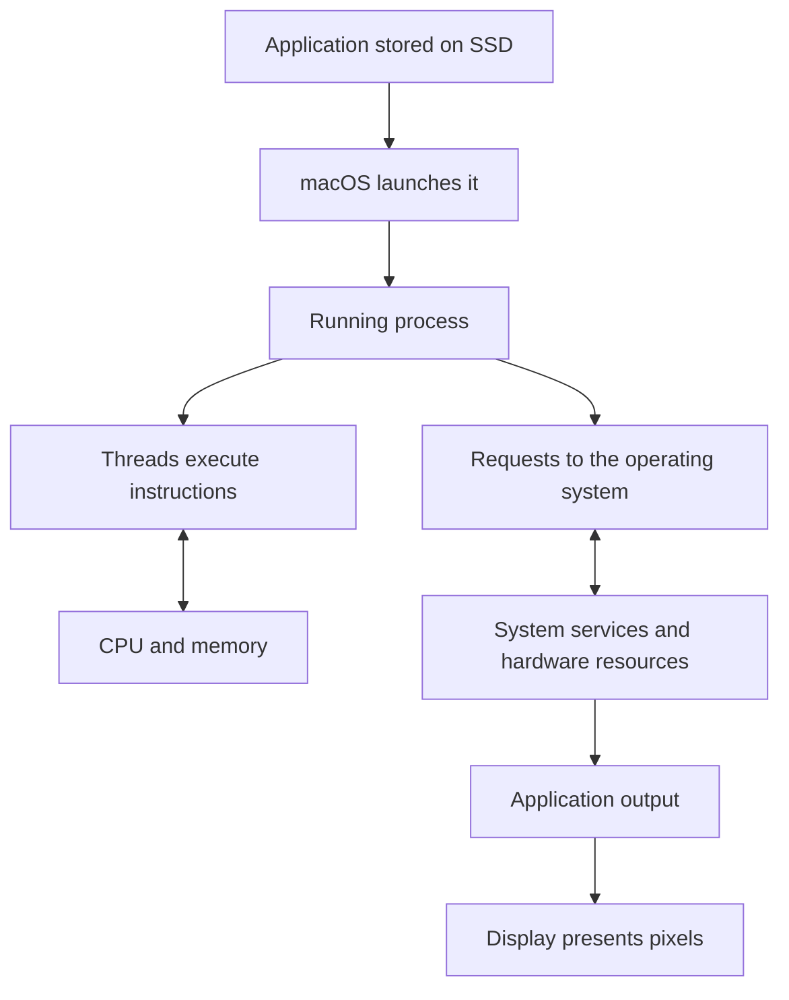

Every time we open an application on our Mac, we are relying on a lot of things working together behind the scenes. We click an icon, a window appears, and we start working. Everything feels simple, almost effortless. But the simplicity we experience on the screen hides a fairly complex system underneath.

The code we write does not directly control the physical machine. There are layers of software between our code and the hardware, and each layer has a job to do. Understanding these layers is the first step towards understanding how macOS works.

The basic relationship looks something like this:

```text
Our code
   ↓
Frameworks, libraries and runtimes
   ↓
The operating system
   ↓
The hardware
```

This is a simplified picture, but it gives us a good starting point. Before we get into macOS itself, let's first understand the machine on which it runs.

### A computer, at its simplest

A computer has many components, but we can begin with four that are particularly useful for understanding how software works.

**The processor (CPU)** executes instructions. It performs calculations, compares values, moves data around, and carries out the operations that programs ask it to perform one by one.

**Memory (RAM)** holds the instructions and data that the computer needs while it is working. The processor constantly needs access to data, and RAM provides a fast working area for that data.

**Storage (SSD)** keeps programs and files even when the computer is switched off. The applications we install, the documents we save, and the operating system itself all occupy storage.

**The display** presents the visual output of the computer. It is where the text, images, windows, and animations produced by software eventually appear.

These four components are enough to build our initial understanding. A modern Mac also has a GPU, memory controllers, networking hardware, and many other components, but we can introduce those as we need them.

Think about what happens when you open a text editor. The program is stored on the SSD. When you launch it, macOS prepares it to run, its instructions are executed by the processor, and the memory holds the data it needs. When you type something, the application processes your input and updates what you see on the display.

Even this simple activity involves all four components working together.

### Where does the operating system fit in?

Imagine if every application had to know how to communicate directly with the processor, manage physical memory, read data from the SSD, and control the display. Building even a simple application would become an enormous task.

Fortunately, applications do not have to do all of that themselves.

The operating system manages the computer's resources and provides services that applications can use. On my Mac, that operating system is macOS.

When an application needs to read a file, allocate memory, receive keyboard input, create a window, or communicate over a network, it can rely on facilities provided by the operating system and the software frameworks built around it.

For example, when we write a program in Swift, we can use Apple's frameworks rather than implementing everything from scratch. When we write a Python program, the Python interpreter and its runtime help execute our code. Both ultimately rely on the operating system and the underlying machine to get their work done.

The relationship is not always a simple, straight line. Frameworks and libraries can run inside an application's process, and different operations can follow different paths through the system. Nevertheless, the following diagram captures the general idea.



The kernel is the core part of the operating system. It is responsible for important tasks such as scheduling execution, managing memory, and providing controlled access to hardware resources. Device drivers help the operating system communicate with particular hardware devices.

Not every operation passes through every layer shown in the diagram, but the main idea is that applications rely on software interfaces to use the machine.

### A program is just a program until it runs

A program is a set of instructions and associated data intended to perform a task.

Consider this Python code:

```python
a = 10
b = 20
result = a + b
```

We can read it and understand what it does. But the processor does not directly understand Python syntax. Python needs an interpreter to execute the code, and that interpreter ultimately relies on machine instructions that the processor can execute.

The important point is that the code describes what we want the computer to do. Something still has to execute it.

When we install an application on macOS, we are placing its files on storage. These files might include an executable, libraries, images, configuration files, and other resources. A graphical Mac application is often packaged as a `.app` bundle, which looks like a single application in Finder but is actually a directory containing the executable and supporting files.

At this stage, the application can exist on the SSD without running at all.

Imagine downloading a code editor and placing it in the Applications folder. The editor's files are present on the disk, but the processor is not continuously executing the editor's instructions just because those files exist.

The program is sitting at rest.

When we double-click its icon, macOS begins launching it. The system establishes the environment in which it will run, loads the necessary executable code and resources, and begins executing its instructions.

### What exactly is a process?

A **process is a running instance of a program**.

The program is the code and associated data that can be executed. The process is the execution of that program within an environment managed by the operating system.

When macOS launches an application, it creates a process with an execution state, a virtual address space, one or more threads, and other resources needed to do its work.

A process also receives a process ID, commonly called a PID. This is a number the operating system uses to identify that particular running process in many system interfaces and operations. The PID is not permanent; it may be reused after the process exits.

We can picture the relationship like this:



Notice that the program does not disappear from the SSD when we launch it. The files remain on disk, while the running process uses the necessary code and resources.

A process also has its own virtual address space. This is an important detail because it means that the memory a process sees is not simply a chunk of physical RAM handed to it without any restrictions. The operating system and hardware manage mappings between virtual addresses and physical memory.

The address space can contain executable code, global data, dynamically allocated memory (often called the heap), thread stacks, and other memory mappings.

This arrangement helps keep processes separate. Under normal circumstances, one process cannot simply read or overwrite another process's private memory. Processes can share information through mechanisms explicitly supported by the operating system, but they do not ordinarily have unrestricted access to one another's memory.

So a process is more than a program loaded into RAM. It is a running environment with its own state and resources, managed by the operating system.

### Can one program have multiple processes?

Yes. There can be multiple running processes associated with the same program.

For example, you could launch the same application more than once, and each running instance could have its own process. A single application can also use multiple processes internally to divide its work.

It is worth remembering that a process and a window are not the same thing. A window is part of a graphical interface; a process is an execution environment. One process can manage several windows, and an application can use multiple processes even if it looks like one application to the user.

Let's take Terminal, which comes with macOS, as our first example.

Suppose I open Terminal and create two windows. It would be easy to assume that two windows mean two Terminal processes, but that is not necessarily the case. A single Terminal application process can manage both windows.

Each window may also have its own shell process running inside it. For example, if both windows open a `zsh` shell, there can be two separate shell processes in addition to the Terminal application process.



The diagram is a simplified illustration, but it shows why counting windows is not the same as counting processes.

A process is about execution, not about how many windows we can see.

### Why do browsers use multiple processes?

A web browser is an especially interesting example because of the kind of software it runs.

When we open a website, we are not necessarily running only code that was written by the people who developed our browser. Websites can contain JavaScript, WebAssembly, and other executable content written by developers all over the world. Some of these developers are people we know and trust; many are complete strangers.

Every time we visit a new website, we are allowing code from another source to execute within the browser's environment.

That does not automatically mean the website can do anything it wants. Browsers enforce security restrictions, and web content generally runs within a restricted environment. But the browser still has to handle code that might contain bugs, consume excessive resources, or attempt to exploit a vulnerability.

This is one of the reasons modern browsers use multiprocess architectures.

Imagine opening two tabs: one displaying your personal blog and another displaying a website you have never visited before. A browser may use a main process to coordinate its operation and separate renderer processes to handle website content.

A simplified view looks like this:



The actual architecture is more complicated. A tab does not always map one-to-one to a process, and a single tab may involve multiple processes. Browsers may also use separate processes for networking, graphics, extensions, and other services.

The important point is why the browser is designed this way.

**The browser is handling code from sources that should not automatically be trusted.** Separating parts of that work into different processes helps limit how much one component can affect another.

If a renderer process crashes, the browser may be able to recover the affected tab without bringing down the entire browser. Process separation also helps protect memory boundaries between components.

However, separate processes alone do not provide complete security. Browsers combine process isolation with sandboxing and other protections that restrict what untrusted content can access.

Think of a process as one boundary in a larger security system. If something goes wrong inside one boundary, the goal is to prevent the problem from spreading freely to everything else.

It must execute content from many different sources while trying to keep the rest of the system safe.

### What does the operating system do with all these processes?

By now, it is easy to see why macOS needs to manage processes.

At any given moment, your Mac might have a browser, a code editor, Terminal, a music player, and several background services running. They all need resources. They may need processor time, memory, access to files, or the ability to communicate with other processes.

The operating system coordinates this activity.

A process contains one or more threads, and threads are the units of execution that the operating system schedules on the available CPU cores. The system decides which threads get processor time and manages the transitions between them.

Some threads may be doing calculations. Others may be waiting for input or data from storage. A thread that is waiting does not need to occupy a CPU core continuously, so the operating system can schedule other work.

This is one reason we can use several applications at once without manually deciding which application gets to run next.

The operating system also manages memory and enforces access restrictions. Without these protections, one misbehaving application could interfere much more easily with another application's data or the system itself.

Of course, operating systems cannot prevent every failure or security vulnerability. But process management, memory protection, and controlled access to resources provide the foundation on which reliable multitasking is built.

### Wiring everything together

When we install an application, its files are stored on the SSD. When we launch it, macOS creates a process and establishes the environment in which the program can execute. Its threads receive processor time, its memory is managed by the system, and it can request services such as file access and graphical output.

If it is a graphical application, the work it performs eventually contributes to the content presented on the display. Meanwhile, macOS continues coordinating the application with other processes and the rest of the machine.

We can summarize the overall relationship like this:



This is a simplified model, but it gives us a foundation for understanding what happens beneath the graphical interface.