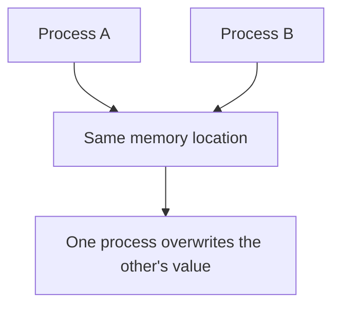
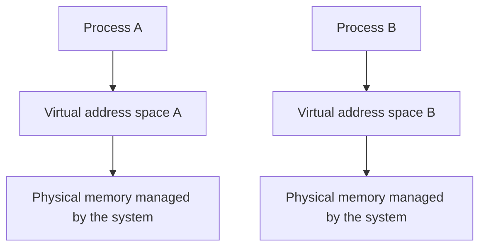
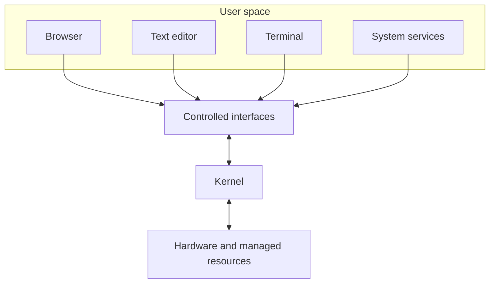
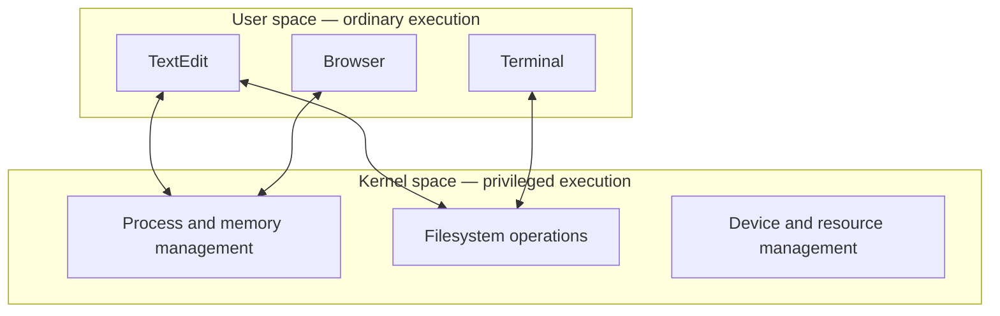
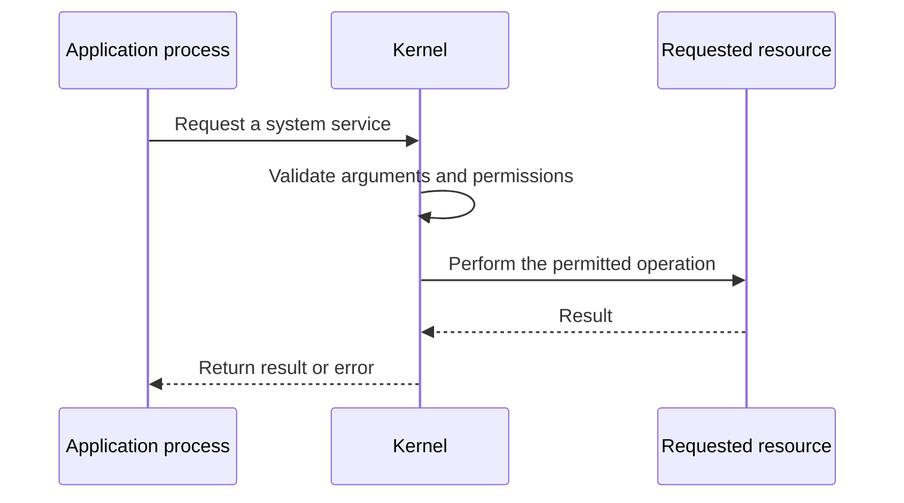
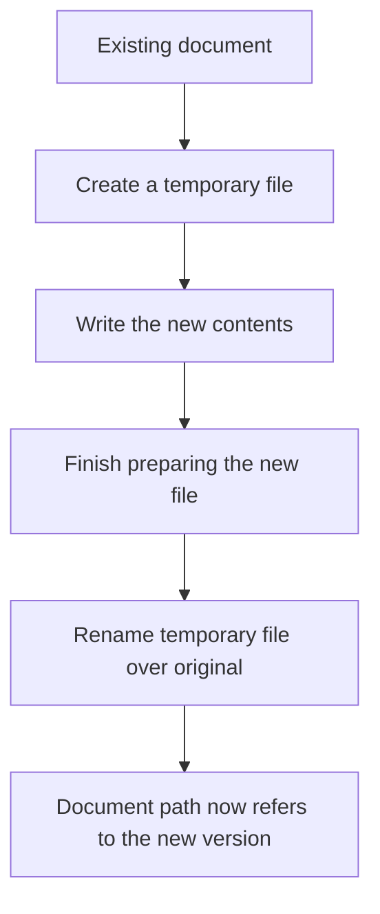

When we open an application on a Mac, we usually see only its icon and the window that appears after we click it. We rarely think about how the application is stored on disk, how it gets permission to use the computer's resources, or what happens when it tries to do something it is not allowed to do.

In the previous part, we established the difference between a program and a process. A program contains instructions and data, while a process is a running instance of that program. We also saw that macOS manages the resources these processes need.

Now we can look a little deeper.

An application is not always what it appears to be in Finder. A running process does not have unrestricted access to the computer. And when an application needs to perform certain operations, it has to ask the operating system to do them on its behalf.

To understand how this works, let's start with something we can actually inspect: an application installed on the Mac.

### An application is a folder in disguise

Open Finder and navigate to the Applications folder. You will see applications represented by familiar icons: Terminal, Safari, TextEdit, and perhaps a few applications you installed yourself.

Each appears to be a single item. You can click it, move it, or drag it to the Trash.

But a macOS application ending in `.app` is usually not an ordinary file. It is a directory with a standardized structure, which Apple calls an **application bundle**.

Finder presents this directory as a single application because that is much easier to work with than exposing all the files inside it every time you open the Applications folder.

The files are still there. Finder simply presents them differently.

Apple documents the standard structure in its guide to [placing content in a bundle](https://developer.apple.com/documentation/bundleresources/placing-content-in-a-bundle).

A typical application bundle looks something like this:

```text
Example.app/
└── Contents/
    ├── Info.plist
    ├── MacOS/
    │   └── Example
    ├── Resources/
    │   ├── icon.icns
    │   └── other files
    ├── Frameworks/
    ├── PlugIns/
    └── _CodeSignature/
```

This is an illustrative structure. Not every application contains all these directories, and the exact contents depend on how the application is built and distributed.

Let's look at the important parts.

#### `Info.plist`

The `Info.plist` file contains configuration information about the application. It can describe things such as the application's identifier, display name, supported document types, and the name of its main executable.

It is one of the files macOS uses to understand the application bundle.

#### `MacOS`

This directory normally contains the application's main executable: the compiled program that macOS can launch.

For a native Mac application, that executable is commonly a Mach-O binary, the executable format used by macOS.

This is the part most directly associated with the code that runs when the application starts. The executable may rely on system frameworks, embedded frameworks, and other resources to do its work.

#### `Resources`

An application needs more than executable code. It may need icons, images, sounds, interface resources, translations, and other data.

These supporting files are typically placed in the `Resources` directory.

For example, a text editor might include icons for its toolbar, images for its interface, and translated strings for different languages.

#### `Frameworks` and `PlugIns`

Some applications bundle additional frameworks and plug-ins.

Frameworks provide reusable code and related resources. Plug-ins can extend an application's functionality or provide additional components that the application can load.

These directories are optional; an application does not need to contain them if it has no such components.

#### What about the code signature?

You may also find a `_CodeSignature` directory in a signed application bundle. Code signing allows macOS and other system components to verify the identity and integrity of signed code and associated resources.

The exact representation of a signature depends on the kind of code being signed, so this directory should not be assumed to exist in precisely the same form in every executable or bundle.

The important point is that the application package can contain not only the code and resources needed to run, but also information used to establish the integrity and identity of that code.

#### Let's inspect a real application

We do not have to take any of this on faith. We can inspect an installed application ourselves.

For example, Ghostty is a terminal emulator available for macOS. If it is installed in the Applications folder, open Terminal and run:

```bash
ls "/Applications/Ghostty.app/Contents"
```

You will see the actual entries present in that application's `Contents` directory. Depending on the version and packaging, these may include `Info.plist`, `MacOS`, `Resources`, and additional directories.

To inspect the application more closely, you can also run:

```bash
ls "/Applications/Ghostty.app/Contents/MacOS"
```

The first command lists the contents of the bundle's `Contents` directory. The second lists the executable directory.

If Ghostty is installed somewhere else, replace the path with its actual location.

Notice what we have done here: Finder showed us an application icon, but Terminal lets us inspect the directory that icon represents.

This is a useful distinction to keep in mind when working with macOS. What the graphical interface presents and what actually exists on disk are two different views of the same underlying system.

The interface is designed to make things convenient. The filesystem contains the actual directories and files.

### The operating system is responsible for sharing the machine

Imagine that you have your browser open, music playing in the background, a code editor running, and Terminal open beside them.

All these applications are running on the same physical machine. They share the processor, memory, storage, display, and other resources.

The processor cannot give every thread unlimited access to every CPU core at the same time. Memory must be managed, files must be protected, and applications must not be allowed to interfere arbitrarily with one another.

Someone has to coordinate all of this.

That is one of the operating system's central responsibilities.

macOS schedules work on the available processor cores, manages virtual memory, mediates access to files, and provides controlled ways for applications to interact with hardware and other system services.

For example, consider two applications that are both busy doing calculations. The operating system decides which threads get CPU time and when. If one application is waiting for a file to be read, the system can schedule other work rather than requiring the CPU to sit idle on its behalf.

Memory needs similar management. A process must not be allowed to overwrite another process's private memory simply because both are running on the same computer.

Files also need protection. A text editor should be able to save a document in a location where the user has permission to write, but that does not mean it should automatically be allowed to replace files that belong to the operating system.

Without these controls, every application would effectively have to trust every other application to behave correctly.

That would be a very fragile way to build a computer.

### Why can't every process access everything directly?

Let's consider a simple example involving memory.

Suppose two processes, A and B, both want to store their own data. Process A stores a value representing its current calculation, while process B stores a different value representing its own calculation.

If both processes could freely write to the same physical memory location without any protection or coordination, one could overwrite the other's data.



The problem is not that the processor cannot perform the writes. The problem is that allowing both processes unrestricted access would make it impossible to reliably protect their independent state.

Modern operating systems solve this using virtual memory and hardware-enforced memory protection.

Each process normally operates within its own virtual address space. Even if two processes use the same numerical virtual address, that address can map to different physical memory locations.



The physical memory can be shared deliberately when the operating system and applications establish appropriate mappings, but one process does not ordinarily gain access to another process's private memory just because it knows an address.

This is an important correction to that the operating system must manually check every individual memory read or write. Much of the isolation is enforced by the processor's memory-management hardware using mappings and permissions established by the operating system.

The result is that processes can work independently without freely corrupting one another's data.

The same general principle applies elsewhere. Applications do not get unrestricted access to every file, device, or system resource. The system establishes rules about what they can access and mediates operations that require privileged authority.

The operating system needs a trusted component to enforce those rules. On macOS, a central part of that responsibility belongs to the kernel.

### The kernel: the core of the operating system

The **kernel** is the privileged core of the operating system.

It manages essential resources and provides mechanisms through which programs can request services that require kernel authority. Its responsibilities include process and thread scheduling, virtual memory management, and important parts of filesystem and device access.

The kernel is not the entire operating system. macOS also includes system frameworks, background services, graphical components, and other software that runs outside the kernel.

Still, the kernel occupies a special position because it has privileged access to resources that ordinary applications do not.

We can represent the relationship like this:



This diagram is a conceptual view, not a complete map of macOS internals. Some system services communicate with each other, and not every request involves a direct hardware operation. The important distinction is between ordinary application code and the privileged mechanisms provided by the kernel.

A text editor, a browser, and Terminal normally execute in user space. The kernel operates with greater privilege and enforces boundaries that ordinary applications cannot simply bypass.

Why make this distinction?

Because if an ordinary application has a bug, we generally want that bug to affect only the application, not the entire operating system. If every application ran with unrestricted kernel-level authority, a small mistake could have consequences far beyond that application's own process.

The separation between user space and kernel space helps limit this risk.

### User space and kernel space

The terms *user space* and *kernel space* describe two different execution environments.

**User space** is where ordinary applications and many system services run. Their access to memory and system resources is restricted by the operating system and hardware.

**Kernel space** is where the kernel executes with elevated privileges. It can perform operations that ordinary processes cannot perform directly.

For example, when you open TextEdit, the application runs as a user-space process. It can process your text, manage its interface, and perform calculations using the permissions available to it. But it cannot simply disregard the operating system's memory protections or directly take control of every hardware device.

When TextEdit needs to save a file, it requests the appropriate operating-system services. The system checks whether the requested operation is permitted and carries it out if the necessary conditions are met.

The following diagram shows the distinction:



The kernel does not have to handle every calculation performed by an application. If TextEdit adds two numbers or rearranges text in its own memory, that work can happen entirely in user space.

The kernel becomes involved when the application needs an operation that crosses a protected boundary, such as requesting file access or changing its memory mappings.

This distinction is what makes the next concept so important: how does a process ask the kernel to perform an operation?

### System calls: the controlled entrance to the kernel

A **system call** is a mechanism through which a process requests a service from the kernel.

The term may sound intimidating, but the idea is straightforward. A process can execute its own instructions in user space, but when it needs certain privileged services, it must cross into the kernel through a defined interface.

Think of a building with a restricted area. People can work in the public area without asking permission for every movement. But if they need access to a room that contains sensitive equipment, they must go through an authorized entrance.

The system call is similar to that entrance. It is not a request for permission in every case—the kernel may perform the operation immediately if it is allowed—but it is the controlled mechanism for requesting a kernel service.

A simplified view looks like this:



This is a conceptual sequence. Actual system calls vary: some return immediately, some wait for an event, and some fail before accessing the requested resource.

A system call is also not the same thing as an ordinary function call. When a program calls a function within its own process, execution can remain in user space. A system call uses a defined mechanism to enter the kernel's privileged execution environment.

On macOS, system calls are one important way for user-space processes to interact with the kernel. Other mechanisms, such as interprocess communication, also allow applications and system services to communicate. The system call interface is not literally the only communication mechanism in the entire operating system, but it is central to many operations involving files, processes, memory, and other kernel-managed resources.

#### What does a system call look like in practice?

Consider a text editor saving a document.

At a high level, the editor needs to:

1. Open or create a file.
2. Write the document's contents.
3. Finish using the file.

On a Unix-like system, the corresponding low-level operations are commonly represented by calls such as `open`, `write`, and `close`.

A simplified C example might look like this:

```c
int fd = open("notes.txt", O_WRONLY | O_CREAT, 0644);

if (fd != -1) {
    write(fd, "Hello, world!\n", 14);
    close(fd);
}
```

This example illustrates the idea rather than providing production-ready file-writing code. A real program must handle partial writes, errors, file permissions, and other details.

The `open` operation requests access to a file and, if successful, returns a file descriptor: a small integer that the process can use to refer to the opened file.

The `write` operation requests that bytes be written through that descriptor. The `close` operation releases the descriptor when it is no longer needed.

The important point is that the application does not simply reach into the SSD and modify physical storage by itself. It requests filesystem operations through the operating system.

There is one more detail worth understanding. In ordinary application code, we often call a library function rather than invoking a raw system call directly. A function such as `write` can be provided through the system's C library interface, which arranges for the underlying system call to be made. Other high-level frameworks may hide these details even further.

So when we say an application makes a system call, we are talking about the boundary that is crossed, not necessarily a function name that appears in the application's source code.

### Every system call has a cost

Crossing from user space into the kernel involves work. The processor must transition into the appropriate privileged execution context, the kernel must handle the request, and control must eventually return to the calling process.

That work has a cost, although the actual cost depends on the operation, the system's state, and whether the request needs to wait for anything.

Consider writing a document that contains a million characters. An application could issue many small write operations, or it could group the data into larger chunks and issue fewer operations.

If the application makes thousands of unnecessary calls, it may spend more time handling those requests than necessary.

This is one reason batching operations can improve performance. Instead of repeatedly asking the operating system to process tiny pieces of work, an application may be able to group work into fewer, larger requests.

However, fewer system calls do not automatically mean a faster program. The amount of data, the work performed by each call, filesystem behavior, caching, and whether the operation must wait for storage can all matter.

System calls are not something developers should try to eliminate indiscriminately. They are necessary interfaces to important operating-system services. The goal is to avoid unnecessary work while preserving correctness and safety.

We can see why these details matter when we examine a real file-saving operation.

### What happens when TextEdit saves a file?

When you press Save in TextEdit, the application must turn the text currently held in memory into a file on storage.

It would be possible to overwrite the existing file directly. But imagine what could happen if the application started overwriting the file and then failed halfway through.

Suppose the original file contains:

```text
My original notes
Line two
Line three
```

Now imagine the application begins replacing that content with a new version. If the computer loses power or the application crashes while the file is only partially written, the file on disk could be left in an incomplete state.

The original content may already have been overwritten, but the new content may not be complete.

For important data, that is an undesirable failure mode.

One common solution is to write the new contents to a temporary file first. Once the new file is ready, the application replaces the original by renaming the temporary file over it.



The temporary file is typically created on the same filesystem as the original so that the final rename can be atomic.

Here, *atomic* means that the replacement is observed as one indivisible namespace change: a reader opening the destination path sees the old version or the new version, rather than an intermediate version produced by gradually overwriting that destination.

This does not mean the entire save procedure is one indivisible operation, nor does it automatically guarantee that every byte has been safely committed to persistent storage against every possible power failure. Crash durability requires additional care, such as appropriate synchronization of file data and metadata.

Still, atomic replacement is a useful technique for avoiding partially written destination files.

This is the same general idea behind many safe file-update strategies used in software: prepare the replacement first, then switch to it when it is ready.

#### Watching the filesystem work

macOS includes a command-line utility called `fs_usage` that can help us observe filesystem-related activity in real time. It reports filesystem system-call activity and related events, allowing us to see operations associated with running processes.

Apple also provides documentation on [examining filesystem usage](https://developer.apple.com/library/archive/documentation/Performance/Conceptual/FileSystem/Articles/FileSystemCalls.html).

A simplified illustration of what we might observe during a file save is:

```text
Text editor → open temporary file
Text editor → write data
Text editor → close temporary file
Text editor → rename temporary file over destination
```

These lines are explanatory, not a literal transcript of TextEdit's output. Actual events depend on the application, the file, and the macOS version.

The important point is that a single action in the interface pressing ```Save``` can result in several lower-level operations.

The application does not have to display these details to the user. But the operating system still has to handle the underlying requests.

This is also why filesystem tracing tools are useful when investigating performance problems. They let us examine some of the work hidden beneath a graphical interface.

### What if the kernel refuses a request?

So far, we have seen how an application asks the operating system to perform work. But asking does not guarantee success.

Suppose a program tries to create or modify a file inside a protected part of the macOS system volume. The kernel and other system security mechanisms enforce the applicable restrictions. If the operation is not permitted, the request fails.

For example, macOS includes System Integrity Protection (SIP), which restricts modification of certain critical system files and directories. These protections apply even when a process has administrative privileges.

Apple explains this in its [System Integrity Protection documentation](https://support.apple.com/guide/security/system-integrity-protection-secb7ea06b49/web).

This matters because having administrator privileges does not mean that a process has unlimited authority over the operating system. macOS has additional protections designed to prevent critical system components from being modified by unauthorized code.

When a filesystem operation fails, the system can return an error that explains why it failed. A program may report a message such as `Operation not permitted`.

At the lower level, an error code is used to represent the failure. Software can inspect that code and decide how to respond—for example, by displaying an error message, asking the user to choose a different location, or abandoning the operation.

The exact error depends on the operation and the reason it failed. `Operation not permitted` is not the response to every denied request; other errors can indicate permission problems, missing files, or other conditions.

This is a key part of the operating system's job: it does not blindly carry out every request. It enforces the rules governing access to resources.

### The same principle applies beyond files

File access is only one example. The same general idea applies whenever an application needs a service that it cannot perform directly.

Consider drawing a window.

A text editor does not simply write arbitrary pixels to the physical display whenever it wants. It uses graphical frameworks and system services to create windows and present content. The windowing and graphics systems coordinate that work with the rest of the operating system and the graphics hardware.

Likewise, when an application needs memory, it requests memory through supported interfaces. When it needs to start another program, it uses process-creation mechanisms. When it needs to communicate over a network, it relies on networking APIs and the system's networking facilities.

These operations do not all use the same system call or follow an identical path. Some involve several system calls; others involve communication with system services, framework code, or hardware-specific components.

The common principle is that applications operate within boundaries established by macOS. They can perform a great deal of work independently, but access to protected resources is governed by the operating system.

That is what allows many different applications to coexist on the same machine without each one having unrestricted control over the others.

### Putting it together

That is the role of the kernel and system calls in macOS: not to do all the work for every application, but to provide controlled access to the resources that applications depend on.

The next time you open an application, save a document, or see an access-denied error, remember that the visible interface is only one part of the story. Beneath it is a system of processes, permissions, interfaces, and resource-management mechanisms that allow the machine to remain usable and secure.