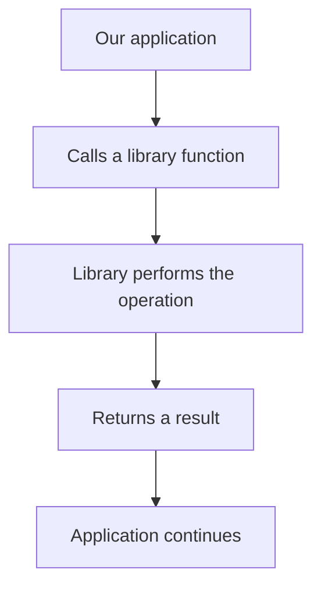
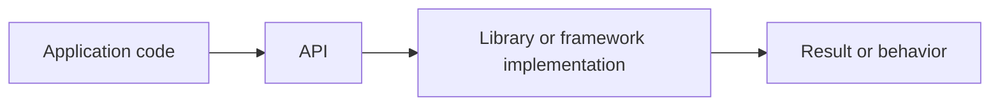
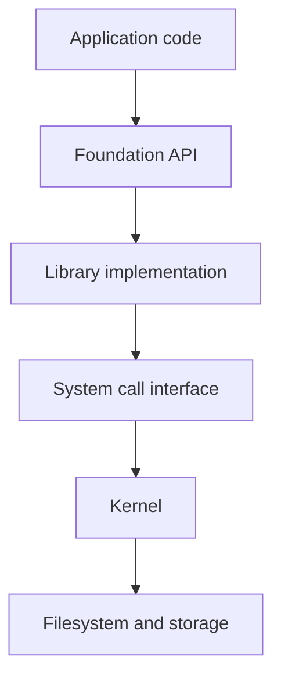
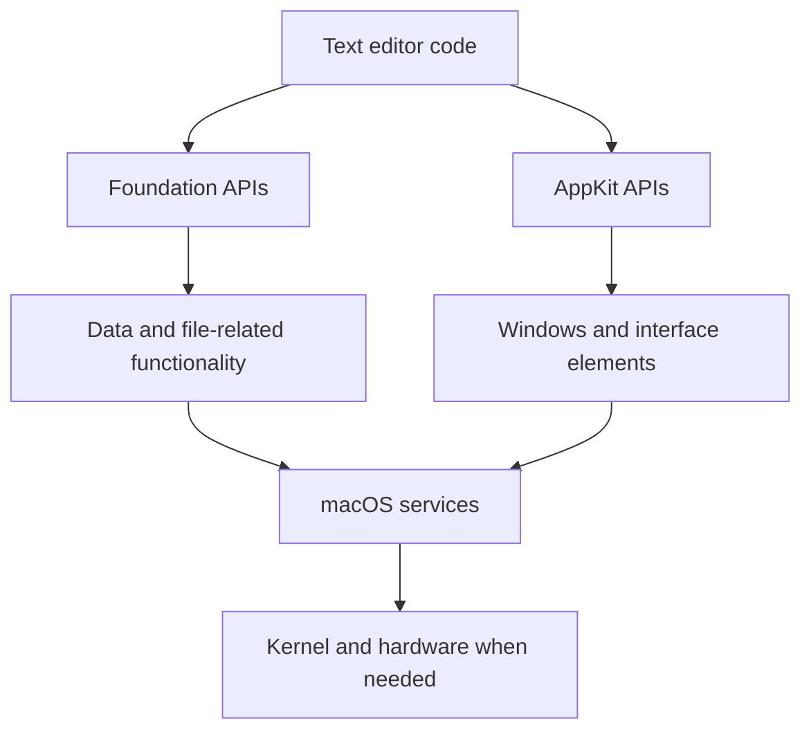
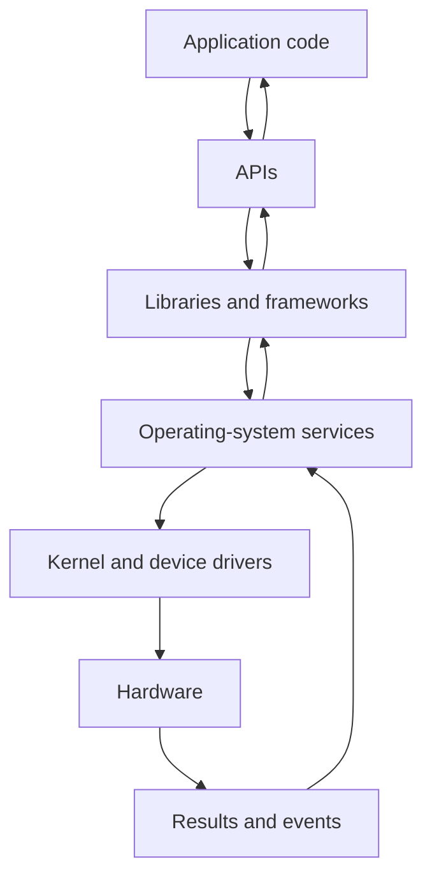
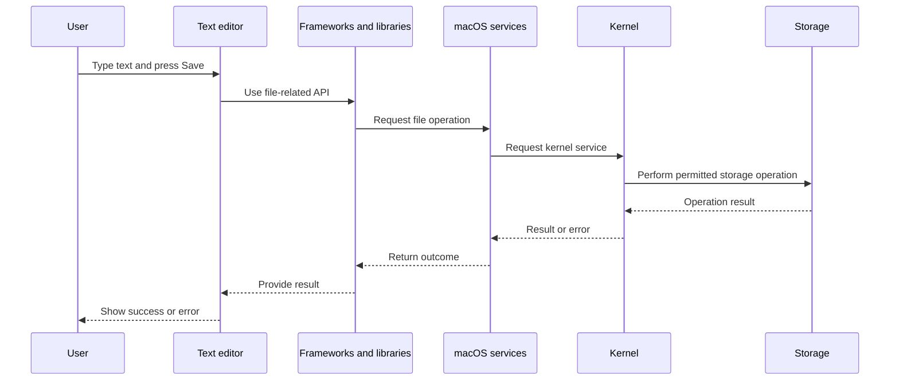

In the previous part, we looked at the kernel and system calls. We saw that applications normally run in user space and must use controlled interfaces when they need services provided by the operating system.

But there is something we have not discussed yet.

When developers build applications for macOS, they do not usually write everything from scratch. They do not implement their own file-reading mechanism, build every graphical element from the ground up, or write all the code required to communicate over a network.

Instead, they use code that already exists.

A developer building a text editor can use existing functionality for working with strings, reading files, creating windows, and displaying text. Someone building a browser can reuse networking functionality rather than implementing every low-level networking operation themselves.

This reuse is made possible by libraries, frameworks, and APIs.

These three terms are closely related, but they do not mean the same thing. Understanding the difference will help us understand how macOS provides functionality to applications and how developers make use of it.

### We don't have to write everything ourselves

Let's start with something simple.

Suppose we want to write a program that calculates the square root of a number. We could attempt to implement the mathematical algorithm ourselves, but most programming languages already provide a function for this.

In Python, we can write:

```python
import math

result = math.sqrt(25)

print(result)  # 5.0
```

We did not implement the square-root algorithm. We imported an existing module and used a function it provides.

The same principle applies to much larger tasks.

Imagine building a text editor. We need to handle text, create a user interface, open and save files, respond to keyboard input, and much more. If we had to implement every piece of functionality ourselves, building even a basic editor would require a tremendous amount of work.

Instead, we can reuse existing code.

The code we reuse might come from the programming language, a third-party package, an operating-system library, or a framework provided by Apple.

This is one of the most important ideas in software development: **we build on top of existing functionality instead of repeatedly solving the same problems from scratch.**

Libraries and frameworks are two major ways in which this reuse is organized.

### What is a library?

A library is reusable code that a program can use to perform particular tasks.

A library might provide functions for mathematical calculations, string manipulation, image processing, database access, or network communication.

Think of a library as a collection of tools. When we need a particular tool, we use the functionality the library provides rather than implementing it ourselves.

For example, Python's `math` module provides mathematical functions. In JavaScript, the built-in `JSON` object provides methods for converting between JavaScript values and JSON text.

In both cases, we are using functionality that has already been implemented.

A library can be small and focused on a single task, or it can be large and provide many different capabilities.

#### What happens when we use a library?

Consider this Python program:

```python
import math

number = 16
result = math.sqrt(number)

print(result)
```

The `sqrt` function is part of the functionality exposed by the `math` module. Our program calls it and uses the result.

We do not need to know every detail of how the square-root calculation is implemented. We only need to understand how to use the function correctly.

This is an important benefit of libraries: they let us work at a higher level of abstraction.

Instead of focusing on the implementation of every operation, we can focus on what our application needs to accomplish.



This is a simplified view of a function call. Depending on the library and its implementation, the operation may involve additional layers or system services.

#### Libraries are not necessarily part of the application itself

A library does not have to be written by the developer who builds the application. It might be provided by the programming language, the operating system, or another developer.

For example, an application written for macOS can use Apple's system libraries and frameworks. It can also use third-party libraries that provide functionality Apple does not supply or that the developer prefers to use.

Depending on how the library is distributed and linked, its code may be included in the executable, loaded dynamically at runtime, or accessed through another component.

The important idea is that the application can use functionality without having to contain a separate implementation of every operation it needs.

This brings us to frameworks, which build on the same idea but usually organize functionality in a more structured way.

### What is a framework?

A framework is a reusable collection of code and related resources that provides functionality for building applications.

Like a library, a framework allows developers to reuse code. However, frameworks often provide a broader structure for building a particular kind of application or implementing a particular capability.

A framework might provide user-interface components, networking facilities, data-management functionality, or tools for working with audio and video.

On macOS, Apple provides many frameworks for these purposes.

For example:

- [**Foundation**](https://developer.apple.com/documentation/foundation) provides common data types and functionality for tasks such as working with strings, dates, collections, files, and networking.
- [**AppKit**](https://developer.apple.com/documentation/appkit) provides the building blocks for traditional macOS graphical applications, including windows, menus, controls, and other interface elements.
- [**SwiftUI**](https://developer.apple.com/documentation/swiftui) provides a declarative way to describe user interfaces across Apple's platforms.

These frameworks solve different problems, but they all let developers build on top of functionality that already exists.

#### An example: creating a window on macOS

Imagine writing a graphical application for macOS.

Without a framework, we would have to deal with a great many details before we could display a useful window. We would need to manage interface elements, respond to user input, handle window events, and coordinate the application's behavior with the graphical system.

AppKit provides ready-made abstractions for many of these tasks.

A developer can use existing window and button classes instead of implementing all the underlying behavior from scratch.

Similarly, a SwiftUI developer can describe a simple interface like this:

```swift
import SwiftUI

struct ContentView: View {
    var body: some View {
        VStack {
            Text("Hello, Mac!")
            Button("Click me") {
                print("Button clicked")
            }
        }
    }
}
```

This is a small SwiftUI view. It describes a vertical arrangement containing a text label and a button.

Notice what we did not write. We did not implement the entire windowing system, determine how the button should receive mouse events, or write code to communicate directly with the display hardware.

We described the interface using the abstractions that SwiftUI provides.

The framework handles much of the work required to turn that description into a functioning user interface, coordinating with other parts of the platform as needed.

The code shown here describes a view, not a complete standalone application. A complete app would also need an application entry point and the appropriate application structure.

The example nevertheless demonstrates the purpose of a framework: it lets us express what we want to build without implementing every underlying mechanism ourselves.

#### How is a framework different from a library?

A library typically provides functionality that our code calls when it needs it. A framework may also provide callable functionality, but it often supplies a larger structure and determines parts of how the application operates.

Consider two simplified approaches to building an application.

With a library, our code might call a function to perform a task:

```text
Our code
   ↓
Call library function
   ↓
Receive result
```

With a framework, we might define a view or provide a callback, and the framework invokes our code when the appropriate event occurs:

```text
Framework manages the application structure
   ↓
Framework detects an event
   ↓
Framework calls our code
```

This second pattern is common in frameworks that manage user interfaces, application lifecycles, or event handling. It is sometimes described as *inversion of control*: rather than our code controlling every step, the framework controls the larger flow and calls our code at the appropriate points.

Not every framework works this way, and not every library is limited to simple function calls. The distinction is about their typical roles, not a rule that every package must follow.

### How we know what we can use

We now have reusable code, whether it comes from a library or a framework. But how do we know how to use it?

Suppose Apple provides a framework containing hundreds of classes and functions. We cannot reasonably inspect its entire implementation every time we want to use one of them.

We need a defined way to interact with it.

That is where an **API** comes in.

API stands for *Application Programming Interface*. It describes the operations and types that software makes available for other software to use.

An API might expose functions, classes, methods, properties, constants, or data structures. It defines how a developer can request functionality and what they can expect in return.

An API as the set of controls available to someone using a machine. You do not need to understand every gear and motor inside the machine to operate it. You need to understand which controls are available and how to use them correctly.

The same idea applies to software.

#### An API in practice

Consider a simple function:

```python
def add(a, b):
    return a + b
```

Its interface tells us that we can call `add` with two arguments and receive a result.

We can use it without needing to know where in the program the function is implemented or how its implementation might change internally, as long as its documented behavior remains the same.

Of course, this is a tiny example of a function interface, not a complete API specification. A real API may define many operations, expected data types, possible errors, and other requirements.

The important point is that an API defines how one piece of software can interact with another.



The API is the interface through which the application uses the implementation. It is not necessarily a separate executable or a separate running process.

#### An API is not the same as a library

A library is reusable implementation code. An API is the interface through which functionality is exposed.

A library usually has an API that describes how to use it. A framework also exposes APIs. An operating system can provide APIs that applications use to access its services.

A useful way to remember the distinction is:

- **Library:** the reusable code that provides functionality.
- **Framework:** a reusable structure and collection of functionality for building software.
- **API:** the defined interface through which software can use functionality.

An API does not have to reveal how its implementation works. It only needs to specify how the functionality is used and what behavior the caller can expect.

That separation allows implementations to change internally without requiring every application using the API to be rewritten.

This is especially important for an operating system. Apple can improve internal implementations over time while preserving public APIs that applications rely on, subject to compatibility rules and platform changes.

#### APIs, frameworks, and system calls are not the same thing

A system call is a mechanism for requesting a service from the kernel. An API is a programming interface. A framework may expose an API that eventually leads to one or more system calls, but the two concepts are not interchangeable.

Consider saving a file.

At the highest level, an application might use a Foundation API to work with a file URL or a file handle. Underneath, the library or framework may call lower-level system interfaces. Those interfaces may eventually involve system calls that request filesystem operations from the kernel.

A simplified example looks like this:



This diagram represents one possible path, not a universal sequence. The exact path depends on the API, the operation, caching, and the implementation. Some high-level operations involve several system calls, and others may be handled partly in user space or by separate system services.

The important distinction is that the API is what the application uses to request functionality, while a system call is a lower-level mechanism for requesting a kernel service.

A developer can often perform an operation through a high-level API without needing to know which system calls are involved.

That is the benefit of abstraction: the application can work with a convenient interface while the underlying implementation handles the lower-level details.

### How macOS frameworks fit into the picture

Suppose we want to build a basic text editor for macOS.

We need to work with text, create a window, display the text, respond to user input, and save the document.

We can use Foundation for common functionality involving strings, URLs, file access, and other data-related operations. We can use AppKit for the graphical interface, including windows and controls.

The application code uses APIs exposed by these frameworks. The frameworks provide reusable functionality, while the operating system and its services handle the underlying work that requires access to system resources.



Again, this is a conceptual map. Foundation and AppKit are not merely wrappers around the kernel, and their implementations can use other frameworks and services. The diagram shows how an application can combine multiple layers of reusable functionality.

We can focus on the behavior of our editor instead of rebuilding the entire system required to display windows and work with files.

This is one reason operating-system frameworks matter so much. They give developers a consistent set of building blocks that fit into the platform's existing architecture.

### From code to the hardware

We have now introduced several concepts that belong at different levels of the software stack.

Our application code describes the behavior we want. APIs define how we can use existing functionality. Libraries and frameworks provide implementations and reusable building blocks. The operating system manages resources and provides services, with the kernel handling many of the privileged operations.

The layers are related, but they should not be treated as a rigid sequence in which every operation passes through every component.

For example, a mathematical calculation may happen entirely within the application's process. A request to read a file may pass through a library and eventually involve the kernel. A request to create a graphical interface may involve a framework, system services, and graphics components.

Still, we can draw a single diagram that brings the concepts together.



It is not a literal call stack, nor does every request travel through every box. APIs are interfaces rather than necessarily separate software layers, and frameworks can themselves use other frameworks, libraries, and system services. Some applications also communicate with separate processes through interprocess communication.

The diagram shows the relationships between the concepts, rather than suggesting that application code must know how to control every hardware component directly.

The operating system provides a managed environment in which applications can use the machine's resources. Libraries and frameworks make it practical for developers to build software within that environment.

### Opening a window and saving a document

Let's bring everything together with a small thought experiment.

We are building a text editor.

When the application starts, its code uses a framework such as AppKit or SwiftUI to define and display its interface. It uses APIs exposed by the framework rather than implementing every graphical operation itself.

When the user types, the application processes the input and updates its document state. Much of this work can happen in user space, within the application's own process.

When the user saves the document, the application uses appropriate file-related APIs. The underlying implementation may request filesystem services from macOS, which checks the relevant permissions and performs the necessary operations.

If the application tries to write somewhere it is not allowed to, the operation may fail. The application can then use the error information to tell the user what went wrong.



This sequence is illustrative rather than a trace of the exact calls made by a particular text editor. Real applications may use different APIs, and file saving can involve multiple operations.

But it captures the main idea: the application can rely on existing abstractions, while the operating system manages the resources and permissions required to carry out the work.

The developer does not have to build the entire chain. The developer uses the interfaces already provided by the platform.