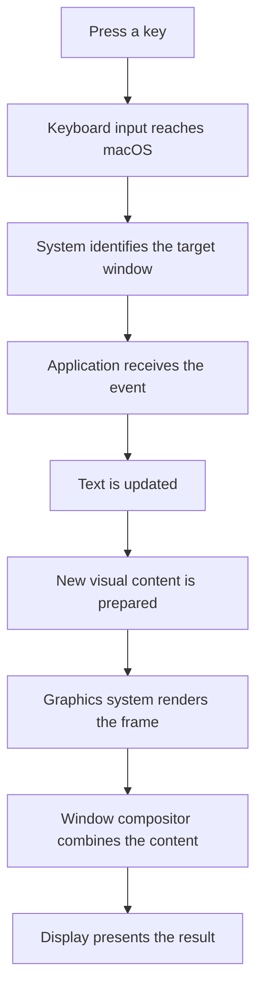
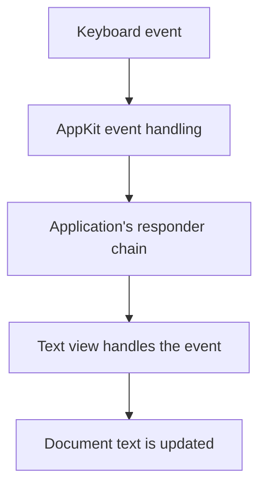
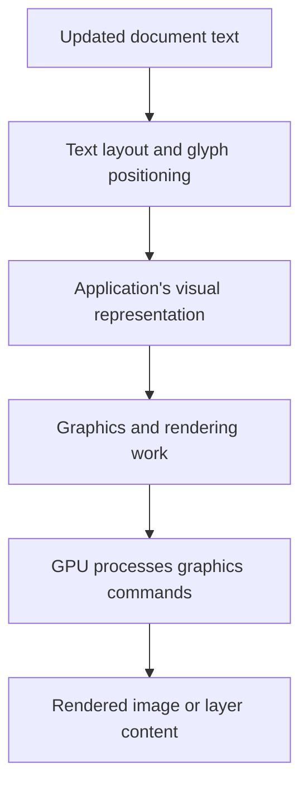
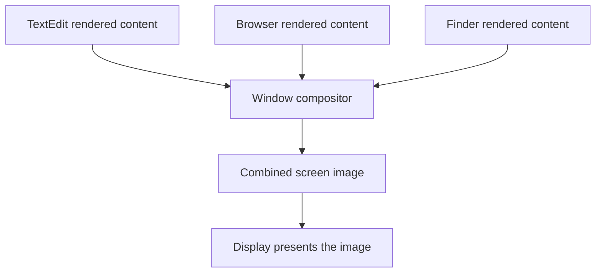
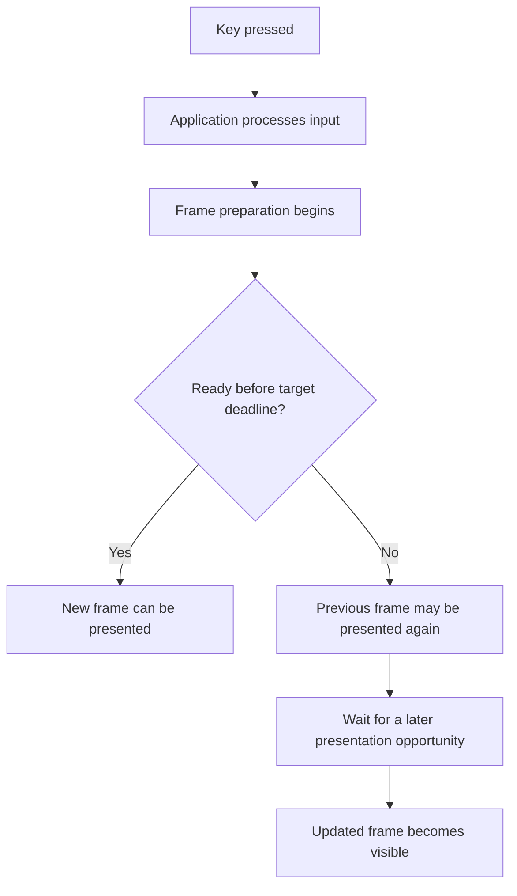
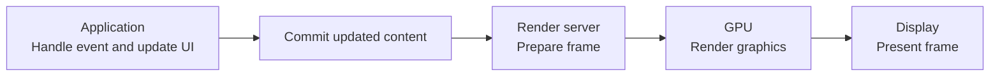

Open a text editor and type a letter. The character appears almost immediately. Type a few words, and the text follows your fingers closely enough that you rarely think about the work happening underneath.

But the computer has quite a bit to do before that character becomes visible.

The keyboard has to communicate the input to the system. The system has to deliver the event to the correct application. The application has to update its text, prepare the new visual content, and hand that content to the graphics system. Finally, the display has to present the result.

All of this happens so quickly that we experience it as one simple action: pressing a key.

In the previous articles, we learned about processes, the kernel, system calls, and the frameworks that applications use. Now we can connect those ideas by following a single keystroke through macOS.

Along the way, we will also see why a few milliseconds can make the difference between an application that feels responsive and one that feels sluggish.

### A key press is the beginning, not the end

Imagine that we have TextEdit open and our cursor is positioned inside an empty document. We press the letter `A`.

At the moment we press the key, the letter does not magically appear on the screen. The keyboard produces input, the operating system processes that input, and the application has to respond to it.

The journey can be represented like this:



This is a simplified overview. The actual implementation involves several components working together, and some of the rendering work happens in separate stages that can overlap with other frames.

Still, it gives us a useful map. Let's walk through it one step at a time.

### From the keyboard to the correct application

The first part of the journey happens before TextEdit even gets a chance to process the key.

When we press a physical key, the keyboard's hardware detects the input. The keyboard communicates that input to the computer, which processes it through the relevant hardware and software layers.

For a built-in keyboard, that path involves the keyboard hardware and the system's input-handling mechanisms. An external USB or Bluetooth keyboard has its own transport and device-handling path, but the general idea is similar: the system receives an input event representing the user's action.

The event then needs to reach the appropriate destination.

Suppose TextEdit and Safari are both open. If TextEdit is the active application and the cursor is inside its document, pressing `A` should insert a character into TextEdit—not into Safari.

The system therefore has to route the input to the appropriate window and application.

On macOS, the WindowServer plays an important role in managing windows and coordinating graphical interaction. It participates in the system's windowing and event-delivery machinery, helping ensure that input reaches the appropriate destination.

This is not the same as saying that the WindowServer independently decides the meaning of every key press. The active window, the application's event-handling logic, and the operating system's input mechanisms all play their respective roles.

The distinction matters because the WindowServer does not need to understand what a character means in the document. Its job is part of getting the input to the right place. The application is responsible for interpreting the event in its own context.

### AppKit turns the input into an event

Once the input reaches a traditional macOS application built with AppKit, the framework provides an event-handling mechanism for the application to work with it.

AppKit represents input through objects such as `NSEvent`. An event can contain information about the type of input, the relevant key information, modifier keys, and timing details.

Apple documents this mechanism in its [NSEvent reference](https://developer.apple.com/documentation/appkit/nsevent).

For our example, AppKit delivers a keyboard event to the application. The application processes events through its event loop and routes them to the appropriate responder.

An event loop is simply the mechanism by which an application repeatedly waits for and processes events. Those events might represent key presses, mouse clicks, window changes, or other activity.

Think about what happens in a text editor. Pressing a letter should modify the document if the text area is ready to receive input. But pressing Command-S should invoke Save, and pressing the arrow keys should move the insertion point or selection rather than insert ordinary characters.

The same general input system can deliver these different events. The application and its interface components determine what each event means.

#### The responder chain

AppKit uses a mechanism called the *responder chain* to route certain events and actions through objects that can handle them.

A responder might be a text view, a window, or another object capable of responding to user input.

In our example, the text view is the natural place for a character intended for the document to be handled. The event can be processed by the appropriate responder, which performs the required action or passes it along when necessary.

This is how AppKit helps separate the delivery of an event from the logic that handles it.



The exact path depends on the event. Not every key press simply travels upward through every responder until something claims it. Some events are handled specially, such as keyboard shortcuts, text input, and commands.

For ordinary typing, however, the important idea is that the application receives an input event and the appropriate interface component processes it.

### The character changes, but the screen has not changed yet

Our text view has now handled the event. Suppose we pressed `A`, and the document was previously empty.

The application's text state changes to contain the new character.

At this point, the application knows what the document should contain, but that does not mean the new character has already appeared on the physical display.

The application still needs to prepare the visual representation of the updated document.

This distinction between changing the application's state and presenting the resulting pixels is fundamental to understanding graphical applications.

Imagine changing a value in a spreadsheet. The spreadsheet can update its internal data before it finishes calculating and displaying all the visible changes. Similarly, a text editor can update its text model before the updated text has been rendered and presented.

The application has changed what it wants to show. Now the graphics pipeline has to make that change visible.

### What exactly is a frame?

In this context, a *frame* is one update of the visual content that can be presented on the display.

It is useful to think of a frame as the visual result of the application at a particular moment: the text, buttons, images, cursor, and other elements that make up its interface.

The application does not necessarily construct a complete bitmap of every pixel on the screen itself. Modern graphical systems use abstractions such as views and layers to describe what should be displayed, and other components help turn those descriptions into rendered output.

For our text editor, the updated visual content must account for the new character and its position within the text. The cursor may also move, and the text layout may need to change.

If we type `A` into an empty document, the work may be small. If we insert a character into a complex document with custom fonts, syntax highlighting, embedded images, and other visual elements, the update may involve more work.

The amount of work required depends on the application and the changes being made.

### Turning text into something the GPU can draw

Text is not displayed simply by sending a sequence of letters to the graphics hardware.

Before the system can render text, it needs to determine how that text should look and where it should appear.

For example, consider the word:

```text
macOS
```

The application must account for the font, the size of the characters, their positions, and the layout of the text. Some languages also require sophisticated shaping, where multiple characters interact to determine the final glyphs and their placement.

A *glyph* is a visual representation of a character or part of a text sequence in a particular font. A single character does not always correspond to exactly one glyph.

Apple provides text-related functionality through frameworks such as Core Text. Core Text supports sophisticated text layout and glyph handling, helping applications determine how text should be shaped and positioned.

The application and its frameworks then work with the graphics system to produce the visual content.

For graphics operations, macOS provides technologies including Core Animation and Metal. Metal is Apple's graphics and compute API, which allows software to submit work to the GPU. Core Animation coordinates the presentation and animation of graphical content through a layer-based system.

These technologies have different responsibilities. Core Text is concerned with text layout and glyphs; Metal provides access to GPU functionality; and Core Animation coordinates graphical content and its presentation.

They are not simply three consecutive stages through which every character must pass. A particular application may use different rendering paths, and much of the lower-level work is handled by the frameworks rather than directly by application code.

The general process looks like this:



The GPU is especially useful for processing graphics efficiently. It can perform many graphics operations in parallel, helping produce the visual output needed for the interface.

However, the GPU cannot independently decide what the text editor's document should contain. The application and the software running on the CPU establish the necessary state and work, while the graphics pipeline produces the corresponding visual result.

### The compositor brings windows together

Even after the text editor has prepared and rendered its content, there is still another step before the result reaches the display.

Your Mac may have several windows open at once. A browser might be behind TextEdit, a Finder window might overlap the browser, and a menu might appear above all of them.

The system must combine the visible content of these windows into the final image presented on the screen.

This is the job of the window-compositing system.

On macOS, the WindowServer participates in coordinating windows and compositing their visible content. It combines the relevant graphical content according to window positions, ordering, clipping, transparency, and other properties.

Imagine three pieces of transparent paper stacked on top of one another. Each sheet contains a different drawing, and the final picture is what you see when you look at the stack.

Window compositing is more sophisticated than this analogy, but the idea is similar: the final screen image is assembled from content belonging to different graphical elements.



The compositor does not necessarily receive a freshly rendered, full-screen bitmap from every application on every frame. Modern systems can reuse existing surfaces and update only the content that needs to change.

That is important for efficiency. If you type one letter into TextEdit, the system does not need to pretend that every pixel in every window has changed. It can work with the updated content while preserving other content that remains valid.

Once the final image is ready, the display system can present it at the appropriate refresh opportunity.

And this is where the time budget becomes important.

### Why 8.33 milliseconds?

A display refreshes at a particular rate, measured in hertz (Hz).

At 60 Hz, the display refreshes 60 times per second. At 120 Hz, it refreshes 120 times per second.

We can calculate the interval between refreshes by dividing one second by the refresh rate.

For a 60 Hz display:

$$
\frac{1}{60}\text{ second}
\approx 16.67\text{ ms}
$$

For a 120 Hz display:

$$
\frac{1}{120}\text{ second}
\approx 8.33\text{ ms}
$$

Here, one millisecond is one thousandth of a second.

| Refresh rate | Time per refresh |
|---:|---:|
| 60 Hz | 16.67 ms |
| 120 Hz | 8.33 ms |

At 120 Hz, the display has twice as many refresh opportunities per second as it does at 60 Hz.

This is the origin of the 8.33 millisecond figure in the title.

At 120 Hz, there is a new display refresh opportunity approximately every 8.33 milliseconds. To present a new frame at a particular refresh, the relevant stages of the rendering pipeline must complete their work before their deadlines.

This does not mean that every key press must travel from the keyboard to the final pixel in exactly 8.33 milliseconds. Input processing, application updates, rendering, compositing, and display presentation form a pipeline. Different stages have their own deadlines, and multiple frames can be in progress at the same time.

The end-to-end delay between a physical key press and the visible character can span multiple refresh intervals.

The important point is that each stage has limited time to finish the work needed for its intended frame.

### What happens if the application misses the deadline?

Let's return to our text editor.

We press `A`, and the application starts processing the event and preparing the updated interface. Suppose the work needed for the next frame misses its deadline.

The display still has to operate according to its refresh schedule. It cannot wait indefinitely for the application to finish.

If the new frame is not ready for the intended presentation opportunity, the system may present the previous frame again and display the updated content at a later opportunity.

At 120 Hz, the refresh opportunities are separated by approximately 8.33 milliseconds. If the application misses one opportunity and the next suitable opportunity is one refresh later, the visible update can be delayed by roughly another 8.33 milliseconds.



Consider a simplified timing example. Assume the next target presentation is 8.33 milliseconds away when the relevant work begins. If the application finishes the required work in 6 milliseconds, it may meet that deadline, provided the other stages are also ready.

If it takes 12 milliseconds, it has missed that particular deadline. The new frame may then have to wait for a later refresh opportunity.

The exact delay depends on when the work begins, how the rendering pipeline is scheduled, and whether other stages meet their own deadlines. The numbers below illustrate the principle, not a guarantee of the precise latency of a real keystroke.

| Time after the starting point | What happens |
|---|---|
| 0 ms | The relevant work begins. |
| 8.33 ms | The target refresh opportunity arrives, but the new frame is not ready. |
| 12 ms | The application finishes its work. |
| 16.67 ms | The next refresh opportunity arrives, allowing the delayed update to be presented if the remaining stages are ready. |

The important distinction is that the application did not necessarily become completely unresponsive. It simply failed to have the new frame ready for the intended presentation time.

When this happens repeatedly, the result can be visible stuttering or lag.

### What does it mean for an application to feel laggy?

Suppose you are typing a sentence, scrolling through a long document, or dragging a window across the screen.

If the system consistently prepares and presents updates on time, the interface feels responsive. The visual result follows your actions closely.

But if an application repeatedly misses rendering deadlines, the display may reuse old frames or present new ones later than intended. The result is a visible interruption in the smoothness of the interface.

Apple calls these kinds of interruptions *hitches* and explains them in its developer documentation on [understanding hitches in your app](https://developer.apple.com/documentation/xcode/understanding-hitches-in-your-app).

A hitch does not always mean that the GPU is too slow. The application may spend too long handling an event on its main thread. It may perform expensive layout calculations, block while waiting for something, or generate too much work for the rendering system. Alternatively, the render server or GPU may take too long to prepare the frame.

In other words, the problem can occur at different stages of the pipeline.

Consider a text editor that performs an expensive calculation every time you type a character. The application might update its document correctly, but if that calculation blocks the main thread for too long, the updated interface may not be submitted in time for the intended frame.

The user experiences this as a delay between pressing the key and seeing the result.

This is why performance work is not just about making the CPU or GPU perform calculations faster. Developers must understand where time is being spent and which stage is missing its deadline.

### The budget is shared across stages

It is tempting to imagine that the application receives 8.33 milliseconds, does all its work, and then hands the result to the display. But modern rendering pipelines do not work as one long, isolated sequence.

The application's main thread may process input and update the interface while the rendering system works on another frame. The GPU may process graphics work while the CPU begins preparing subsequent work. The display presents a completed frame while other stages continue operating.

Apple describes this as a rendering pipeline with multiple stages, each of which has its own deadline.

A simplified representation is:



The stages do not all have to finish at the same instant, and they can work on different frames concurrently. But the work must be coordinated so that the right frame is ready for the intended presentation time.

This is also why a frame can be delayed even if the application's own code seems fast. The application may finish its work on time, but a later rendering stage can miss its deadline. Conversely, the GPU may be capable of rendering the scene quickly, but the application may take too long to prepare the updated interface.

The useful question when diagnosing performance is not simply, "Is the computer fast enough?"

It is, "Which stage is taking too long, and which deadline is it missing?"

That is the perspective that makes the 8.33 millisecond budget useful to developers.

**A responsive interface is not just one that does the work. It is one that gets the work done in time for the frame the user is waiting to see.**