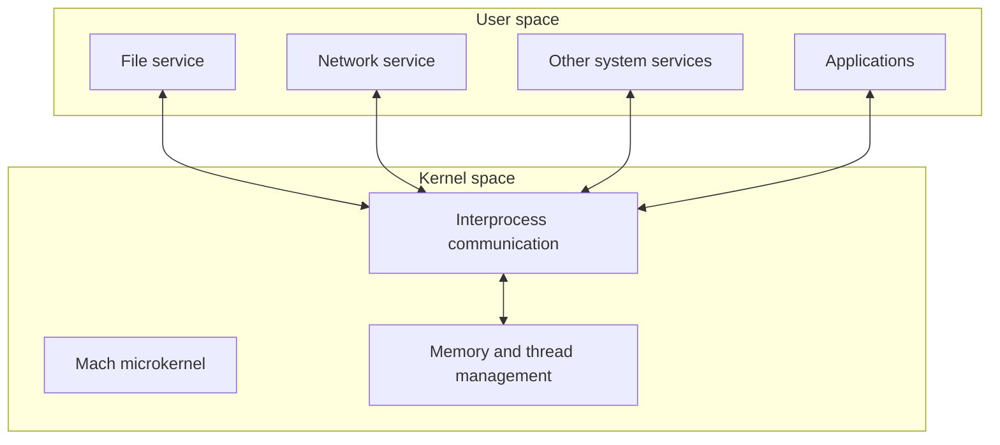
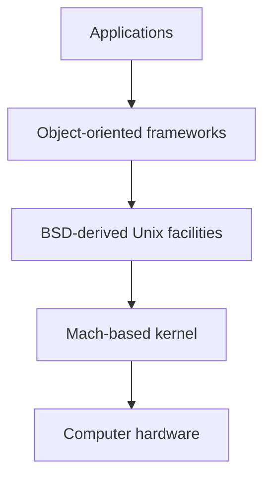
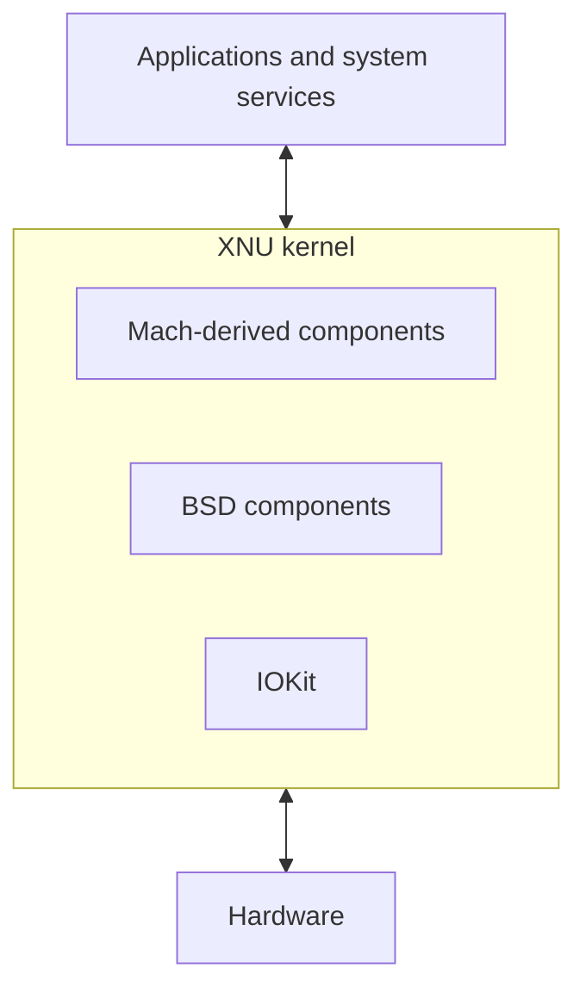

If you have ever looked at macOS code, you might have noticed some unusual names.

A window is often represented by a class called `NSWindow`. A string of text might be represented by `NSString`. The kernel is called XNU. The operating system has another name, Darwin. And then there are references to Mach, BSD, and NeXTSTEP scattered throughout the system's history and documentation.

At first, these names seem unrelated. Some look like abbreviations, others like old project names, and a few sound as though they belong to entirely different operating systems.

They are not random, though. Each name comes from a particular stage in the development of macOS. To understand why they still appear today, we need to go back several decades, to a time when the computer operating systems we take for granted were still being designed.

### Mach: Building a smaller kernel

In 1985, researchers at Carnegie Mellon University began developing an operating-system project called **Mach**. The project was led by Richard Rashid and involved researchers including Avie Tevanian. Its goal was to explore a more modular approach to operating-system design. [Carnegie Mellon University's Mach project](https://www.cs.cmu.edu/afs/cs.cmu.edu/project/mach/public/www/mach.html)

To understand why this mattered, remember what the kernel does.

The kernel is the privileged part of an operating system. It manages resources that programs cannot safely control on their own, including memory, processor scheduling, and access to hardware. We explored this boundary between applications and the kernel in Part 2.

But how much responsibility should the kernel have?

One approach is to put a large collection of operating-system services inside the kernel. Another is to keep the kernel relatively small and run more services as separate programs, with communication between them.

Mach explored the second approach.

A microkernel aims to keep only a small set of essential mechanisms in the privileged kernel. These can include low-level memory management, thread scheduling, and communication between tasks. Other operating-system services can run outside the kernel, where they have fewer privileges.

This arrangement creates two broad environments:

- **Kernel space:** code running with the privileges needed to manage critical system resources.
- **User space:** ordinary programs and services running with more restricted privileges.

We can picture the idea like this:

This diagram illustrates the architectural idea, not the exact implementation of every Mach-based operating system.

The appeal is separation. If a service runs as an ordinary user-space process, it does not automatically receive the same privileges as the kernel. That can help with modularity, fault isolation, and the ability to develop or replace individual services.

However, separation also has a cost. When one component needs another component to do something, they must communicate. That communication can involve switching execution contexts, transferring messages, and checking permissions.

Those operations take time and add complexity. Whether the trade-off is worthwhile depends on the system's design and implementation.

Mach was not the only project to explore this architecture, but it became particularly influential. Its ideas would eventually become part of the foundation of Apple's modern operating systems.

### BSD: The practical Unix environment

While Mach was being developed at Carnegie Mellon, another important line of operating-system development was taking place at the University of California, Berkeley.

The name was **BSD**, short for *Berkeley Software Distribution*.

BSD grew out of the Unix tradition. Over time, it became associated with a substantial collection of operating-system features and tools, including networking facilities, file-system implementations, process management, and Unix-compatible interfaces.

Think about what an ordinary program needs from an operating system.

It needs to open and read files. It needs to create processes and manage their relationships. It may need to communicate with another computer over a network. It may need to receive signals that tell it to stop, continue, or respond to an event.

These are the kinds of facilities that make an operating system useful for running real applications.

Mach provided important low-level mechanisms, but a complete Unix-like environment needed more than those mechanisms alone. BSD brought much of that established Unix functionality into the picture.

The two projects therefore offered complementary strengths.

Mach explored a modular kernel architecture and provided mechanisms such as threads, virtual memory, and interprocess communication. BSD supplied a mature Unix environment with familiar operating-system interfaces and services.

That distinction will become important shortly, because NeXT combined technologies from both worlds.

### NeXTSTEP: Bringing Mach and BSD together

In 1985, Steve Jobs left Apple and founded a company called NeXT. The company developed computers and an operating system for them.

That operating system became known as **NeXTSTEP**.

NeXTSTEP combined technology based on Mach with BSD-derived Unix functionality. Above that foundation, it provided an object-oriented software environment that developers could use to build applications with windows, menus, text, and other graphical interface elements.

It is useful to think of NeXTSTEP as a stack of layers rather than a single piece of software.

This is a simplified conceptual view. The real implementation involved more interactions between these layers, and BSD-derived functionality was not confined to a single neat layer in every version.

The important point is that NeXTSTEP did not have to choose between Mach's architectural ideas and BSD's practical Unix capabilities. It used both.

The graphical frameworks were especially significant. They gave developers reusable building blocks for creating applications without requiring each developer to implement windows, menus, and text handling from scratch.

Many of those frameworks were written in or designed around **Objective-C**, an object-oriented extension of C.

This brings us to a small detail you can still encounter in modern macOS code: the letters `NS`.

### Why so many macOS classes begin with `NS`

Consider these familiar-looking class names:

| Class      | What it represents                |
| ---------- | --------------------------------- |
| `NSWindow` | A window in AppKit                |
| `NSString` | A string of text in Foundation    |
| `NSArray`  | An array collection in Foundation |

The prefix `NS` comes from **NeXTSTEP**.

It was used in the naming conventions of NeXT's software frameworks, and it survived as those technologies evolved into the frameworks used by macOS.

For example, the AppKit framework provides classes for building graphical applications. When an application creates a standard AppKit window, it can work with an `NSWindow` object.

Foundation, meanwhile, provides fundamental types and services, including `NSString` and `NSArray`.

The prefix does not mean that every class beginning with `NS` belongs to one framework. Rather, it is a historical naming convention that appears across multiple related Apple frameworks.

### Apple acquires NeXT

By the mid-1990s, Apple needed a successor to its classic Mac OS.

Classic Mac OS had a major limitation: it lacked the kind of robust, per-process memory protection found in modern operating systems. Its multitasking model also differed substantially from the preemptive multitasking used by modern macOS. Applications could interfere with one another more easily, making stability and reliability harder to achieve.

Apple explored several ways to move the platform forward, but eventually chose an existing foundation rather than building an entirely new operating system from scratch.

In December 1996, Apple announced that it would acquire NeXT. The acquisition brought NeXTSTEP technology and key people back into Apple, including Steve Jobs.

Apple then worked to combine NeXT's underlying operating-system technology with the familiar Macintosh experience.

This was not simply a matter of changing the appearance of the desktop. Apple needed an operating system with a modern foundation while retaining the menus, windows, applications, and interaction patterns that Mac users expected.

The resulting system became Mac OS X.

Mac OS X 10.0 was released in March 2001. Over the following years, the product name changed: it became OS X in 2012 and macOS in 2016.

The interface, hardware support, frameworks, and kernel have all evolved considerably since then. Yet the lineage from Mach, BSD, and NeXTSTEP remains visible in the architecture and terminology of today's macOS.

### XNU: The kernel inside macOS

We have now reached the name that matters most when discussing the kernel: **XNU**.

XNU kernel is part of the Darwin operating system for use in macOS and iOS operating systems. XNU is an acronym for X is Not Unix. XNU is a hybrid kernel combining the Mach kernel developed at Carnegie Mellon University with components from FreeBSD and a C++ API for writing drivers called IOKit. XNU runs on x86_64 and ARM64 for both single processor and multi-processor configurations.

Its source code is published in Apple's open-source repository. [Apple's XNU source code](https://github.com/apple-oss-distributions/xnu)

Why call it a hybrid kernel?

Recall the original microkernel idea: keep the privileged kernel small, and move more operating-system services into user space.

XNU retains important Mach mechanisms, but it also incorporates substantial BSD functionality into the kernel itself. IOKit provides a framework for device drivers and hardware interaction.

This means XNU does not follow the pure microkernel arrangement in which the major Unix services all run as separate user-space servers. It combines elements of different architectural approaches.

A simplified picture looks like this:

The three labels inside XNU are useful for understanding its source tree, but they are not three independent kernels stacked on top of one another. They are integrated components of a single kernel.

### Why combine these approaches?

Kernel architecture involves trade-offs. Keeping services separate can improve modularity and isolation, but communication between components may introduce overhead. Bringing more functionality into the kernel can avoid some of those boundaries, but it also means more code runs with powerful privileges.

XNU reflects Apple's choice to combine Mach's mechanisms with BSD functionality and integrated driver infrastructure, rather than keeping the kernel as small as a traditional microkernel design would aim to.

It would be too simple to say that microkernels are inherently slow or that system calls make file operations slow. Performance depends on the design and implementation. XNU's hybrid structure is a historical and architectural choice, not proof that every alternative would perform worse.

### What are `osfmk`, `bsd`, and `iokit`?

You can see the architecture reflected in the public XNU source tree.

Open the [XNU repository on GitHub](https://github.com/apple-oss-distributions/xnu), and you will find directories named `osfmk`, `bsd`, and `iokit`.

These names are not arbitrary.

- **`osfmk`** contains Mach-derived kernel components. The name comes from the Open Software Foundation and Mach terminology.
- **`bsd`** contains BSD-derived operating-system components, including code related to Unix process and system-call functionality.
- **`iokit`** contains IOKit, Apple's framework for device-driver and hardware-related infrastructure.

There are other directories too, including those related to kernel libraries, security, startup, and platform-specific code. The three directories above are simply a useful starting point for understanding the kernel's major historical components.

The source tree makes the earlier history concrete. What began as separate projects and design traditions is now reflected in the organization of a single kernel.

### Darwin: The open-source foundation

There is one more name to understand: **Darwin**.

Apple released Darwin 1.0 as open-source software in April 2000, describing it as the operating-system core at the heart of Mac OS X. [Apple's Darwin announcement](https://www.apple.com/newsroom/2000/04/05Apple-Releases-Darwin-1-0-Open-Source/)

Darwin is not another name for the XNU kernel. Rather, **XNU is part of Darwin**.

Darwin includes the kernel along with important parts of the underlying operating-system environment, including BSD-derived components and low-level system libraries and utilities. The exact contents and availability of open-source components vary by release.

macOS builds on this foundation with additional components that provide the complete Apple desktop experience.

A simplified comparison is:

| Name     | What it refers to                                                                                            |
| -------- | ------------------------------------------------------------------------------------------------------------ |
| Mach     | A kernel project whose technology influenced Apple's kernel                                                  |
| BSD      | A Unix-derived software tradition and collection of operating-system components                              |
| NeXTSTEP | NeXT's operating system, combining Mach-based and BSD-derived technology with application frameworks         |
| XNU      | Apple's hybrid kernel                                                                                        |
| Darwin   | The open-source operating-system foundation that includes XNU and other components                           |
| macOS    | Apple's complete desktop operating system, built on Darwin with additional system and graphical technologies |

The distinction between Darwin and macOS is especially important when thinking about windows.

The graphical desktop is not simply a feature of the kernel. A visible window depends on higher-level frameworks and system components responsible for application interfaces, window management, drawing, and compositing.

Those components sit beyond the kernel itself. The publicly available XNU source code therefore cannot tell us everything about how the complete macOS desktop works.

Apple does publish source code for many components, including XNU, but not the entire macOS implementation. Some higher-level components are proprietary.

This creates an interesting situation for anyone studying macOS internals: we can inspect important parts of the operating-system foundation directly, while other parts must be understood through documentation, observable behavior, debugging tools, and measurement.

### A note about Intel Macs

One last name can be confusing if you encounter older documentation: *Intel Mac*.

An Intel Mac is a Mac computer that uses a processor made by Intel. The term describes the computer's processor architecture, not the Mach kernel.

The two names happen to look similar, but they refer to completely different things.

Older Intel-based Macs used Intel's x86 architecture. Modern Apple-silicon Macs use Apple's ARM-based processor architecture. XNU has supported multiple processor architectures over its lifetime, and much of its core design is not tied to just one type of CPU.

This distinction matters when reading older source code or technical discussions. A reference to an Intel Mac may concern processor instructions, architecture-specific code, or compatibility. A reference to Mach concerns the kernel technology that helped shape XNU.