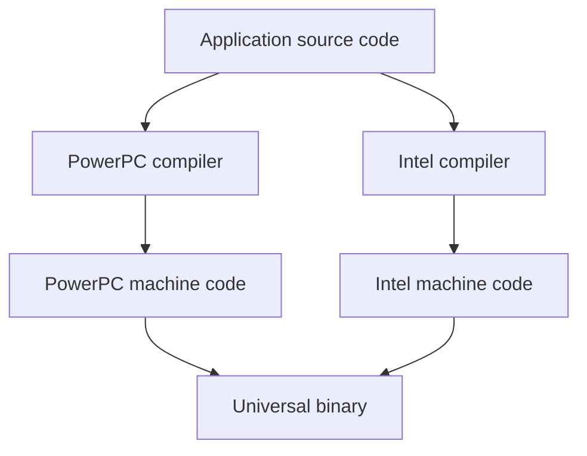
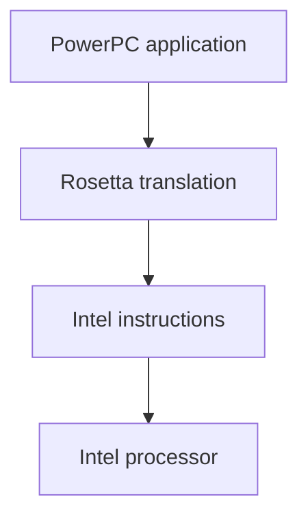
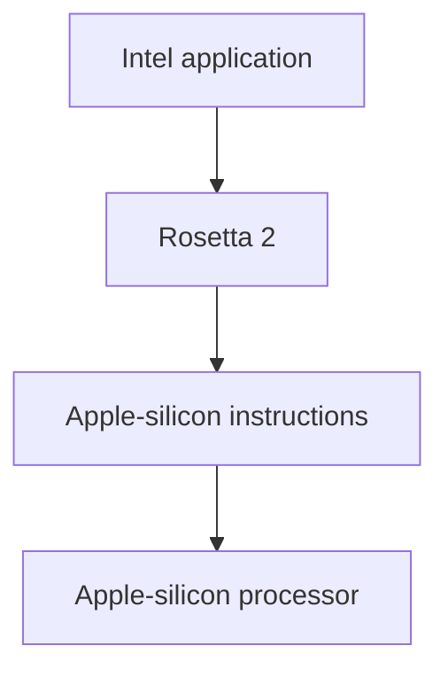
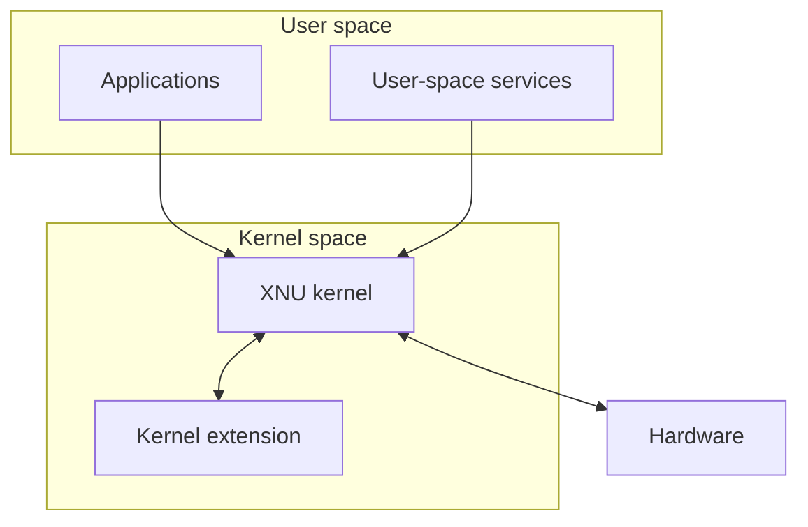
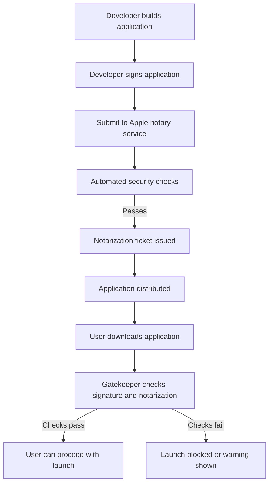

An operating system does not exist in isolation. It has applications written for it, developers building software for it, and hardware on which that software must run. When any of these foundations changes, the operating system has to deal with a difficult problem: what happens to everything that was built for the previous version?

Apple has faced this problem several times.

It moved from older Mac APIs to NeXT-derived frameworks, from PowerPC processors to Intel, and then from Intel to Apple silicon. Along the way, it also changed how applications and low-level system software are allowed to interact with macOS.

Understanding these transitions will help explain several names you may encounter when studying the platform: Carbon, Cocoa, Rosetta, universal binaries, kernel extensions, DriverKit, and notarization.

### Carbon and Cocoa: Two ways to build Mac applications

When Apple decided to use NeXTSTEP as the foundation for Mac OS X, it inherited a new set of application frameworks.

But Apple had a problem.

For years, developers had been writing Macintosh applications using the APIs of classic Mac OS. There were already thousands of applications, and developers had invested considerable time and money in building them.

Apple could not simply tell everyone to throw away their existing code and start again.

Imagine that you have been maintaining a desktop application for ten years. It contains thousands of lines of code, uses established APIs, and has customers depending on it. A new operating system arrives with a different programming environment. Rewriting the entire application immediately would be expensive and risky.

Apple needed a transition strategy.

The solution was to support two major application programming environments side by side:

- **Carbon:** APIs derived from the classic Mac OS programming environment.
- **Cocoa:** The application framework environment inherited from NeXTSTEP.

#### Carbon

Carbon was designed to help developers bring their existing classic Mac applications to Mac OS X without having to rewrite everything from scratch.

It provided a modernized set of APIs for applications that had previously used the older Macintosh Toolbox APIs.

The goal was compatibility. Developers could adapt their existing applications to Mac OS X while preserving much of their existing code.

#### Cocoa

Cocoa came from NeXTSTEP.

It provided an object-oriented application environment built around Objective-C, with frameworks such as Foundation and AppKit.

For example, a developer building a graphical application with Cocoa could use:

- `NSWindow` to work with windows.
- `NSView` to represent and draw interface regions.
- `NSString` to work with strings.
- `NSArray` to work with array collections.

For several years, both Carbon and Cocoa were available to developers. This allowed Apple to transition the platform without immediately abandoning its existing software ecosystem.

Eventually, Apple moved toward Cocoa as the primary application development environment. Carbon APIs were deprecated over time, with most Carbon Core APIs marked deprecated in macOS 10.8, released in 2012.

Deprecation does not necessarily mean that every API disappears immediately. It means developers are being told that the technology is no longer the preferred direction and should not be used for new development.

Today, AppKit and Foundation remain important parts of native macOS development, alongside newer technologies such as SwiftUI.

### The first processor transition: PowerPC to Intel

The next major transition happened at the hardware level.

For many years, Macs used processors based on the **PowerPC architecture**. These processors were developed through an alliance involving Apple, IBM, and Motorola.

However, in June 2005, Apple announced that it would transition the Mac platform from PowerPC processors to Intel processors.

The first Intel-based Macs were introduced in January 2006.

Why was this such a significant change?

Because a program is not just a collection of instructions that any processor can execute.

A compiled program contains machine instructions designed for a particular processor architecture.

For example, a program compiled for PowerPC contains instructions that a PowerPC processor understands. An Intel processor uses a different instruction set, so it cannot directly execute those PowerPC instructions.

Apple needed a way to make existing applications work during the transition.

It used two important techniques: universal binaries and Rosetta.

### Universal binaries: One application, multiple instruction sets

The first solution was to package multiple compiled versions of an application into a single executable file.

Apple called this a **Universal Binary**.

Imagine that a developer wants to distribute an application to both PowerPC and Intel Mac users.

Instead of distributing two completely separate applications, the developer can compile the application for both processor architectures and combine the resulting binaries into one file.

Conceptually:



The operating system examines the executable when launching it and selects the appropriate architecture-specific version.

On a PowerPC Mac, it uses the PowerPC instructions. On an Intel Mac, it uses the Intel instructions.

The user does not need to manage two separate applications. Both versions are contained within the same executable.

This is a clever approach because it allows developers to distribute one application while supporting multiple processor architectures.

However, it also has a cost: the executable contains multiple compiled versions of the program, so it is generally larger than a single-architecture executable.

### Rosetta: Translating instructions between architectures

The second solution was a translation layer called **Rosetta**.

Universal binaries required developers to provide a compiled version for each supported architecture. But what about an application that had not yet been updated?

Apple needed another solution.

Rosetta translated PowerPC application instructions so that they could execute on Intel processors.

The application did not need to be rewritten immediately. Instead, Rosetta handled the architecture difference.

A simplified view:



This was not the same as running a PowerPC processor inside the Intel Mac. Rosetta translated the application's instructions into instructions the Intel processor could execute.

The translation came with some overhead, and not every kind of software could be supported. But it made the transition much easier for users and developers.

There is an important distinction here:

- A universal binary contains code compiled for multiple architectures.
- Rosetta allows code compiled for one architecture to run on a different architecture through translation.

One is a packaging and compilation strategy. The other is an instruction translation strategy.

Apple would use both ideas again during its next major processor transition.

### The second transition: Intel to Apple silicon

In June 2020, Apple announced that it would transition the Mac from Intel processors to its own chips, which it called **Apple silicon**.

The first Apple-silicon Macs, powered by the M1 chip, arrived later that year.

This was another significant architectural change.

Intel-based Macs used the x86-64 instruction set. Apple-silicon Macs use the ARM-based instruction architecture, commonly identified as `arm64`.

That meant an application compiled only for Intel processors could not simply execute natively on an Apple-silicon processor.

Once again, Apple needed a compatibility strategy. And once again, it used universal binaries and Rosetta—this time in a new form.

#### Universal binaries return

Developers could compile their applications for both:

- `x86_64`: Intel's 64-bit Mac architecture.
- `arm64`: Apple's silicon architecture.

Both compiled versions could then be combined into one universal executable.

The operating system chooses the appropriate version when launching the application.

On an Intel Mac, it selects `x86_64`. On an Apple-silicon Mac, it selects `arm64` when available.

This means the same application can run natively on both types of Mac.

#### Rosetta 2

Apple also introduced **Rosetta 2** to run Intel applications on Apple-silicon Macs.

Rosetta 2 translates Intel instructions into instructions that Apple silicon can execute.

It supports translation ahead of execution as well as certain forms of runtime translation. The implementation is more sophisticated than simply translating every instruction one at a time while the application runs.

A simplified view:



This gave developers time to update their applications without forcing users to abandon older software immediately.

There is one important limitation: Rosetta 2 translates application software, not everything that might exist on an Intel Mac. For example, it does not translate Intel kernel extensions. Applications that depend on unsupported low-level components may therefore have additional compatibility problems.

### Looking inside a Universal Binary

Suppose you download an application such as Ghostty, a terminal emulator, onto your Mac.

Its executable can contain separate compiled versions for Intel and Apple silicon.

On macOS, Apple provides a command-line utility called `lipo` for inspecting and manipulating universal binaries.

You can inspect the architectures contained in an executable with:

```bash
lipo -archs /path/to/Ghostty
```

A universal executable might return:

```text
x86_64 arm64
```

This tells us that the file contains two architecture-specific versions.

You can also inspect the executable using:

```bash
file /path/to/Ghostty
```

And to get more detailed information about a universal binary:

```bash
lipo -detailed_info /path/to/Ghostty
```

The important idea is that a universal binary is not one set of machine instructions that somehow works on every processor. It contains separate architecture-specific slices.

When the application starts, macOS selects the appropriate slice.

#### Why does the executable contain aligned slices?

When examining a universal binary, you may notice that the architecture-specific slices begin at particular byte offsets.

These offsets are not necessarily arbitrary.

Executable formats and operating systems use alignment requirements so that important sections of a file can be accessed efficiently. In some cases, alignment also relates to how the operating system maps executable data into virtual memory.

For example, a machine using a 16 KB memory page size may use 16 KB alignment for relevant executable regions.

A memory page is a fixed-size unit that the operating system and processor use when managing virtual memory. We will explore this more deeply when we discuss memory management.

One detail worth keeping in mind: alignment values depend on the executable format, build settings, and target platform. A particular offset in one application should not be treated as a universal rule for every Mac executable.

### The end of 32-bit applications

Processor transitions were not the only compatibility changes Apple made.

For many years, macOS supported both 32-bit and 64-bit applications. Eventually, Apple decided to remove 32-bit application support entirely.

With macOS Catalina 10.15, released in 2019, 32-bit applications could no longer run.

Why?

A 64-bit processor and operating system can work with a larger address space and support modern software requirements more effectively. Maintaining older 32-bit compatibility also requires engineering effort and testing.

Apple had already been encouraging developers to move to 64-bit applications for years. Catalina completed that transition by removing the ability to execute 32-bit apps.

This is an important distinction: a 64-bit processor may be capable of supporting older instruction modes, but that does not mean the operating system must continue supporting applications built for those modes.

The operating system decides which application formats and execution environments it supports.

### Kernel extensions: Code with kernel-level privileges

An ordinary application runs in user space. It does not receive unrestricted access to the kernel or hardware.

But some software needs to interact with the operating system at a much lower level.

For example:

- Device drivers need to communicate with hardware.
- Network filters may need to inspect or modify network traffic.
- Security software may need visibility into sensitive system events.
- Filesystem software may need to participate in filesystem operations.

Historically, macOS provided a mechanism called **kernel extensions**, commonly shortened to **kexts**.

A kernel extension is a piece of code that can be loaded into the kernel.

That means it runs with kernel-level privileges.

Ordinary applications are restricted, while kernel code has access to powerful system resources.

A kext crosses that boundary.



This gives a kernel extension powerful capabilities, but it also creates a risk.

Imagine that a normal application has a memory-management bug. The application may crash, but the operating system can often continue running.

Now imagine that a kernel extension has a similar bug.

Because it runs inside the kernel, an error can corrupt critical kernel memory or interfere with core operating-system operations. The result can be a system crash rather than just an application crash.

This is one reason Apple began moving developers away from traditional kernel extensions.

### System extensions and DriverKit

Apple introduced **system extensions** in macOS Catalina 10.15 as a safer alternative for many kinds of system-level functionality.

The central idea is to move more functionality out of the kernel and into user space.

Instead of placing every piece of system software directly inside the kernel, Apple provides controlled interfaces that allow certain services to perform specialized tasks without having unrestricted kernel privileges.

For example, Apple provides:

- **Network Extensions** for networking-related functionality.
- **Endpoint Security** for security software that needs to observe and respond to system events.
- **DriverKit** for developing certain types of device drivers in user space.

DriverKit is particularly interesting.

Traditionally, device drivers often ran as kernel extensions. With DriverKit, supported drivers can run in separate user-space processes rather than being loaded directly into the kernel.

This improves isolation. If a user-space driver crashes, it does not automatically mean that the kernel itself must crash.

However, system extensions and DriverKit are not universal replacements for every possible kernel extension. Some functionality still has platform-specific requirements, and certain legacy kexts can continue to load under supported conditions with the appropriate security settings and user approval.

Apple has deprecated kernel extensions and recommends modern alternatives where available. Starting with macOS Big Sur, kernel extensions using deprecated kernel programming interfaces are no longer loaded by default.

The direction is clear: keep as much code as possible outside the kernel, and give it only the permissions it needs.

### Notarization: Checking software before distribution

There is another important part of macOS security that affects developers distributing applications outside the Mac App Store.

It is called **notarization**.

Imagine that you build a Mac application and want to distribute it directly from your website.

You package your application, upload it, and provide a download link. Someone downloads it and tries to open it.

How does macOS know whether the application comes from an identified developer? How does it know whether the software has been tampered with? And how can it check whether the application contains known malicious code?

Apple uses several security mechanisms together, including code signing, Gatekeeper, notarization, and XProtect.

#### Code signing

Before discussing notarization, we need to understand code signing.

Code signing allows macOS to verify the identity associated with an application and detect whether the signed code has been modified since it was signed.

For software distributed outside the Mac App Store, developers commonly use an Apple-issued Developer ID certificate to sign their applications.

Think of it as attaching a cryptographically verifiable identity to the software.

If someone modifies the signed application afterward, the signature verification can detect that the code no longer matches what the developer signed.

But code signing alone does not establish that an application is free from malware.

A malicious application can also be signed.

That is where notarization comes in.

#### What happens during notarization?

Notarization is an automated service operated by Apple.

A developer submits their signed application to Apple's notary service. The service scans the software for known malicious content and checks for code-signing issues.

If the submission passes the checks, Apple issues a notarization ticket.

The ticket can be attached to the application, a process called *stapling*, or retrieved online by the user's Mac.

When the user first tries to open the application, Gatekeeper can check the developer's signature and the notarization information.

A simplified workflow looks like this:



The diagram is simplified: the actual process includes additional checks and policy decisions.

#### Does notarization guarantee that an application is safe?

No.

Notarization is not the same as a full manual review of an application, and it does not guarantee that the application is harmless.

It means Apple's automated service has checked the submitted software and did not find issues that prevent notarization at that time.

Apple can also revoke notarization tickets when software is later identified as malicious. Gatekeeper can use that information to block applications that had previously been notarized.

This is why notarization should be understood as one layer of macOS security, not a promise that software can never be malicious.

Apple's documentation explains how notarization, Gatekeeper, and XProtect work together to protect users. [Apple's macOS malware protection documentation](https://support.apple.com/guide/security/protecting-against-malware-sec469d47bd8/web)

### Golden Gate: The end of the Intel Mac era

In 2020, Apple announced its transition from Intel processors to Apple silicon. At the time, Rosetta 2 provided a compatibility layer that allowed Intel applications to continue running on the new hardware.

That transition has now reached another milestone.

Apple announced macOS 27, codenamed **Golden Gate**, in June 2026. It became the first major macOS release that supports only Apple-silicon Macs.

Intel-based Macs are no longer supported by this major release.

This means macOS 26 was the final major macOS version that supported Intel-based Mac hardware.

But there is another important detail.

macOS 27 is also the final major release with general-purpose Rosetta support.

Starting with macOS 28, Apple plans to restrict Rosetta functionality to certain older, unmaintained games that depend on Intel-based frameworks. It will no longer serve as a general-purpose way to run Intel Mac applications.

This distinction matters:

- Intel Macs cannot upgrade to macOS 27.
- Apple-silicon Macs can run macOS 27 and use Rosetta for supported Intel applications.
- macOS 28 will no longer provide general-purpose Rosetta support, although limited support for certain older games will remain.

Apple has now completed the transition away from Intel as a supported Mac hardware architecture in its latest major operating-system release.

[Apple's announcement about upcoming Rosetta changes](https://developer.apple.com/news/?id=w5ngl9k2)