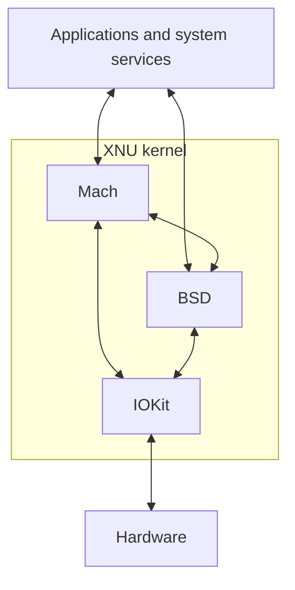
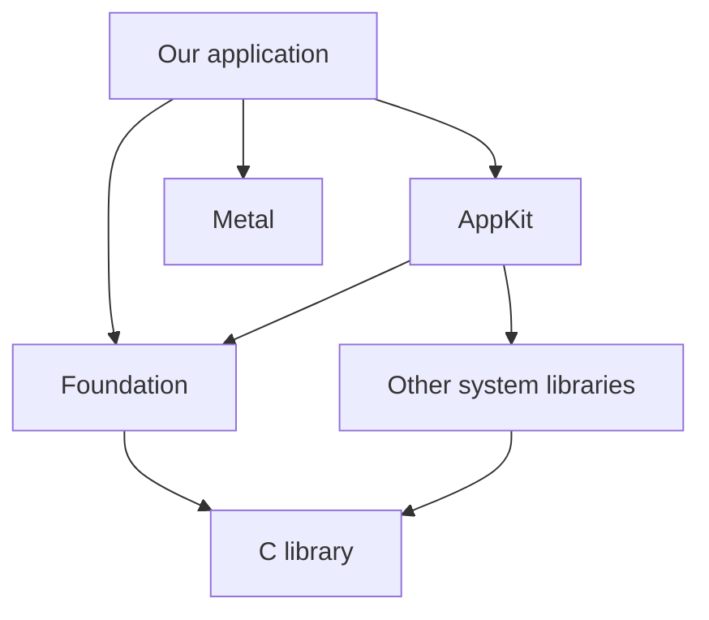
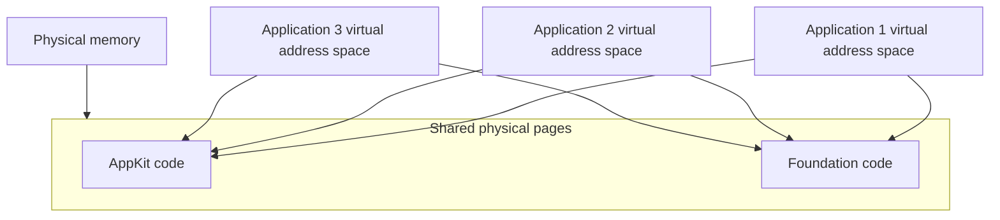
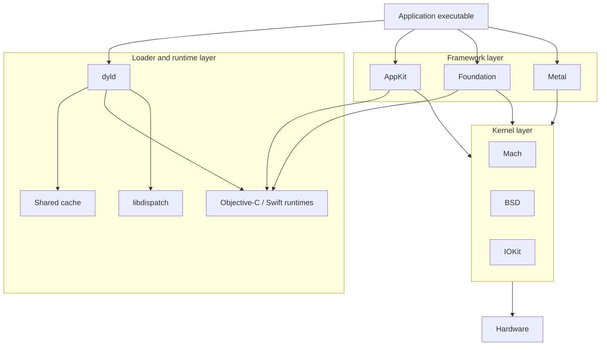

Imagine that you open a small application on your Mac. It creates a window, displays some text, and perhaps draws a few shapes.

From the user's perspective, this looks like a simple operation. You click an icon, the application opens, and a window appears.

But the application cannot do all of this by itself.

It needs the kernel to manage memory and schedule its threads. It needs libraries and frameworks to provide functionality that would otherwise take enormous effort to implement. It needs a loader to bring its dependencies into memory. And it needs language runtimes to provide the machinery required by the programming languages used to build it.

These responsibilities belong to different parts of macOS.

Let's start at the bottom and work our way up.

### The kernel floor: Mach, BSD, and IOKit

We introduced XNU, Apple's hybrid kernel. We also saw that its source tree contains three major areas: `osfmk`, `bsd`, and `iokit`.

These represent three important areas of responsibility within the kernel.

Although they work together, each has a different job.

#### Mach: Memory, threads, and communication

Mach provides fundamental mechanisms for managing execution and memory.

Consider what happens when you open an application.

The operating system needs to give that application an address space in which it can operate. It needs to manage the application's threads and decide when those threads get processor time. It also needs mechanisms through which different processes can communicate.

These are among the responsibilities associated with Mach.

Three particularly important concepts are:

- **Memory management:** Managing virtual memory and the address spaces used by processes.
- **Thread management:** Creating and managing threads, scheduling their execution, and coordinating access to processor resources.
- **Interprocess communication (IPC):** Providing mechanisms through which processes and system components can exchange messages.

We have already encountered processes and threads in earlier articles. The important thing to remember is that a process provides an execution environment, while threads represent units of execution within that environment.

Mach provides much of the low-level machinery that makes this possible.

It also provides Mach messaging, an IPC mechanism that allows tasks to exchange structured messages through ports.

This is particularly important in macOS because many system services are separate processes. They need a controlled way to communicate rather than directly accessing one another's memory.

#### BSD: Files, sockets, signals, and processes

While Mach provides important low-level mechanisms, applications also need a familiar Unix environment.

For example, when a program opens a file, creates a socket, sends data over a network, or receives a signal, it is using operating-system facilities associated with the BSD layer.

Some of its responsibilities include:

- **Files and filesystems:** Providing interfaces for opening, reading, writing, and managing files.
- **Sockets:** Providing networking interfaces through which programs communicate.
- **Signals:** Providing a mechanism for notifying processes about particular events.
- **Process management:** Providing Unix process-related interfaces and functionality, including process creation and management.

Consider a simple command:

```bash
cat notes.txt
```

The `cat` program needs to open the file, read its contents, and write those contents to the terminal.

The program does not directly access the physical storage device. It uses operating-system interfaces, which eventually involve the kernel's filesystem and device-related machinery.

The BSD layer provides much of the Unix-facing interface involved in this process.

#### IOKit: Communicating with devices

A computer is not useful without devices. It needs keyboards, trackpads, storage controllers, graphics hardware, network interfaces, and many other components.

The operating system needs a way to discover these devices and communicate with them.

This is where IOKit comes in.

IOKit is Apple's device-driver framework. It provides infrastructure for representing devices, managing driver relationships, and allowing software to interact with hardware.

Consider what happens when you connect a USB keyboard.

At a high level, the process looks something like this:

1. The system detects that a device has appeared on the USB bus.
2. The device-matching infrastructure identifies an appropriate driver.
3. The driver establishes communication with the device.
4. When you press a key, the device reports an input event.
5. The operating system processes that input and makes it available to the relevant system components and applications.

The actual path depends on the device, its driver, and the input subsystem. It is not simply a matter of IOKit passing a key directly to a Mach message.

Still, this example gives us a useful mental model: IOKit deals with device infrastructure, Mach provides low-level mechanisms such as threads and IPC, and BSD provides Unix-oriented facilities such as files and sockets.

#### Putting the kernel components together

We can now summarize the responsibilities:



This is a conceptual diagram, not a strict request-routing diagram. Kernel components interact with one another, and a real operation may pass through several subsystems.

The important point is that the kernel is not one monolithic collection of unrelated code. Its different components provide different kinds of functionality.

But the kernel is only the foundation.

Above it, we have another layer responsible for getting applications and their dependencies into memory.

### dyld: The dynamic loader

Let's return to our small application.

Suppose we have written a program that creates a window on macOS. We might use AppKit to create the window, Foundation to work with strings and objects, and Metal to perform graphics-related work.

But our executable does not necessarily contain the complete implementation of all these frameworks.

Instead, it contains references to external libraries and frameworks that it needs. This is where **dyld**, Apple's dynamic linker, comes in.

The name stands for *dynamic loader*.

Its job is to load the executable's required dynamic libraries and frameworks, resolve their dependencies, and prepare the program to begin execution.

To understand why this is necessary, consider a small dependency graph.

Our application depends on AppKit, Foundation, and Metal. AppKit may itself depend on Foundation and other system libraries. Those libraries may depend on additional components.

In other words, dependencies form a graph, not a simple list.



This is a simplified example. The actual dependency graph of a macOS application can be much larger and more complicated.

When the operating system launches a dynamically linked executable, dyld participates in preparing the executable and its dependencies.

Broadly, it needs to:

1. Locate the executable and its required dynamic libraries.
2. Map the relevant executable and library segments into the process's virtual address space.
3. Resolve references between the executable and its dependencies.
4. Perform the necessary relocations and symbol bindings.
5. Run the required initialization routines before normal application execution proceeds.

Let's unpack two of these ideas.

#### Mapping a library into memory

When an application depends on a framework, the framework's executable code needs to be accessible to that application.

The loader arranges for the appropriate parts of the framework to be mapped into the process's virtual address space.

Remember virtual memory from our earlier discussions.

A process does not need to know where its code physically resides in RAM. It works with virtual addresses, and the operating system and processor handle the mapping to physical memory.

This is why the loader can make a library available to an application without copying every byte of the library into a completely separate physical memory allocation.

We will see why this becomes especially important when discussing the shared cache.

#### Resolving symbols

Suppose our application calls a function named `someFunction()` that is implemented inside a dynamic library.

The executable needs a way to refer to that function.

A compiled executable contains information about symbols and references. During loading, dyld and the associated linking mechanisms resolve those references so that the application can reach the correct implementation.

Think of a symbol as a named reference to something provided by a compiled binary, such as a function or global variable.

Without this linking process, the application would know that it needs a function but would not have the appropriate connection to the implementation.

Once the necessary dependencies are prepared and initialization is complete, execution can proceed into the application's entry point.

There is one nuance worth remembering: dyld does not necessarily load every possible dependency of an application immediately. Some libraries and symbols can be loaded or resolved lazily, depending on the binary and linking configuration.

The main idea is that dyld prepares the executable and its dynamic dependencies so that the program can run.

### The shared cache: Avoiding repeated system-library work

Now imagine that you open one hundred applications on your Mac.

Most of them use Foundation. Many use AppKit. Others may use additional system frameworks.

If every application had to load an entirely separate physical copy of every system framework, the system would waste a considerable amount of memory.

Apple uses an optimization called the **dyld shared cache**.

The basic idea is straightforward: instead of treating every system framework as an entirely independent library that must be prepared separately for every process, Apple builds optimized collections of system libraries and frameworks ahead of time.

These collections are known as shared caches.

#### Building the cache

During the macOS build process, Apple processes many of its system libraries and frameworks and combines them into optimized cache files.

The shared cache contains the executable code and related information needed by many system frameworks.

This means that when an application needs a framework such as AppKit, dyld can use the relevant content from the shared cache rather than treating it like an ordinary standalone dynamic library.

The cache also benefits from optimizations involving linking and symbol resolution.

The exact layout depends on the macOS release and the processor architecture.

For example, the cache organization on an Apple-silicon Mac can differ from that on an Intel Mac. It may also be split across multiple files rather than existing as one enormous file.

#### How can one copy serve many applications?

Let's return to our hundred applications.

Suppose all one hundred need to use AppKit.

The shared cache is mapped into the virtual address space of the processes that need it. The underlying physical memory pages containing shared executable code can be shared between those processes.

This distinction is important.

Each process has its own virtual address space, but that does not mean every process needs its own physical copy of the same framework code.

The operating system can map the same underlying physical pages into multiple processes.



The diagram illustrates the shared-page concept. Each process has its own mappings and virtual addresses; the underlying physical pages can be shared.

There is another useful detail here: shared executable code is generally mapped read-only or executable, rather than being freely modified by each application.

If a process needs to modify data associated with a library, the operating system can provide process-specific memory rather than allowing one application to modify another application's view of shared code.

This is one reason shared libraries are so useful. They reduce duplicated memory usage while preserving process isolation.

#### Does the shared cache contain everything?

No.

The shared cache is primarily concerned with Apple's system libraries and frameworks. It does not mean that every third-party library or every application dependency is automatically part of the cache.

An application can still have its own embedded frameworks, external dynamic libraries, and other dependencies.

Also, the shared cache is an implementation detail of the operating system. Developers should not assume that every framework is always stored in one particular cache file or that its physical layout remains identical between macOS releases.

The important idea is the optimization: system libraries can be prepared together and their executable pages shared across processes.

### Runtimes: The machinery behind programming languages

We have discussed the kernel, the dynamic loader, and the shared cache. There is one more important component on this layer: **runtimes**.

A runtime is the support machinery that a program needs while it executes. Different programming languages have different requirements.

For example, a program written in C, Objective-C, Swift, or Rust may all ultimately execute as machine instructions on the processor. But each language has its own rules and mechanisms for managing objects, memory, method calls, and other operations.

Some of that work is handled by the compiler. Some is handled by libraries and runtime components.

Let's look at a few examples.

#### Objective-C runtime

Objective-C is heavily associated with Apple's application frameworks.

When we write code such as:

```objective-c
[window makeKeyAndOrderFront:nil];
```

we are asking an object to perform a method.

Unlike a simple direct function call, Objective-C method dispatch involves a runtime mechanism.

The Objective-C runtime is responsible for managing classes, objects, method information, and dynamic method dispatch.

At a high level, when a message is sent to an object, the runtime helps determine which implementation should handle that message.

For example, imagine that we have an object called `window`, and we send it the message:

```objective-c
[window makeKeyAndOrderFront:nil];
```

The runtime participates in finding the appropriate method implementation for the object's class and invoking it.

This dynamic behavior is one of the defining characteristics of Objective-C.

It also helps explain why Objective-C frameworks can offer capabilities such as dynamic method resolution, introspection, and runtime manipulation.

#### Swift runtime

Swift has its own runtime support.

It provides functionality required by Swift programs, including support for type metadata, runtime type operations, and other language features.

One important distinction concerns memory management.

Swift uses Automatic Reference Counting, commonly known as ARC.

ARC is largely implemented through compiler-generated retain and release operations, with runtime support for managing reference counts and object lifetimes.

This means ARC is not a garbage collector that periodically scans the entire heap looking for unreachable objects. Instead, reference-counting operations help determine when an object is no longer needed.

The Swift runtime also supports features such as type metadata and dynamic behavior that cannot be handled entirely by the compiler.

#### libdispatch: Giving work to queues

Another important runtime-related component is **libdispatch**, commonly known as Grand Central Dispatch (GCD).

It provides an API for managing concurrent work through dispatch queues.

Imagine an application that needs to perform three tasks:

- Download some data.
- Process an image.
- Update the interface.

It would be a poor design to perform all these operations synchronously on the main thread if some of them take a long time.

The interface could become unresponsive.

With Grand Central Dispatch, developers can submit work to queues, allowing the system to schedule that work for execution.

For example:

```swift
DispatchQueue.global().async {
    // Perform background work
}
```

This submits work to a global concurrent queue.

The application does not need to manually create and manage a new thread for every task. Dispatch manages the scheduling and execution machinery.

This does not mean that every submitted block gets a dedicated thread. Dispatch queues are an abstraction for organizing work, while the system manages the underlying execution resources.

That distinction is important when studying concurrency.

A queue is not the same thing as a thread.

### How these pieces work together

Let's bring everything together using the small window application we introduced at the beginning.

Suppose we write a native macOS application that creates a window using AppKit.

The application might depend on:

- AppKit for window and interface functionality.
- Foundation for common data types and services.
- Metal for graphics-related functionality.
- The C library for lower-level standard library functionality.

The application also needs the appropriate runtime support for the language in which it was written.

When we launch the application, several things happen. First, the operating system begins the process-launch sequence and dyld prepares the executable and its dynamic dependencies.

The required system frameworks are made available through the shared cache where applicable. The relevant language runtime components are also available.

Once the necessary initialization has completed, the application begins executing.

As it runs, it may request memory, create threads, access files, or communicate with other processes. Those operations involve the kernel and its different subsystems.

The overall picture looks like this:



This is a conceptual map rather than a strict execution sequence. Applications, runtimes, frameworks, and the kernel interact through multiple paths, and many operations happen concurrently.

The important thing is that each layer has a different responsibility:

| Component | Primary responsibility |
|---|---|
| Mach | Memory, threads, and low-level IPC mechanisms |
| BSD | Unix interfaces, files, sockets, signals, and process functionality |
| IOKit | Device and driver infrastructure |
| dyld | Loading executables and preparing dynamic dependencies |
| Shared cache | Optimized shared collection of system libraries and frameworks |
| Language runtimes | Supporting language-specific behavior during execution |
| libdispatch | Organizing and scheduling concurrent work |