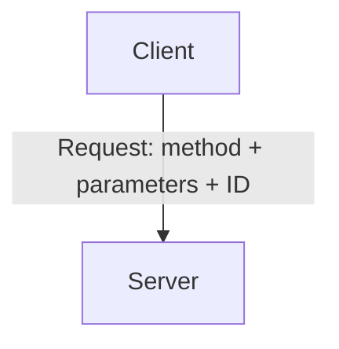
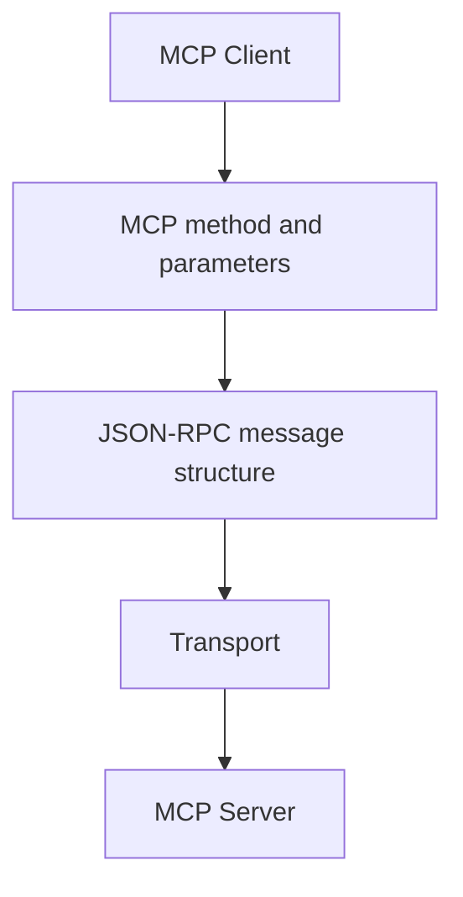
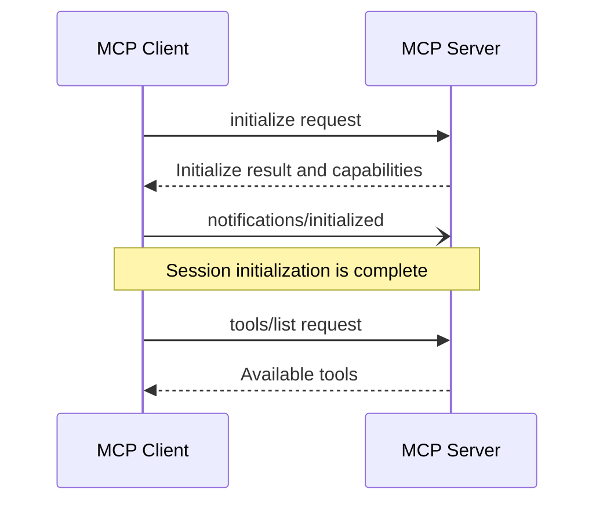
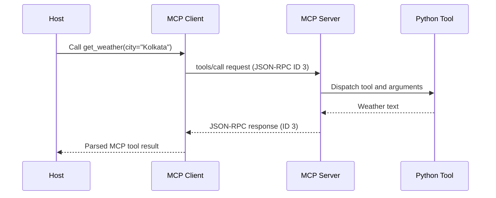
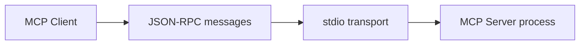

We know that the MCP client communicates with the server through a common protocol. But **what does that communication actually look like?**

When an MCP client asks a server to list its tools, what does it send? How does the server know what operation to perform? How does the client identify which response belongs to which request?

To understand these questions, we first need to understand JSON-RPC 2.0, the messaging foundation used by MCP.

### Why do we need a communication protocol?

Imagine that we have written an MCP server in Python. It exposes a tool called `get_weather`, which retrieves weather information for a city. Now imagine a client written in JavaScript wants to use that tool.

The client and server need a shared way to communicate. The client must be able to express a request such as:

> Execute `get_weather` with `city = "Kolkata"`.

The server must understand that request, execute the appropriate operation, and return the result in a format the client understands. Without an agreed communication format, the client and server would need custom rules for every interaction.

For example, one developer might invent this format:

```text
CALL|get_weather|Kolkata
```

Another might use:

```text
TOOL: get_weather
CITY: Kolkata
```

A third might send a JSON object with a completely different structure.

All three formats could communicate the same intent, but a client written for one format would not automatically understand the others. We need a common structure for messages. That's where JSON-RPC comes in.

### What is JSON-RPC?

JSON-RPC is a lightweight remote procedure call (RPC) protocol that uses JSON to represent messages.

Let's break down the name.

- **JSON** is a data format used to represent structured information.
- **RPC**, or Remote Procedure Call, is a communication pattern in which one component requests an operation from another component.

The word *remote* does not necessarily mean that the components run on different machines. They could communicate across a network or between local processes.

Consider a simple example.

A client wants a server to add two numbers. It sends a request describing the operation and its arguments:

```json
{
  "jsonrpc": "2.0",
  "id": 1,
  "method": "add",
  "params": {
    "a": 10,
    "b": 20
  }
}
```

The server processes the request and returns a response:

```json
{
  "jsonrpc": "2.0",
  "id": 1,
  "result": 30
}
```

The client can now read the result: `30`.

Notice what happened. The client did not need to know how the server implemented the addition. It only needed to know the operation's name, the expected arguments, and the message format.

JSON-RPC defines a standard message structure so that different implementations can communicate without inventing a new format for every operation.

### Understanding a JSON-RPC request

Let's examine the request more carefully.

```json
{
  "jsonrpc": "2.0",
  "id": 1,
  "method": "add",
  "params": {
    "a": 10,
    "b": 20
  }
}
```

A JSON-RPC request has several important fields.

#### `jsonrpc`

```json
"jsonrpc": "2.0"
```

This identifies the JSON-RPC protocol version used by the message. For JSON-RPC 2.0, the value is `"2.0"`.

#### `id`

```json
"id": 1
```

The ID identifies the request so that the client can match the response to the request that produced it. Imagine the client sends two requests:

- Request `1`: add 10 and 20.
- Request `2`: add 5 and 7.

The server might process them concurrently and return the second result first. The IDs let the client identify which result belongs to which request, even if the responses arrive in a different order. The ID is a correlation mechanism. It is not necessarily a sequence number, and the client does not have to use consecutive integers.

#### `method`

```json
"method": "add"
```

The method identifies the operation being requested. In our example, the method is `add`. In MCP, method names include operations such as:

- `initialize`
- `tools/list`
- `tools/call`
- `resources/list`
- `resources/read`

These are MCP protocol methods. They are different from the application-specific tool names exposed by an MCP server.

For example, `tools/call` is an MCP method, while `get_weather` might be the name of a tool being called through it. We'll return to this distinction shortly.

#### `params`

```json
"params": {
  "a": 10,
  "b": 20
}
```

The `params` field contains the arguments for the requested method. JSON-RPC allows parameters to be represented as an object or an array. MCP uses the parameter structures defined for its particular methods. In our example, the parameters provide the two numbers needed by `add`.

#### Putting it together

The general request pattern is:



The server uses the method and parameters to determine what to do, while the ID allows the client to correlate the response.

### Understanding a JSON-RPC response

For a request that expects a response, the server returns either a successful result or an error.

#### Successful response

```json
{
  "jsonrpc": "2.0",
  "id": 1,
  "result": 30
}
```

The response contains:

- `jsonrpc`: the protocol version.
- `id`: the ID of the corresponding request.
- `result`: the returned value.

The important detail is that the response ID matches the request ID.

#### Error response

What happens if the requested method does not exist or the server cannot process the request? JSON-RPC provides a standard error response structure:

```json
{
  "jsonrpc": "2.0",
  "id": 1,
  "error": {
    "code": -32601,
    "message": "Method not found"
  }
}
```

The `error` object contains an error code and a human-readable message. An optional `data` field can provide additional information. For example, `-32601` is the standard JSON-RPC error code for a method that does not exist.

The client can distinguish this from a successful response because the response contains `error` rather than `result`.

#### Why does this matter?

Without a shared error format, every client would need custom logic to interpret failures from every server. A common structure makes error handling more consistent.

However, JSON-RPC standardizes the message structure; it does not guarantee that an operation will succeed or prescribe every application's business-level error behavior.

### What about notifications?

So far, we've discussed requests that expect responses.

But sometimes a component needs to communicate an event without asking the other component to return a result.

JSON-RPC supports this through **notifications**.

A notification is similar to a request, but it has no `id`.

For example:

```json
{
  "jsonrpc": "2.0",
  "method": "notifications/initialized"
}
```

This message tells the receiving component that initialization has completed. Because it is a notification, the sender does not expect a JSON-RPC response.

Compare the two:

**Request:**

```json
{
  "jsonrpc": "2.0",
  "id": 1,
  "method": "tools/list"
}
```

The client expects a response associated with ID `1`.

**Notification:**

```json
{
  "jsonrpc": "2.0",
  "method": "notifications/initialized"
}
```

There is no request ID and no response is expected.

The distinction is simple:

- **Request:** asks for an operation or information and expects a response.
- **Notification:** communicates an event without expecting a response.

Notifications are useful for lifecycle events and other protocol messages that do not require a return value.

### How does JSON-RPC fit into MCP?

JSON-RPC defines the basic message structure. MCP defines the meaning of its methods, the capabilities clients and servers expose, and the rules governing their interactions.

Think of the relationship this way:



The diagram is conceptual. In practice, the MCP SDK usually constructs and parses the protocol messages for you.

For example, when an MCP client wants to discover available tools, it does not invent a custom message. It sends the MCP method `tools/list` using the JSON-RPC message structure.

Conceptually, the request looks like this:

```json
{
  "jsonrpc": "2.0",
  "id": 2,
  "method": "tools/list",
  "params": {}
}
```

The server responds with the tools it exposes:

```json
{
  "jsonrpc": "2.0",
  "id": 2,
  "result": {
    "tools": [
      {
        "name": "get_weather",
        "description": "Get the current weather for a city.",
        "inputSchema": {
          "type": "object",
          "properties": {
            "city": {
              "type": "string"
            }
          },
          "required": ["city"]
        }
      }
    ]
  }
}
```

This example illustrates the conceptual message structure; exact schemas and optional fields depend on the MCP specification version.

The client now knows that the server exposes a tool called `get_weather`, along with its description and input schema.

Notice that `tools/list` is the protocol method, while `get_weather` is an application-level tool name returned by that method.

This distinction is fundamental to understanding MCP.

### MCP lifecycle: from initialization to tool discovery

Before an MCP client can use a server, the two sides establish a protocol session and negotiate supported capabilities.

At a high level, the initialization exchange works like this:

1. The client sends an `initialize` request with its protocol version and client capabilities.
2. The server responds with the protocol version it will use and its capabilities.
3. The client sends an `notifications/initialized` notification.

Let's visualize the sequence.



The capabilities exchanged during initialization help the parties determine which protocol features they support.

For example, a server might advertise that it supports tools, resources, or prompts. The client can use this information to understand the server's declared capabilities.

Initialization is not the same as discovering the individual tools. Initialization establishes the protocol session; `tools/list` retrieves the available tool definitions.

The exact fields in the initialization messages depend on the negotiated protocol version.

### Calling an MCP tool: follow the request from start to finish

Let's use the Weather MCP Server.

It exposes this tool:

```python
@mcp.tool()
def get_weather(city: str) -> str:
    """Get the current weather for a city."""
    return f"The weather in {city} is 31°C and cloudy."
```

Suppose the client has already initialized its session and discovered this tool.

The user asks:

> "What's the weather in Kolkata?"

For this example, we'll focus only on the MCP client-server communication. The model's decision to use the tool happens in the host, outside the MCP request itself.

1. **The client requests tool execution**

    The client calls the MCP method `tools/call`.

    Conceptually, the JSON-RPC request looks like this:

    ```json
    {
    "jsonrpc": "2.0",
    "id": 3,
    "method": "tools/call",
    "params": {
        "name": "get_weather",
        "arguments": {
        "city": "Kolkata"
        }
    }
    }
    ```

    Let's examine the important fields:

    - `method` is `tools/call`, because the client is asking the server to execute a tool.
    - `params.name` identifies the tool: `get_weather`.
    - `params.arguments` supplies the tool's arguments.
    - `id` identifies the request so the client can match the response.

Notice that the request does not directly call a Python function by name. It asks the MCP server to invoke one of its registered tools.

2. **The server dispatches the request**

    The MCP server receives the request and recognizes the method `tools/call`.

    The MCP framework routes the request to the appropriate tool handler based on the tool name and arguments.

    ```mermaid
    flowchart TD
        A[Incoming MCP Request] --> B[tools/call]
        B --> C[get_weather]
        C --> D["get_weather('Kolkata')"]
    ```

    The actual routing and function invocation are handled by the MCP server implementation and SDK.

3. **The tool executes**

    Our Python function runs:

    ```python
    get_weather("Kolkata")
    ```

    It returns:

    ```text
    The weather in Kolkata is 31°C and cloudy.
    ```

    In a real application, the handler might call a weather API instead of returning hardcoded information.

4. **The server returns the result**

    The server wraps the tool output in an MCP tool result and sends it back through the JSON-RPC response.

    A simplified example of the response is:

    ```json
    {
    "jsonrpc": "2.0",
    "id": 3,
    "result": {
        "content": [
        {
            "type": "text",
            "text": "The weather in Kolkata is 31°C and cloudy."
        }
        ],
        "isError": false
    }
    }
    ```

    This is a simplified illustration of a successful MCP tool result. Actual messages may include additional fields, and protocol-level JSON-RPC errors have a different structure from tool execution errors represented in a tool result.

    The response uses ID `3`, matching the request.

5. **The client receives the result**

    The MCP client parses the response and makes the tool result available to the host application.

    The host can then supply that result to the LLM, which may generate a final answer such as:

    > "It's currently 31°C and cloudy in Kolkata."

    The LLM's final response is not generated by JSON-RPC. JSON-RPC carries the structured request and response between the client and server; the host and model handle the broader conversational interaction.

#### The entire tool-call sequence



The important observation is that the host may invoke a high-level SDK method such as `session.call_tool()`, while the SDK handles the lower-level protocol messages.

You usually do not need to construct raw JSON-RPC messages manually when using an MCP SDK.

So a `tools/call` is an MCP protocol method. It tells the server what kind of protocol operation the client wants to perform and `get_weather` is a tool name exposed by a particular server. It identifies the application-level operation that the server should execute.

#### Does JSON-RPC define how messages travel?

No. JSON-RPC defines the message format and interaction model, not the physical connection used to carry the messages.

MCP supports transports such as:

- **stdio:** messages are exchanged between local processes using standard input and standard output.
- **Streamable HTTP:** messages are exchanged over HTTP, with support for the streaming behavior defined by the transport.

For example, with stdio, a host may launch a local MCP server process and communicate with it through the process's input and output streams.



With Streamable HTTP, the same broad protocol concepts are carried over HTTP instead.

The transport determines how messages are delivered. The protocol defines what those messages mean.

This separation allows the same MCP concepts to work across different deployment arrangements.