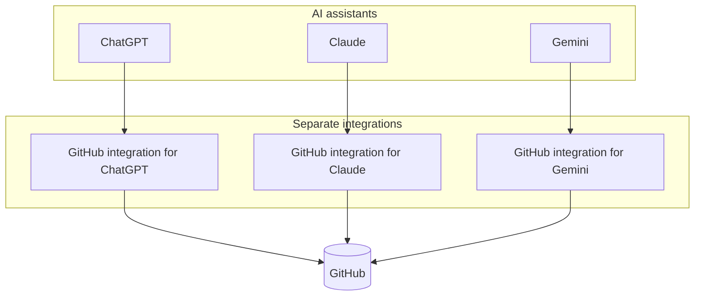
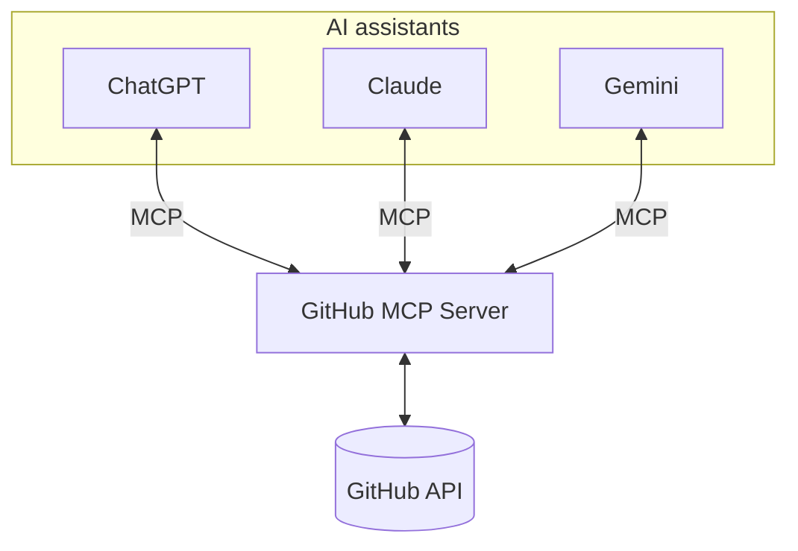
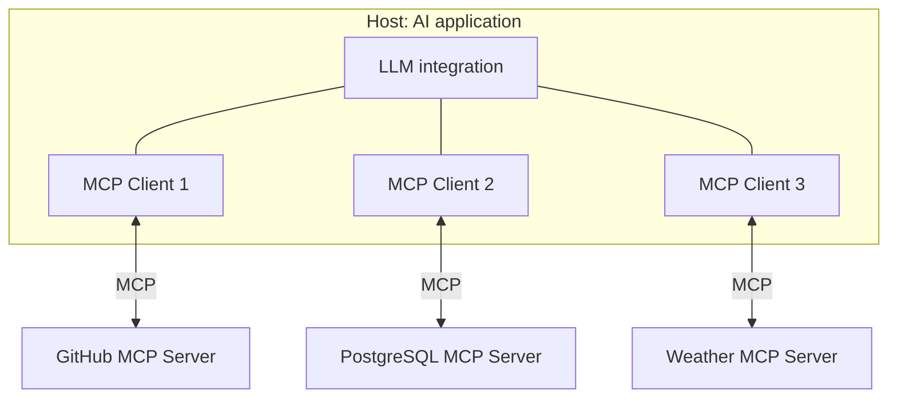
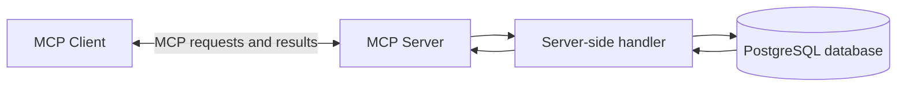
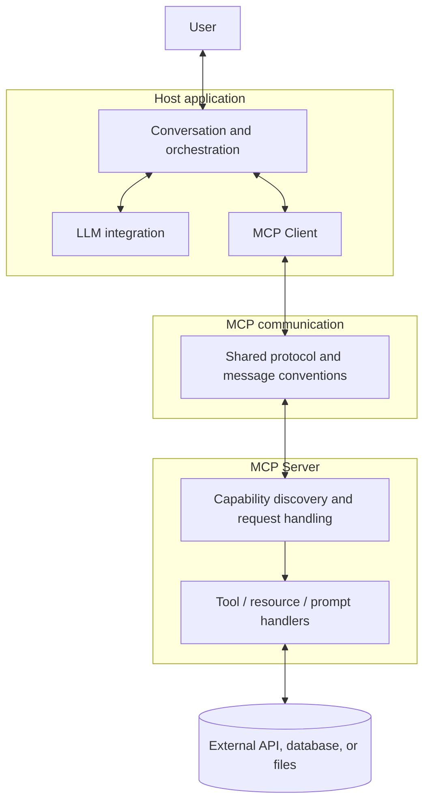
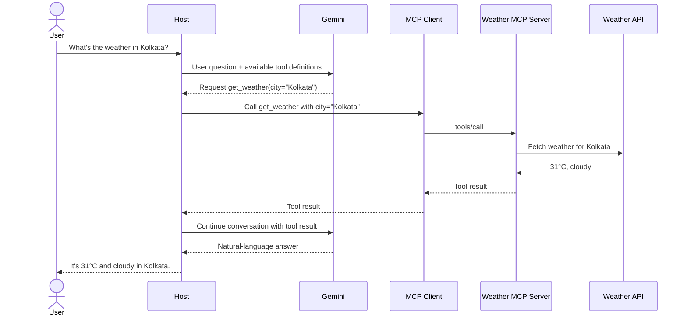
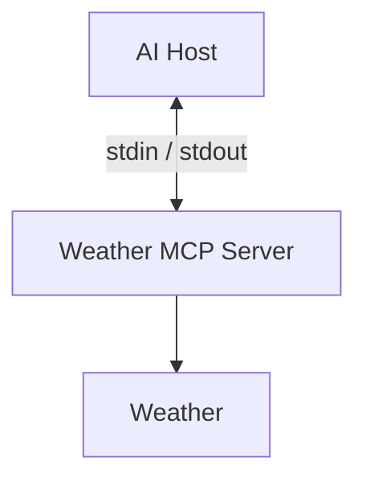
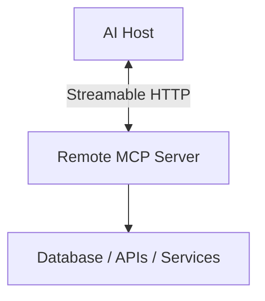

When we build applications powered by Large Language Models (LLMs), the model itself is rarely enough.

A model can explain a SQL query, but it cannot automatically inspect our database. It can suggest how to create a GitHub issue, but it cannot create one without access to GitHub. It can describe a file, but it cannot read a file on our machine unless the application provides that capability.

To achieve most of the LLMs in the real world, we need to connect models to external systems: databases, APIs, filesystems, developer tools, and business applications.

This introduces a fundamental engineering question:

**How do we connect AI applications to external capabilities without building a different integration for every combination of model, application, and service?**

The Model Context Protocol (MCP) is designed to address this problem.

In this article, we'll understand why MCP exists, how its architecture works, what each component does, and how the components cooperate to turn a natural-language request into a real-world action.

### Why can't every AI assistant use the same tools?

Imagine you're using three AI assistants: ChatGPT, Claude, and Gemini.

You want each of them to do something beyond answering questions. For example:

- Read a file from your computer.
- Search your GitHub repositories.
- Retrieve information from your PostgreSQL database.
- Check the latest weather in your city.

These tasks require the AI assistant to interact with something outside the language model itself.

Let's take GitHub as an example.

Suppose you ask ChatGPT:

> "Look at my GitHub repository and explain what the project does."

For ChatGPT to fulfill this request, it needs a way to access your repository. The same is true if you ask Claude or Gemini to perform the task.

But here's the problem: **just because an AI assistant understands your request doesn't mean it automatically has access to your GitHub repository.**

Someone must build a connection between the AI application and GitHub.

#### What happens without a common approach?

Imagine we build a custom GitHub integration for ChatGPT. We write the code needed to authenticate with GitHub, retrieve repository information, and return the results in a format ChatGPT can use.

Now suppose we want Claude to perform the same task.

We may need to implement or configure another integration that Claude can use. If we also want Gemini to access GitHub, we need a compatible integration for that application, too.

The same problem can occur when we connect these assistants to PostgreSQL, Slack, or other services.



This diagram illustrates the potential duplication. It doesn't mean ChatGPT, Claude, and Gemini always require completely separate code: they may already support integrations, and developers can reuse libraries or existing connectors. The issue is that different applications and services may use different integration interfaces.

As we add more assistants and services, maintaining all these connections can become complicated.

#### What if we could build the connection once and reuse it?

Imagine that instead of building a different GitHub integration for every AI application, we build a **GitHub MCP server**.

This server exposes GitHub capabilities through a common protocol called the Model Context Protocol (MCP).

Now, any compatible AI application that supports MCP can connect to that server and discover the capabilities it offers.



The GitHub MCP server handles the integration with GitHub. The AI applications communicate with it through the shared MCP interface.

For example, the server might expose tools to search repositories, retrieve files, or inspect issues. Each assistant can discover and use the tools it supports, subject to the permissions and configuration in place.

The result is a more reusable integration: instead of requiring a completely separate GitHub connector for every AI application, we can build one MCP server that multiple compatible clients can use.

Of course, compatibility alone doesn't grant access. Each application still needs to support MCP, establish a connection, and have the necessary authorization.

**This is the problem MCP aims to solve: making it easier for AI applications and external systems to communicate through a common, reusable interface.**

### What exactly is MCP?

**The Model Context Protocol (MCP) is an open protocol that standardizes how AI applications discover and interact with external capabilities and context providers.**

It defines conventions for communication between MCP clients and MCP servers, including how capabilities are described, how requests are made, and how results are returned.

MCP can provide access to capabilities such as:

- **Tools:** executable operations, such as searching a repository or querying a database.
- **Resources:** addressable information, such as documents, configuration, or database schema information.
- **Prompts:** reusable prompt templates that an application can present to users.

These capabilities allow an AI application to work with external information and operations through a common interface.

MCP does not replace the underlying APIs, databases, or services. It provides a standardized way for an AI application to access capabilities exposed by MCP servers.

A useful analogy is USB.

Before USB became widespread, connecting peripherals often involved different connectors and integration mechanisms. USB introduced a common interface for compatible devices.

Similarly, MCP provides a common interface for compatible AI applications and external capability providers.

The analogy is not exact. USB and MCP operate at different layers, and MCP also defines higher-level concepts such as tools, resources, and prompts. But the central idea of a shared interface is useful.

### The four essential concepts

To understand MCP architecture, we need to distinguish four things:

1. The host.
2. The MCP client.
3. The MCP protocol.
4. The MCP server.

They are related, but they are not interchangeable.

#### Host: the AI application

The **host** is the application the user interacts with.

Examples include an AI desktop application, an IDE with AI features, or a custom agent built with Python.

The host is responsible for coordinating the overall interaction. Depending on the application, it may:

- Receive the user's message.
- Manage the conversation and model interaction.
- Decide which connected capabilities are available to the model.
- Run one or more MCP clients.
- Route requested operations to the appropriate client.
- Handle results and present the final response.
- Enforce application-level policies and user approvals.

A host commonly contains an LLM integration and one or more MCP clients, although the exact implementation varies.

For example, suppose we build a Python application using Gemini.

The application receives:

> "What's the weather in Kolkata?"

The host sends the question and suitable tool descriptions to Gemini. If Gemini requests a weather operation, the host coordinates the corresponding MCP call.

The host is the coordinator. It is not the weather service itself.

#### MCP client: the communication component

An **MCP client** is the component inside the host that communicates with an MCP server.

A client handles protocol-level interactions such as:

- Establishing the appropriate connection.
- Performing protocol initialization when required by the negotiated protocol version.
- Discovering server capabilities.
- Sending requests to the server.
- Receiving results and errors.
- Handling the chosen transport.

The client does not need to know the internal implementation of every operation on the server.

For example, the host may have a client connected to a Weather MCP Server. That client can discover a tool named `get_weather`, then request its execution with the city as an argument.

One important architectural detail is that **a host commonly creates a separate MCP client for each server connection**.

A single host can therefore connect to several servers.



The host coordinates the model and clients, while each client communicates with its corresponding server.

The LLM does not need to establish a direct MCP connection to every server.

#### MCP: the protocol

The **Model Context Protocol** defines the rules and message structures used by clients and servers to communicate.

It specifies how capabilities are represented and how operations such as listing tools or calling a tool are requested.

For example, a client can request a list of available tools. The server responds with tool descriptions and input schemas.

The client can then invoke a selected tool using its name and arguments.

Conceptually:

```text
Client → Request available tools → Server

Client ← Tool descriptions and schemas ← Server

Client → Invoke a tool with arguments → Server

Client ← Tool result or error ← Server
```

MCP defines the interaction contract. The server developer implements the actual business logic.

MCP uses JSON-RPC 2.0 as its message foundation in the protocol versions that use that message model. JSON-RPC defines a common structure for requests, responses, and notifications; MCP defines the meaning of its operations and the capabilities built on top of that foundation.

#### MCP server: the capability provider

An **MCP server** exposes capabilities that an MCP client can discover and use.

It may provide access to:

- A REST API.
- A database.
- A local filesystem.
- A Git repository.
- A search engine.
- An internal business system.

The server acts as an adapter between the MCP interface and the underlying system.

For example, a PostgreSQL MCP Server might expose a `query_database` tool. When the client calls that tool, the server validates the arguments, executes the appropriate database operation, and returns the result.



The database itself does not need to implement MCP. The server handles the MCP side and interacts with the database using its own driver or library.

Similarly, a Weather MCP Server might call an external weather API. A GitHub MCP Server might use the GitHub API.

**An MCP server is not necessarily a separate physical machine or a remote cloud service.** It may run as a local process on the same computer as the host, or it may run remotely and be accessed over a supported network transport.

The word *server* describes its role in the protocol, not necessarily its physical location.

### How they fit together

Let's put the pieces together.



Here is the responsibility of each part in one sentence:

| Component | Responsibility |
|---|---|
| Host | Coordinates the user interaction, model, and connected capabilities. |
| MCP client | Communicates with an MCP server on the host's behalf. |
| MCP protocol | Defines the shared communication contract. |
| MCP server | Exposes capabilities and connects them to underlying systems. |

Notice that the host and client are not two independent AI applications. The client is a component of the host.

Likewise, MCP is not a process that must be deployed separately. It is the protocol followed by the client and server.

### What does an MCP server offer?

An MCP server can expose three important types of capability: tools, resources, and prompts.

Understanding their differences is essential because they serve different purposes.

#### Tools: perform an operation

A tool represents an operation the client can request the server to execute.

Examples:

- `search_repository(query)`
- `get_weather(city)`
- `query_database(sql)`
- `create_issue(title, description)`
- `send_email(to, subject, body)`

Tools are particularly useful when the AI application needs to retrieve information through an operation or change something in an external system.

A tool has a name, a description, and an input schema describing the arguments it accepts. The server handles the execution.

Example:

```python
@mcp.tool()
def get_weather(city: str) -> str:
    """Get the current weather for a city."""
    return weather_api.get_current_weather(city)
```

This is an illustrative Python SDK example. The decorator registers a Python function as an MCP tool through the SDK.

The tool's description helps a model-enabled host understand when the operation may be relevant. The server still needs to validate inputs and implement the operation safely.

#### Resources: provide information

A resource represents addressable information that an MCP server makes available to a client.

Examples:

- A project's README.
- A database schema.
- A configuration document.
- A file's contents.
- Documentation for an internal API.

A resource is identified by a URI. The URI identifies the resource; it is not the content itself.

Example:

```text
postgres://database/schema
```

This URI might identify a resource whose content describes the tables in a database.

```python
@mcp.resource("postgres://database/schema")
def get_database_schema() -> str:
    """Return the database schema."""

    # In a real application, retrieve this from PostgreSQL.
    tables = ["users", "orders", "products"]

    return "\n".join(tables)
```

When a client reads the resource, the server can retrieve the relevant information from the database and return it.

Conceptually:

```text
Client
  |
  | resources/read
  | URI: postgres://database/schema
  v
MCP Server
  |
  | Inspect database metadata
  v
PostgreSQL
  |
  | users, orders, products
  v
MCP Server
  |
  | Resource contents
  v
Client
```

The URI does not automatically query PostgreSQL. The server developer writes the handler that maps the resource URI to the appropriate data.

Resources are generally intended to provide context, rather than perform arbitrary actions or side-effecting operations.

Also, exposing a resource does not mean the model automatically reads it. The host determines how resources are discovered, selected, and supplied as context.

#### Prompts: reusable interaction templates

Prompts are reusable templates that an MCP server can expose to a client.

For example, a GitHub MCP Server could provide a prompt called `review_pull_request`, with arguments such as a repository name and pull request number.

The application can use that template to prepare a structured request for a code review.

Prompts are useful when an integration should offer repeatable workflows or predefined ways of interacting with a service.

They are not the same as tools: a prompt supplies reusable instructions or messages, while a tool exposes an operation that can be executed.

### Example: asking for the weather

Now let's trace a real interaction through the architecture.

Suppose we build a custom AI assistant using Gemini, with a Weather MCP Server that exposes a `get_weather(city)` tool.

The user asks:

> "What's the weather in Kolkata?"

Our server has access to a weather API and exposes this capability:

```python
@mcp.tool()
def get_weather(city: str) -> str:
    """Get the current weather for a city."""
    return weather_api.get_current_weather(city)
```

The following flow assumes the host makes this tool available to Gemini and implements a tool-calling loop.

1. **The user sends a message**

    The host receives:

    ```text
    What's the weather in Kolkata?
    ```

    At this point, no weather API has necessarily been called.

    The host must decide how to handle the request.

2. **The host provides relevant tool information to Gemini**

    The host has discovered the available MCP tools through its client.

    For example, the MCP server advertises a tool named `get_weather`, along with a description and an input schema that identifies `city` as a string argument.

    The host converts this information into the function-calling format expected by Gemini and includes it in the model request.

    MCP does not prescribe the model provider's internal function-calling format. The host performs that translation.

3. **Gemini requests the tool**

    Gemini determines that the request requires weather information and returns a function call conceptually equivalent to:

    ```json
    {
    "name": "get_weather",
    "arguments": {
        "city": "Kolkata"
    }
    }
    ```

    This is a simplified representation of the model's function call, not an MCP request.

    That distinction matters: **Gemini has requested an operation from the host; it has not directly invoked the MCP server.**

4. **The host invokes the MCP tool**

    The host identifies which connected server provides `get_weather` and asks the corresponding MCP client to invoke it.

    Conceptually, the client sends a `tools/call` request containing the tool name and arguments.

    The MCP server receives the request and dispatches it to its registered handler.

5. **The server calls the weather API**

    The handler calls the underlying weather API, retrieves the weather information, and returns a result through the MCP server.

    Example:

    ```text
    31°C, cloudy
    ```

    The actual result depends on the weather API and its response.

6. **The host returns the result to Gemini**

    The MCP client receives the result and passes it to the host.

    The host adds the result to the model conversation and requests another Gemini response.

    Gemini can now formulate an answer using the returned data.

7. **The user receives the answer**

    The assistant might respond:

    > "It's currently 31°C and cloudy in Kolkata."

    The model generated the final natural-language answer, but the underlying weather information came from the external service through the MCP server.

#### The complete flow



This sequence illustrates the division of responsibility:

- Gemini decides which exposed capability to request.
- The host coordinates the model interaction and tool execution.
- The MCP client communicates with the server.
- The MCP server executes the registered handler.
- The weather API supplies the underlying data.

In a real application, the host should also handle errors, permissions, tool approval where appropriate, and cases where the model requests multiple tools or produces no tool call.

### Does MCP make every integration automatic?

No. MCP reduces the need to build a custom communication interface for every AI application and external service, but it does not eliminate integration work.

Someone still has to build or configure the MCP server.

For a database integration, that involves deciding which queries or operations to expose, connecting to the database, validating inputs, enforcing permissions, and formatting results.

For a GitHub integration, the server must interact with GitHub's API and handle authentication and authorization.

MCP standardizes the client-server interface. It does not automatically make every API MCP-compatible, grant access to external systems, or guarantee that an AI model will use tools correctly.

The host also needs to understand MCP and provide appropriate support for the capabilities it wants to use.

### What about security?

Standardized communication does not mean unrestricted access.

An MCP server may expose powerful capabilities, such as reading private files, querying sensitive data, or creating resources in external systems. Those capabilities need appropriate access controls.

A production implementation should consider:

- Authentication and authorization.
- Limiting which operations are exposed.
- Validating tool arguments.
- Restricting filesystem or database access.
- Handling untrusted tool outputs.
- Requiring user approval for sensitive or irreversible operations where appropriate.

The host, client, server, and underlying service each have responsibilities in the overall security model. MCP is not a substitute for those controls.

### Local servers and remote servers

MCP servers do not have to run in the cloud.

Two common deployment patterns are:

**Local server using stdio**

The host launches a local process and communicates with it through standard input and standard output.



This is useful for local tools, development environments, and integrations that need access to local files or processes.

**Remote server using Streamable HTTP**

The host connects to a server over HTTP using MCP's Streamable HTTP transport.



This is useful when the server is deployed as a network-accessible service.

These transports differ in how messages are carried, but both serve the same broader purpose: enabling communication through the MCP interface.

The choice depends on the deployment, security requirements, and operational constraints.

### Thoughts

MCP exists to make integrations between AI applications and external capabilities more standardized and reusable.

Its architecture separates responsibilities:

- **Host:** the AI application that coordinates everything.
- **Client:** the component that speaks MCP to a server.
- **Protocol:** the shared contract defining their communication.
- **Server:** the component that exposes capabilities backed by real systems.

The server can expose tools, resources, and prompts, allowing applications to access operations, information, and reusable templates through a common interface.

The key insight is not that MCP makes an LLM inherently more intelligent. It makes external capabilities easier to connect to an AI application in a consistent way.

---

**If you want to explore more**

- [Official MCP documentation](https://modelcontextprotocol.io/)
- [MCP specification](https://modelcontextprotocol.io/specification/)
- [MCP Python SDK — First steps](https://py.sdk.modelcontextprotocol.io/get-started/first-steps/)
