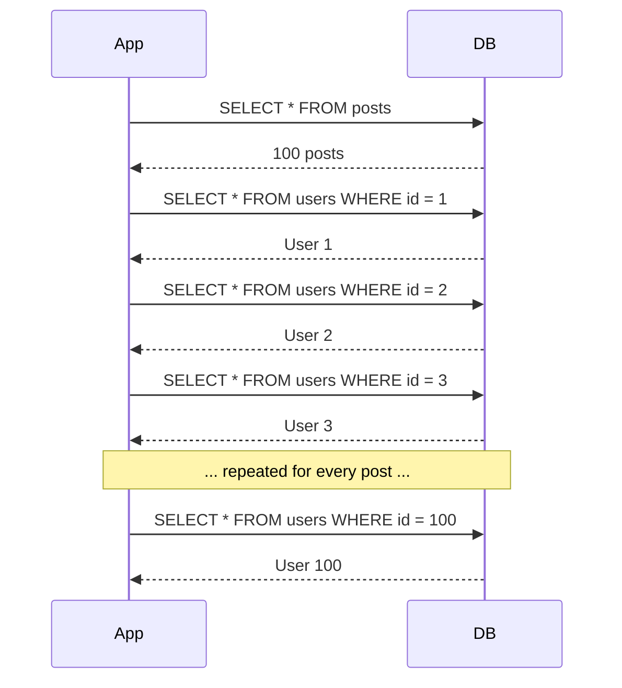
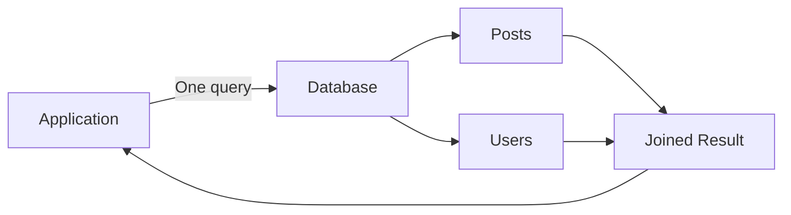

The N+1 query problem is one of those performance issues that looks harmless when you first write the code.

You fetch a list of records. Then, for each record, you fetch some related data.

The code is simple. The database, however, may end up receiving **one query to fetch the list + N additional queries to fetch related data**.

That is where the name comes from:

> **1 + N queries**

Suppose we have two tables:

```text
users
-----
id
name

posts
-----
id
title
user_id
```

Each post belongs to a user. Now imagine we want to display all posts along with the author's name. A straightforward implementation might look like this:

```python
posts = db.query("SELECT * FROM posts")

for post in posts:
    user = db.query(
        "SELECT * FROM users WHERE id = ?",
        post.user_id
    )

    print(post.title, user.name)
```

At first glance, this looks perfectly reasonable.

The first query retrieves all posts:

```sql
SELECT * FROM posts;
```

Suppose it returns 100 posts. Now the loop runs 100 times.

For every post, we execute another query:

```sql
SELECT * FROM users WHERE id = 1;
SELECT * FROM users WHERE id = 2;
SELECT * FROM users WHERE id = 3;
...
```

So the database receives:

```text
1 query → fetch posts
100 queries → fetch users

Total = 101 queries
```

That's the **N+1 query problem**.

---

### Visualizing the Problem

The application and database communicate repeatedly:



The important thing isn't just the number of queries.

It is the **repeated round trips between the application and database**.

---

### Why Is This a Problem?

You might wonder:

> "Isn't a database query very fast? Why should I care about 100 queries?"

A single query might indeed be fast.

The problem appears when the number of queries grows with the amount of data.

Imagine:

```text
10 posts      → 11 queries
100 posts     → 101 queries
1,000 posts   → 1,001 queries
10,000 posts  → 10,001 queries
```

The application has accidentally created a query count that grows linearly with the number of records.

And every query may involve:

1. Network communication (TCP handshake)
2. Connection handling
3. Query parsing/planning
4. Database execution
5. Result serialization
6. Data transfer back to the application

Even if each individual operation is inexpensive, repeating it thousands of times can become very expensive.

---

### Where Does N+1 Usually Come From?

The interesting part is that developers often don't write code thinking:

> "I am going to execute 101 database queries."

Instead, the problem is frequently hidden behind an ORM.

For example:

```python
posts = Post.objects.all()

for post in posts:
    print(post.author.name)
```

This looks innocent. But depending on the ORM configuration, this could translate into:

```sql
SELECT * FROM posts;

SELECT * FROM users WHERE id = 1;
SELECT * FROM users WHERE id = 2;
SELECT * FROM users WHERE id = 3;
...
```

The ORM is doing exactly what the code appears to ask:

1. Give me the posts.
2. For each post, give me its author.

The problem is that **the application knows it needs all the authors, but the database doesn't receive that information as one operation**.

---

### The Better Approach

Instead of asking the database for each user individually, we can fetch the required data together.

One way is to use a `JOIN`:

```sql
SELECT
    posts.id,
    posts.title,
    users.name
FROM posts
JOIN users
    ON posts.user_id = users.id;
```

Now the database can perform the relationship lookup internally.

Instead of:

```text
1 + N queries
```

we can perform:

```text
1 query
```

Conceptually:



The database is generally much better positioned to perform this kind of operation than repeatedly sending individual requests from the application.

---

### Fetch Related Data Separately

A `JOIN` isn't the only solution.

We could also fetch the posts first and then fetch all required users in one query.

For example:

```sql
SELECT * FROM posts;
```

Suppose the posts reference these users:

```text
1, 2, 5, 8
```

Instead of making four queries:

```sql
SELECT * FROM users WHERE id = 1;
SELECT * FROM users WHERE id = 2;
SELECT * FROM users WHERE id = 5;
SELECT * FROM users WHERE id = 8;
```

we can make one:

```sql
SELECT *
FROM users
WHERE id IN (1, 2, 5, 8);
```

Now we have:

```text
1 query → posts
1 query → users

Total = 2 queries
```

This is often called **eager loading** or **batch loading**, depending on the ORM and implementation.

---

### Lazy loading

With lazy loading, related data is fetched **only when you access it**.

For example:

```python
posts = get_posts()

for post in posts:
    print(post.author.name)
```

The `author` might not actually be loaded when `posts` is retrieved.

It is loaded when:

```python
post.author
```

is accessed. This can produce N+1 queries.

### Eager loading

With eager loading, related data is fetched **before it is accessed**.

Conceptually:

```python
posts = get_posts_with_authors()

for post in posts:
    print(post.author.name)
```

The ORM knows that authors are required and retrieves them as part of the initial operation or through a small number of additional queries.

The important distinction is:

```text
Lazy loading
    "Give me the related object when I ask for it."

Eager loading
    "I already know I'll need the related objects."
```

---

### N+1 Isn't Limited to One Relationship

The problem can become even worse with nested relationships.

Consider:

```text
User
 └── Posts
      └── Comments
```

Suppose we want:

```text
User
  └── Post
       └── Comment
```

A naive implementation might do:

```python
users = get_users()

for user in users:
    posts = get_posts(user.id)

    for post in posts:
        comments = get_comments(post.id)
```

Now we have multiple layers of database access. The number of queries can grow dramatically depending on how many users, posts, and comments exist. 

This is why N+1 is not merely about counting queries. It's about **how the query pattern scales as the amount of data increases**.

---

### How To Detect N+1?

The easiest way is to look at the SQL generated by your application. During development, enable your ORM's SQL logging or use a database monitoring tool.

You might see something like:

```text
SELECT * FROM posts;

SELECT * FROM users WHERE id = 17;
SELECT * FROM users WHERE id = 23;
SELECT * FROM users WHERE id = 42;
SELECT * FROM users WHERE id = 51;
SELECT * FROM users WHERE id = 17;
...
```

That repeating pattern is a strong signal.

You should ask:

> "Why am I executing essentially the same query once for every object?"

A useful rule of thumb is:

```text
Query count should usually depend on the operation,
not directly on the number of returned objects.
```

For example:

```text
100 posts → 101 queries   (incorrect)

100 posts → 2 queries     (correct)
```

This isn't an absolute law—some operations legitimately require many queries—but it is a useful warning sign.

---

### It May Work Fine in Development

N+1 problems are particularly dangerous because they can remain invisible for a long time.

Suppose your development database contains:

```text
20 posts
```

Your application executes:

```text
21 queries
```

You probably won't notice. Then production grows to:

```text
20,000 posts
```

Suddenly:

```text
20,001 queries
```

are being generated for the same request. The code didn't change. **The amount of data did.**

That's why performance testing with realistic data sizes matters.

---

### Does Every N+1 Need to Be Fixed?

Not necessarily. Suppose you have:

```text
5 records
```

and an additional five queries take practically no measurable time. Rewriting the code might not provide meaningful value.

The important question isn't:

> "Does this code technically have N+1?"

It is:

> "Is this query pattern causing unnecessary work or latency at the scale that matters?"

For a small dataset, the difference may be irrelevant. For thousands or millions of records, it can become a serious bottleneck.

---

### Practical Mental Model

Whenever you write code that looks like this:

```python
items = fetch_items()

for item in items:
    related = fetch_related(item.id)
```

pause for a moment.

Find out:

> **"Is `fetch_related()` making a database query?"**

If the answer is yes, you may have an N+1 problem.

Then:

```text
Can I JOIN the data?

Can I eager-load the relationship?

Can I batch the related IDs?

Can I fetch everything I need in fewer queries?
```

---

### Thoughts 

The N+1 query problem isn't fundamentally about ORMs. It's about **query patterns**.

The pattern looks like this:

```text
Fetch N records
       ↓
For each record
       ↓
Fetch related data
       ↓
Repeat N times
```

Which produces:

```text
1 + N database operations
```

The solution is usually to change the shape of the data access:

```text
Fetch the records
       +
Fetch the required related data in bulk
       ↓
Process everything in memory
```

Or let the database perform the relationship through a `JOIN`.

**Don't make the database rediscover the same relationship one record at a time when you already know you need the relationship for the entire collection.**