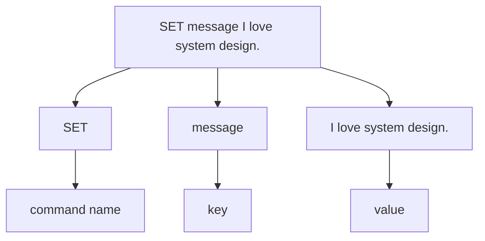
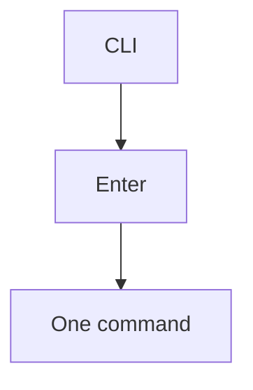
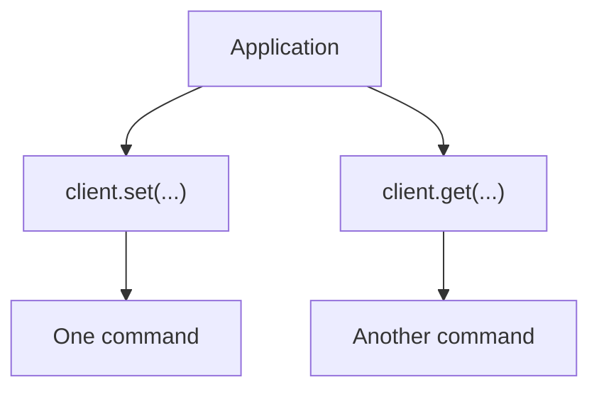
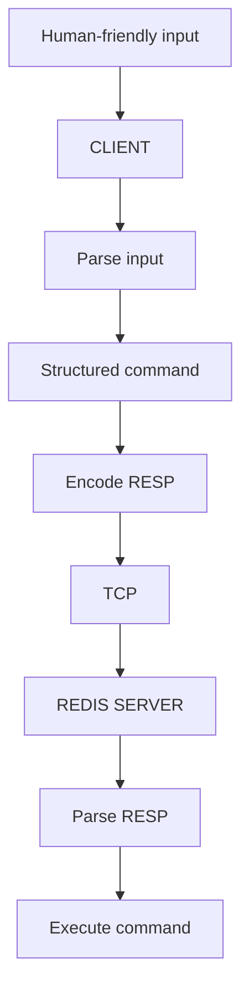

Before diving into knowing resp, I think we should know why resp was needed.

RESP is a protocol heavily used by Redis, worry not even if you never heard of Redis. I am giving you a brief on that. 

### What is redis?

Redis (Remote Dictionary Server) is an open-source, in-memory data store designed to provide extremely fast data access. Unlike traditional databases that primarily keep data on disk, Redis keeps its working dataset in RAM, allowing applications to read and write data with very low latency.

At its core, Redis stores data as key–value pairs, where each key maps to a value. But Redis is much more than a simple key–value store, it natively supports rich data structures such as strings, lists, sets, sorted sets, hashes, streams, bitmaps, and probabilistic data structures.

Because of its speed and flexible data model, Redis is commonly used as a cache, session store, message broker, real-time data store, rate limiter, leaderboard system, and coordination mechanism.

Imagine an e-commerce website. When you open the homepage, the site may need:
- your login status
- your cart items
- recently viewed products
- your search history

Instead of asking the main database every time, the app can ask Redis first and it gives the answer very fast.

So Redis helps applications store and fetch data much faster.

### Why do we need redis in the first place?

We need Redis because normal databases are not always the fastest choice for every task.

A traditional database (a system that stores data permanently on disk) is great for keeping records safely, but it can be slower when the same data is requested again and again.

Redis is useful when:
- data is needed very often
- speed matters more than long-term storage
- the same information is read repeatedly
- temporary data needs to be stored for a short time

Suppose a blog website has 1 million visitors.

If every visitor requests the same homepage data from the main database, the database gets overloaded.

Instead, the app can store that homepage data in Redis for a short time (re-cache the page when it becomes stale). Then all visitors get the data quickly without putting too much pressure on the main database.

In a login system, Redis can store:

- OTP attempts
- session data (temporary login information)
- rate limits (limits on how many times something can happen)

This makes the system faster and easier to control.

### How is redis so fast?

Redis is fast mainly because it keeps data in ram.

A normal database usually stores data on a disk, and disk access is slower than RAM access. Redis avoids that delay for most operations.

Redis is also fast because:

- it uses simple data structures (like strings, lists, sets, and hashes)
- it does not spend much time on complex processing
- it is designed for quick read and write operations
- many operations happen in memory instead of waiting for disk access

Think of two ways to find a book:

- In a library storage room, you may need time to search shelves, open boxes, and check records.
- On your study table, the book is already in front of you.

Redis works more like the study table. The data is already close and ready to use.

If an app needs to check a user’s session 100 times, Redis can do it quickly because the session data is already in memory. The app does not need to wait for the disk every time.

The topic "How Redis is so fast" is a rabbit hole itself, we can keep digging.

---

### Dive into RESP

Think of it this way: we have spent months building Redis from scratch. We have finally built this amazing service called Redis, and it is running on a server somewhere in the world.

But now we need a way for developers to communicate with that server.

So, we need to design and build clients that can talk to Redis. We could build a **command-line client (CLI)** for developers to interact with Redis directly from the terminal, and **SDKs** for different programming languages so applications can communicate with Redis programmatically.

> Users don’t directly interact with memory. They use either SDKs (such as the redis npm package) or a CLI

For now, let's focus on building the CLI.

The CLI needs to follow a well-defined protocol that specifies how commands should be structured, sent to the Redis server, and how responses should be received before the client can proceed with the next command.

In other words, both the CLI and the Redis server need to agree on a common language for communicating with each other.

#### The Parsing Problem

Now, suppose a developer types the following command into the CLI terminal:

```text
SET name "shohaum"
```

This command tells Redis to store the value `"shohaum"` under the key `"name"`.

But now we have a question: **Should we send this command to the Redis server exactly as the developer typed it, or do we need to parse and preprocess it before sending it?**

If preprocessing is required, what exactly should it handle? The CLI needs to identify the **command** (`SET`), separate its **arguments** (`name` and `"shohaum"`), correctly handle **spaces and quoted values**, and then represent this information in the format expected by the Redis server.

So, the CLI cannot simply treat the entire input as an arbitrary string. It first needs to understand the structure of the command and then encode that structure according to the communication protocol used by Redis.

#### Problems with Plain Text

At first, sending commands as plain text seems perfectly reasonable. After all, a command like:

```text
SET name Shohaum
```

is easy for both humans and computers to understand.

But as soon as we start thinking about everything Redis needs to support, plain text quickly becomes problematic.

1. **How do we separate arguments?**

    Consider:

    ```text
    SET message Hello World
    ```

    If the server simply splits the command by spaces, it gets:

    ```text
    ["SET", "message", "Hello", "World"]
    ```

    But what does that mean?

    Is the value:

    ```text
    "Hello"
    ```

    or:

    ```text
    "Hello World"
    ```

    Now consider a more obvious example:

    ```text
    SET message "I love system design."
    ```

    A simple space-based parser would produce:

    ```text
    ["SET", "message", "\"I", "love", "system", "design\""]
    ```

    The server now needs additional rules for quotes, escaping, and special characters just to determine where the value begins and ends.

    We need a format where **argument boundaries are explicit**, rather than something the server has to guess from the contents of the data.

    ---

2. **How many arguments does a command have?**

    Not every Redis command takes the same number of arguments.

    For example:

    ```text id="g2d8zq"
    GET name
    ```

    has one argument:

    ```text
    (name)
    ```

    While:

    ```text id="5fjx3p"
    SET name Shohaum
    ```

    has two:

    ```text
    (name, Shohaum)
    ```

    And some commands can accept many arguments:

    ```text id="n7v3xk"
    MSET name Shohaum age 23 city Kolkata
    ```

    So the server cannot simply assume that every command contains a fixed number of arguments.

    It needs a reliable way to determine:

    > **Where does this command's list of arguments end?**

    Without explicit information about the number of arguments, the server cannot always tell whether the bytes it has received belong to the current command or are the beginning of the next one.

    We therefore need a protocol that can explicitly describe the **structure of a command**, including how many arguments it contains.


3. **What if the value contains arbitrary bytes?**

    Redis strings are **binary-safe**. A value doesn't have to be human-readable text. It can contain serialized objects, encoded data, or arbitrary bytes—including bytes such as:

    ```text
    0x00
    0x0A   (\n)
    0x0D   (\r)
    ```

    For example:

    ```text
    SET file <binary_data>
    ```
    A binary data might contain `\r`, or `\n`.

    If our protocol relies on characters such as spaces, `\r`, or `\n` to separate data, those characters can also appear **inside the data itself**.

    The protocol therefore cannot assume that every byte it encounters is text or that certain characters are safe delimiters.

    We need a way to tell the server that **“These next N bytes belong to this argument, regardless of what those bytes contain.”**

    ---

4. **How does the server know where the request ends?**

    This becomes even more important when values are large.

    Suppose we want to send:

    ```text
    SET big_key <10 MB of data>
    ```

    The server cannot assume that one `read()` call will contain the entire command.

    TCP provides a **continuous byte stream**, not a message-based protocol. The 10 MB of data might arrive in many pieces:

    ```text
    Chunk 1 → SET big_key Hell
    Chunk 2 → oooooooo...
    Chunk 3 → oooooooo...
    ...
    Chunk N → ....(remaining data)
    ```

    The server therefore needs to distinguish between:

    > **“I haven't received the complete request yet.”**

    and

    > **“I have received the complete request; execute it.”**

    A plain-text protocol with no explicit framing makes this difficult.

    ---

5. **TCP packet boundaries cannot be used as message boundaries**

    This is an important consequence of using TCP.

    Suppose the client sends:

    ```text
    SET name Shohaum
    ```

    The application sends those bytes to the TCP connection as one logical request. But the server might receive them in pieces:

    ```text
    SE
    T name Shohau
    m
    ```

    Or:

    ```text
    SET name
    Shohaum
    ```

    Or the entire request might arrive at once.

    The server **cannot rely on these chunks to determine where commands or arguments begin and end**. TCP guarantees the ordered byte stream, but it does not preserve the boundaries of the application's writes.

    So a parser must be able to consume data incrementally:

    ```mermaid
    flowchart TD
    A[Receive bytes] --> B{Do we have enough data?}
    B -->|No| C[Wait for more]
    C --> A
    B -->|Yes| D[Parse request]
    D --> E[Execute]
    ```

    This means our protocol needs a proper framing mechanism that works regardless of how the bytes are split across the network.

    ---

6. **What happens if the connection breaks halfway through?**

    Imagine the client is sending a large value:

    ```text
    SET big_key Helloooooooooooooooo...
    ```

    but the connection suddenly drops.

    The server may have received only part of the data.

    Without explicit framing, it can be difficult to determine whether:

    * the request is complete, or
    * more data was supposed to arrive.

    A well designed protocol should make incomplete requests detectable so that the server can **wait for more data rather than accidentally interpreting partial data as a complete command**.

    ---

7. **Large values should not require the server to guess or repeatedly scan data**

    Consider:

    ```text
    SET key <10 MB value>
    ```

    If the protocol is based on searching for delimiters such as spaces or newlines, the server may need to scan through large amounts of data to determine where an argument ends which will take O(n) time.

    More importantly, the server needs to know **exactly how many bytes belong to the value**.

    If the protocol tells the server:

    ```text
    The next argument contains 10,485,760 bytes.
    ```

    the server can read exactly that many bytes.

    This is much more precise than:

    > “Keep reading until you encounter some character that might mean the value has ended.”

    ---

8. **What about the server's response?**

    So far, we have only considered the request:

    ```mermaid
    flowchart LR
    A[Client] --> B[Redis]
    ```

    But Redis also needs to send a response back:

    ```mermaid
    flowchart RL
    A[Redis] --> B[Client]
    ```

    And Redis commands can produce very different kinds of responses.

    For example:

    ```text
    GET name
    ```

    might return a string:

    ```text
    Shohaum
    ```

    While another command might return an integer, a list of values, a null value, or an error.

    If the server simply sends plain text, the client has no reliable way to determine **what type of response it received** or how to interpret it.

    So our protocol needs to define not only how requests are encoded, but also **how different types of responses are represented**.

    ---

### So, What Do We Need?

All of these problems lead us to the same conclusion:

**Plain text is not enough to reliably represent structured Redis commands and arbitrary data over a TCP byte stream.**

We need a protocol that gives the Redis server and client an unambiguous way to communicate. It should explicitly tell us:

* **How many arguments a command contains**
* **Where each argument begins and ends**
* **How many bytes each argument contains**
* **How to safely represent arbitrary binary data**
* **Whether a complete request has been received**
* **How different types of server responses should be represented**

Most importantly, the protocol should not have to **guess** where commands, arguments, or data end based on the contents of the data itself.

Instead, the structure should be encoded directly into the message.

In other words, we need a **serialization protocol**, a well defined format for turning structured commands and responses into bytes that can be sent over the network and reconstructed reliably on the other side.

And this is exactly where **RESP (Redis Serialization Protocol)** comes into the picture.

### Let's Solve the Problem from First Principles

We now understand that the real problem is **how to parse and represent the command reliably** before sending it to the Redis server.

A plain text representation creates several problems that we need to solve:

1. What if the data contains spaces?
2. What about binary data?
3. How do we define clear boundaries between arguments?
4. How do we handle a command arriving in multiple TCP chunks?
5. What happens when the data contains the same characters we are using as delimiters?
6. How do we efficiently process large values?
7. What happens if the connection is interrupted and only part of the command arrives?
8. How do we represent different types of server responses?

Let's solve these problems one at a time.

For simplicity, we have this command:

```text id="3xq2mv"
SET message I love system design.
```

let's first break our `SET` command into three parts:

* **Command name**
* **Key**
* **Value**

So:



In this example:

| Part | Value |
|---|---|
| Command name | `SET` |
| Key | `message` |
| Value | `I love system design.` |

Here, **`message` and `I love system design.` are the arguments to the `SET` command**.

However, this is only a simplification for our `SET` example. **Redis commands do not all follow the same `command → key → value` structure.** Some commands take one argument, some take multiple arguments, and some have completely different argument structures.

Our real goal is therefore to design a representation that can describe **any command and its arguments unambiguously**.

Let's start by solving the first problem.

---

### Approaches

Now that we understand the problem, let's try to solve it from first principles.

Our command is:

```text
SET message I love system design.
```

We need a way for the Redis server to reliably determine:

```text
Command → SET
Key     → message
Value   → I love system design.
```

Let's explore some possible approaches.

1. **Can we use a separator?**

    The simplest idea is to choose a special character as a separator.

    For example, let's use `|`:

    ```text
    SET | message | I love system design.
    ```

    Now the server can simply split the input using `|`:

    ```text
    ["SET", "message", I love system design.]
    ```

    That looks great.

    But what happens if the actual value contains `|`?

    ```text
    SET | message | I love system | design.
    ```

    Now splitting on `|` gives us:

    ```text
    ["SET", "message", "I love system ", " design."]
    ```

    The server can no longer tell whether `|` is:

    * a separator created by the protocol, or
    * part of the actual data.

    And this problem exists for **any separator we choose**.

    If we choose `#`, the data might contain `#`.

    If we choose `,`, the data might contain `,`.

    If we choose a newline, the data might contain a newline.

    **Any delimiter can eventually appear inside the data itself.**

    So a simple separator is not enough.

    ---

2. **What if we use quotes?**

    We could say that values are always enclosed in double quotes:

    ```text
    SET | message | "I love system design."
    ```

    Now the server knows that everything between the quotes belongs to the value.

    But what if the value itself contains quotes?

    ```text
    SET | message | "He said "Hello" to me"
    ```

    Where does the value actually end?

    The parser now needs additional rules:

    * Should quotes inside the value be escaped?
    * How do we represent an escaped quote?
    * What happens when a backslash itself appears in the data?
    * How do we handle malformed or incomplete input?

    We have started with a simple delimiter and are gradually building a **string parsing language** around it.

    This approach can work for text, but it becomes increasingly complicated as the data becomes more complex.

    ---

3. **What if we escape special characters?**

    We could introduce an escaping mechanism.

    For example:

    ```text
    SET | message | "He said \"Hello\" to me"
    ```

    Now `\"` means:

    > "This quote is part of the data, not the end of the string."

    This solves the immediate problem.

    But our parser now has to understand escape sequences:

    ```text
    \"   → quote
    \\   → backslash
    \n   → newline
    ...
    ```

    And we have to answer another question:

    **What happens when the data contains arbitrary binary bytes?**

    Redis is binary safe. A value can contain bytes such as:

    ```text
    00 FF A1 7C 0A ...
    ```

    Those bytes don't necessarily have a meaningful textual representation, and some of them may be our chosen delimiters or escape characters.

    We could keep adding more escaping rules, but the protocol is becoming increasingly complicated.

    ---

### But There Is Another Problem: TCP

So far, we've been thinking about parsing the command as if the entire command arrives at the Redis server at once.

But that's not how TCP works.

Suppose the client sends:

```text
SET | message | I love system design.
```

The Redis server might receive the bytes in chunks such as:

```text
Chunk 1: SET | mess
Chunk 2: age | I love sys
Chunk 3: tem design.
```

Or:

```text
Chunk 1: SET |
Chunk 2: message | I love
Chunk 3: system design.
```

Or the entire command might arrive in one read.

**TCP is a byte stream, not a message based protocol.**

It guarantees that bytes arrive **in order**, but it does not preserve the boundaries of the messages that the client originally sent.

So when Redis receives:

```text
SET | mess
```

it cannot assume that this is the complete request.

It has to ask:

> **Have I received the entire command, or is more data coming?**

Then it receives:

```text
age | I love sys
```

Still incomplete.

Finally:

```text
tem design.
```

Now the command is complete.

This means our server-side parser must be able to:

* maintain state across multiple reads,
* handle partial commands,
* detect complete commands,
* and correctly continue parsing when the next command arrives.

And this becomes even more complicated when multiple commands are sent over the same connection:

```text
SET message "hello"
SET name "Shohaum"
```

The server needs to know exactly where the first command ends and where the second command begins.

### Our Simple Parsing Strategy Is Growing Complicated

At this point, we could keep adding rules:

```text
Use | as a separator.
Use quotes for values.
Escape quotes inside values.
Maintain parser state across TCP chunks.
Detect command boundaries.
Handle different numbers of arguments.
Handle binary data.
Handle incomplete requests.
```

But notice what is happening.

We started with a simple requirement:

> **Send a command from the client to the Redis server.**

And we are ending up with a complicated collection of special cases just to determine **where commands and arguments begin and end**.

The fundamental problem is becoming clear.

### We are trying to infer structure from the data.

We are asking the server to look at a stream of bytes and figure out:

```text
Where does the command start?
Where does the command end?
How many arguments are there?
Where does each argument end?
Is this character part of the data or part of the protocol?
Have I received the complete request?
```

Instead of making the server **guess**, what if we simply **encode this information explicitly**?

For example, what if the message itself could tell Redis:

```text
There are 3 elements.
The first element contains 3 bytes.
The second element contains 7 bytes.
The third element contains 21 bytes.
```

Now Redis wouldn't need to guess where the data ends.

It would already know.

**This is the direction we need to take.**

---

### Fixing the Problems

Now we know what we don't want:

* We don't want to rely on spaces to separate arguments.
* We don't want special characters to act as fragile delimiters.
* We don't want to interpret the contents of the data.
* We need to handle commands arriving in multiple TCP chunks.
* We need to know exactly where a command and each argument end.
* We need to support commands with different numbers of arguments.
* And we need to support arbitrary binary data.

So let's solve these problems one by one.

1. **Treat the command as a list**

    Instead of thinking about the command as a piece of text:

    ```text
    SET message I love system design.
    ```

    let's think of it as **structured data**:

    ```text
    ["SET", "message", I love system design.]
    ```

    Now we are explicitly saying:

    ```text
    *3
    SET
    message
    I love system design.
    ```

    The `*3` means:

    > **This command contains 3 elements.**

    We no longer need to determine the number of arguments by looking for spaces.

    But we still have a problem.

    The server knows there are three elements, but **how does it know where each element ends?**

    ---

2. **Add the length before every element**

    Let's add the length of every element before the actual data:

    ```text
    *3
    $3
    SET
    $7
    message
    $21
    I love system design.
    ```

    Here, `$` indicates that what follows is a **bulk string**, and the number after `$` tells Redis exactly how many bytes belong to that string.

    So Redis can read:

    ```text
    $3
    SET
    ```

    Meaning:

    > Read exactly 3 bytes.

    Then:

    ```text
    $7
    message
    ```

    Meaning:

    > Read exactly 7 bytes.

    And finally:

    ```text
    $21
    I love system design.
    ```

    Meaning:

    > Read exactly 21 bytes.

    Now the server doesn't need to search for a delimiter to determine where the value ends.

    It already knows.

    This is a fundamental shift in how we parse data:

    > **Don't search for the end of the data. Tell the parser how much data to read.**

    ---

3. **Ignore the content completely**

    Remember our earlier problem with quotes?

    We had:

    ```text
    "I love system design."
    ```

    With a quote based approach, the parser would need to understand where the quotes begin and end, and eventually deal with escaping if the value itself contained quotes.

    But with length based encoding, none of that matters.

    We can simply send:

    ```text
    $23
    "I love system design."
    ```

    Redis doesn't need to understand what the data means.

    The `.` is just a character. Spaces are just characters. Quotes, if present, would just be characters too.

    There is no special interpretation.

    The server simply follows the instruction:

    > **Read the next 23 bytes.**

    This makes the protocol much simpler and, importantly, makes it **binary safe**.

    ---

4. **Length based reading works with TCP streams**

    Now let's bring TCP back into the picture.

    Suppose our encoded command arrives in several chunks:

    ```text
    Chunk 1: *3\r\n$3\r\nSE
    Chunk 2: T\r\n$7\r\nmess
    Chunk 3: age\r\n$21\r\nI love
    Chunk 4:  system design.\r\n
    ```

    Do not worr about `\r` and `\n`. We will come to that.

    The server doesn't need to care how TCP divided the data.

    It sees:

    ```text
    *3
    ```

    So it knows:

    > There are 3 elements in this command.

    Then it sees:

    ```text
    $3
    ```

    So it knows:

    > I need 3 bytes for the first element.

    It has only received:

    ```text
    SE
    ```

    That's 2 bytes.

    So it simply waits for one more byte.

    The next chunk begins with:

    ```text
    T
    ```

    Now it has:

    ```text
    SET
    ```

    Exactly 3 bytes.

    It can continue.

    The same process happens for the key and the value.

    The important point is that the parser doesn't need to guess whether a TCP chunk contains a complete command.

    **TCP chunks are irrelevant to the protocol.**

    The protocol itself tells Redis how much data it needs before it can continue.

    ---

5. **The element count defines the command boundary**

    Now consider multiple commands being sent over the same connection:

    ```text
    SET message "hello"
    GET message
    ```

    TCP might deliver them together:

    ```text
    *3\r\n$3\r\nSET\r\n$7\r\nmessage\r\n$5\r\nhello\r\n*2\r\n$3\r\nGET\r\n$7\r\nmessage\r\n
    ```

    There is no need for a special "end of command" character.

    The first command begins with:

    ```text
    *3
    ```

    That means:

    > Read exactly 3 elements.

    After Redis has consumed those three elements, the first command is complete.

    The next bytes begin with:

    ```text
    *2
    ```

    which means:

    > The next command contains 2 elements.

    So Redis can parse:

    ```text
    Command 1 (SET, message, hello)

    Command 2 (GET, message)
    ```

    The **array count provides the structural boundary** between commands.

    ---

6. **Variable numbers of arguments**

    We also need to handle the fact that Redis commands don't all have the same number of arguments.

    For example:

    ```text
    PING
    ```

    contains one element:

    ```text
    *1
    $4
    PING
    ```

    While:

    ```text
    GET message
    ```

    contains two:

    ```text
    *2
    $3
    GET
    $7
    message
    ```

    And:

    ```text
    SET message I love system design. EX 10 NX
    ```

    contains six elements:

    ```text
    *6
    $3
    SET
    $7
    message
    $21
    I love system design.
    $2
    EX
    $2
    10
    $2
    NX
    ```

    The server doesn't need to hardcode:

    > "`SET` always has exactly two arguments."

    Instead, the encoded command tells it exactly how many elements to read.

    This makes the protocol flexible enough to represent commands with different argument counts.

    ---

7. **Length based encoding makes the protocol binary-safe**

    Now consider a value containing arbitrary bytes:

    ```text
    \x00\xFFhello\nworld
    ```

    A delimiter based protocol could easily get confused if the data contains spaces, newlines, quotes, or the delimiter itself.

    But with length based encoding, none of those bytes have any special meaning.

    The protocol simply says:

    ```text
    $14
    <14 raw bytes>
    ```

    Redis reads exactly 14 bytes.

    It doesn't matter whether those bytes are:

    * readable text,
    * whitespace,
    * quotes,
    * newlines,
    * null bytes,
    * or completely arbitrary binary data.

    The **length defines the boundary**, not the contents.

    ---

### We Have a Much Better Representation

Putting everything together, our original command:

```text
SET message I love system design.
```

can be represented structurally as:

```text
*3
$3
SET
$7
message
$21
I love system design.
```

Now look at what we've achieved.

`*3` tells Redis:

> **There are 3 elements.**

Each `$<length>` tells Redis:

> **Read exactly this many bytes.**

The contents of those bytes don't matter to the parser.

There is no need to:

* split on spaces,
* search for a delimiter,
* interpret quotes,
* escape arbitrary data,
* guess where a value ends,
* or rely on TCP packet boundaries.

We have moved from:

> **"Look at the text and figure out what it means."**

to:

> **"The message explicitly describes its own structure."**

And that's the key idea behind **RESP — Redis Serialization Protocol**.


### But We Still Have a Problem

We've made significant progress.

Our command:

```text
SET message I love system design.
```

can now be represented as:

```text
*3
$3
SET
$7
message
$21
I love system design.
```

Let's verify the lengths:

```text
SET                    → 3 bytes
message                → 7 bytes
I love system design.  → 21 bytes
```

So:

* `*3` tells us that there are 3 elements.
* `$3` tells us that the first element contains 3 bytes.
* `$7` tells us that the second element contains 7 bytes.
* `$21` tells us that the third element contains 21 bytes.

But there is still a problem.

**How does Redis know where these numbers end?**

---

1. **Where does the number end?**

    Imagine that, instead of putting each piece on its own line, we simply concatenate everything:

    ```text
    *3$3SET$7message$21I love system design.
    ```

    Now look at the beginning:

    ```text
    *3
    ```

    How does the parser know that `3` is the complete number?

    It could be:

    ```text
    *3
    ```

    or:

    ```text
    *32
    ```

    or:

    ```text
    *312
    ```

    The same problem exists here:

    ```text
    $21I love system design.
    ```

    Where does the length `21` end, and where does the actual data begin?

    We could make the parser inspect each character and decide where the number ends, but we would still need some rule that tells it:

    > **"The metadata ends here."**

    So we need a reliable boundary between **protocol metadata** and **data**.

    ---

2. **Let's introduce `\r\n`**

    A natural solution is to use:

    ```text
    \r\n
    ```

    This is called **CRLF**, which stands for:

    * **CR** — Carriage Return (`\r`)
    * **LF** — Line Feed (`\n`)

    CRLF has been widely used as a line terminator in network protocols, making it a natural choice for terminating protocol metadata.

    But what exactly are `\r` and `\n`?

    Let's understand them first.

    ---

    #### What is `\r`?

    `\r` is the **Carriage Return (CR)** control character.

    Historically, a carriage return meant:

    > Move the cursor back to the beginning of the current line.

    Think of a cursor as the position where the next character will be written:

    ```text
    Hello|
    ```

    The `|` represents the cursor.

    As we type:

    ```text
    H|
    He|
    Hel|
    Hell|
    Hello|
    ```

    the cursor moves forward after every character.

    Now consider:

    ```text
    Hello\rWorld
    ```

    #### Step 1: Write `Hello`

    ```text
    Hello|
    ```

    #### Step 2: Encounter `\r`

    Carriage Return moves the cursor back to the beginning of the same line:

    ```text
    |Hello
    ```

    Notice something important:

    **`\r` does not delete `Hello`.**

    It only moves the cursor.

    #### Step 3: Write `World`

    The characters are written starting from the beginning:

    ```text
    World
    ```

    So conceptually:

    ```text
    Hello
    ↓
    \r
    ↓
    World
    ```

    becomes:

    ```text
    World
    ```

    because `World` overwrites the characters that were already there.

    Consider another example:

    ```text
    Hello\rHi
    ```

    Step 1:

    ```text
    Hello|
    ```

    Step 2 :`\r`:

    ```text
    |Hello
    ```

    Step 3: write `Hi`:

    ```text
    Hillo
    ```

    Again, `\r` itself didn't erase anything. The new characters simply overwrote the existing characters.

    ---

    #### What is `\n`?

    `\n` is the **Line Feed (LF)** control character.

    Historically, it means:

    > Move the cursor down to the next line.

    Consider:

    ```text
    Hello\nWorld
    ```

    #### Step 1: Write `Hello`

    ```text
    Hello|
    ```

    #### Step 2: Encounter `\n`

    Move to the next line:

    ```text
    Hello
    |
    ```

    #### Step 3: Write `World`

    ```text
    Hello
    World|
    ```

    So:

    ```text
    Hello\nWorld
    ```

    conceptually produces:

    ```text
    Hello
    World
    ```

    ---

    #### Now combine them: `\r\n`

    When we put them together:

    ```text
    \r\n
    ```

    we get:

    > **Carriage Return + Line Feed**

    or **CRLF**.

    Let's see what happens step by step:

    ```text
    Hello\r\nWorld
    ```

    #### Step 1: Write `Hello`

    ```text
    Hello|
    ```

    #### Step 2: `\r`

    Move the cursor back to the beginning of the current line:

    ```text
    |Hello
    ```

    #### Step 3: `\n`

    Move down to the next line:

    ```text
    Hello
    |
    ```

    #### Step 4: Write `World`

    ```text
    Hello
    World|
    ```

    So CRLF effectively represents a **new line**.

    But there is an important distinction for our Redis protocol:

    > We are not using `\r\n` because we need to move a terminal cursor.

    We are using it because `\r\n` is a **well defined two-byte sequence that can mark the end of a protocol line**.

    That gives our parser a precise boundary.

    ---

3. **Use CRLF to terminate metadata**

    Let's take our representation:

    ```text
    *3
    $3
    SET
    $7
    message
    $21
    I love system design.
    ```

    and explicitly terminate each protocol line with CRLF:

    ```text
    *3\r\n
    $3\r\n
    SET\r\n
    $7\r\n
    message\r\n
    $21\r\n
    I love system design.\r\n
    ```

    Now the parser has a simple rule:

    > **For protocol lines, keep reading until `\r\n` is encountered.**

    So when Redis receives:

    ```text
    *3\r\n
    ```

    it can identify:

    ```text
    *3
    ```

    as one complete protocol line.

    It then interprets:

    ```text
    *3
    ```

    as:

    > This is an array containing 3 elements.

    Next it receives:

    ```text
    $3\r\n
    ```

    It reads:

    ```text
    $3
    ```

    and understands:

    > The next element is a bulk string containing 3 bytes.

    It then reads exactly 3 bytes:

    ```text
    SET
    ```

    The same process continues for the remaining elements.

    Now we have a clean separation between **metadata** and **data**.

    ---

4. **Why not just use the length?**

    You might now think:

    > "We already have the length. Why do we need CRLF?"

    Consider:

    ```text
    $21I love system design.
    ```

    Redis can certainly understand that `$21` means the next 21 bytes are the data.

    But there is still a small parsing problem:

    **Where does the length field end?**

    The parser needs to know where:

    ```text
    $21
    ```

    ends and where:

    ```text
    I love system design.
    ```

    begins.

    CRLF gives us that boundary:

    ```text
    $21\r\n
    I love system design.
    ```

    Now the parser can follow a deterministic procedure:

    1. Read bytes until `\r\n`.
    2. Interpret the bytes before `\r\n` as metadata.
    3. Parse `$21` and extract the length `21`.
    4. Read exactly 21 bytes from the stream.
    5. Those 21 bytes are the value.

    So we now have **two different mechanisms doing two different jobs**:

    ```text
    CRLF tells us where the metadata ends

    Length tells us how many bytes belong to the data
    ```

    This distinction is fundamental.

    **CRLF defines the boundary of the metadata.**

    **The length defines the boundary of the data.**

    ---

5. **What happens if TCP splits `\r\n`?**

    We still have to deal with TCP.

    Suppose Redis expects:

    ```text
    $21\r\n
    ```

    But the bytes arrive in separate TCP reads:

    ```text
    Chunk 1:
    $21\r

    Chunk 2:
    \n
    ```

    The parser receives:

    ```text
    $21\r
    ```

    It sees `$21`, but it has not yet received the complete CRLF sequence.

    So it waits for more data.

    Then the next chunk arrives:

    ```text
    \n
    ```

    Now the parser has:

    ```text
    $21\r\n
    ```

    The metadata line is complete.

    It can parse the length:

    ```text
    21
    ```

    and then read exactly 21 bytes for the value.

    The same thing can happen with the array header:

    ```text
    Chunk 1: *
    Chunk 2: 3\r
    Chunk 3: \n
    ```

    The parser simply maintains its state until the complete header arrives.

    This is why we cannot treat every TCP `read()` as a complete message.

    A single read might contain:

    * part of a header,
    * a complete header,
    * part of a value,
    * an entire value,
    * or even multiple commands.

    **TCP gives us a stream of bytes. Our protocol gives that stream structure.**

    ---

6. **Now the parser has a deterministic strategy**

    We can now describe the parsing process precisely.

    Our encoded command is:

    ```text
    *3\r\n
    $3\r\n
    SET\r\n
    $7\r\n
    message\r\n
    $21\r\n
    I love system design.\r\n
    ```

    #### Step 1: Read the array header

    ```text
    *3\r\n
    ```

    Read until CRLF.

    Result:

    ```text
    *3
    ```

    Interpret it as:

    > An array containing 3 elements.

    #### Step 2: Read the first element's header

    ```text
    $3\r\n
    ```

    Read until CRLF.

    Result:

    ```text
    $3
    ```

    Interpret it as:

    > The next element contains 3 bytes.

    #### Step 3: Read exactly 3 bytes

    ```text
    SET
    ```

    #### Step 4: Read the next header

    ```text
    $7\r\n
    ```

    Interpret it as:

    > The next element contains 7 bytes.

    Read exactly 7 bytes:

    ```text
    message
    ```

    #### Step 5: Read the next header

    ```text
    $21\r\n
    ```

    Interpret it as:

    > The next element contains 21 bytes.

    Read exactly 21 bytes:

    ```text
    I love system design.
    ```

    The parser never needs to guess where the value ends.

    It never needs to search for spaces inside the value.

    It never needs to interpret quotes.

    It simply follows explicit instructions encoded in the message.

    ---

### The Protocol Is Starting to Take Shape

Our original command:

```text
SET message I love system design.
```

has now become:

```text
*3\r\n
$3\r\n
SET\r\n
$7\r\n
message\r\n
$21\r\n
I love system design.\r\n
```

Notice how the two ideas work together:

| Part | Meaning | Example |
|---|---|---|
| Length | Number of bytes in the data | `21` |
| CRLF | Marks the end of the metadata | `\r\n` |
| Metadata | Contains the length information | `$21\r\n` |
| Actual data | The actual value being sent | `I love system design.` |

**CRLF tells us where the metadata ends.**

**The length tells us exactly how many bytes belong to the data.**

This gives the Redis parser something it didn't have before, an **explicit structure.**

We are no longer asking the server to guess where things end.

We are telling it exactly where they end.

And now we're very close to the core idea behind **RESP — Redis Serialization Protocol**.

### One Question Remains

At this point, you might have an important question:

> **Something has to convert the human readable command into RESP, right?**

If so, doesn't that thing face all the same parsing problems we were trying to solve?

The answer is **yes, but there is an important distinction.**

That "something" is the **client**.

And the client is not trying to parse an arbitrary, continuous stream of commands from the network. It receives commands as **individual inputs** and converts each command into RESP.

Let's look at the two common scenarios.

---

1. **Interactive client — `redis-cli`**

    Suppose you're using `redis-cli`.

    You type:

    ```text
    SET name shohaum
    ```

    and press **Enter**.

    For an interactive CLI, pressing Enter tells the client:

    > **This line is one complete command.**

    So internally, the client has:

    ```text
    Command 1
    "SET name shohaum"
    ```

    The client can now parse that input into its individual arguments:

    ```text
    ["SET", "name", "shohaum"]
    ```

    and encode those arguments into RESP:

    ```text
    *3\r\n
    $3\r\n
    SET\r\n
    $4\r\n
    name\r\n
    $7\r\n
    shohaum\r\n
    ```

    Then you enter another command:

    ```text
    GET name
    ```

    and press Enter again.

    The client treats this as a **new command**:

    ```text
    Command 2
    "GET name"
    ```

    and converts it into:

    ```text
    *2\r\n
    $3\r\n
    GET\r\n
    $4\r\n
    name\r\n
    ```

    So the flow is:

    ```mermaid
    flowchart TD
        A[You type a command] --> B[Press Enter]
        B --> C[CLI receives one complete input]
        C --> D[CLI parses the arguments]
        D --> E[CLI encodes them as RESP]
        E --> F[TCP connection]
        F --> G[Redis server]
    ```

    #### What about multi-word values?

    Suppose you want the value to contain spaces:

    ```text
    SET name "shohaum sarkar"
    ```

    The quotes tell the CLI:

    > **Treat everything inside these quotes as one argument.**

    So the client parses it as:

    ```text
    ["SET", "name", "shohaum sarkar"]
    ```

    rather than:

    ```text
    ["SET", "name", "shohaum", "sarkar"]
    ```

    The important point is that these quotes are **CLI input syntax**. They are not part of the RESP bulk string data itself.

    After parsing, the client sends:

    ```text
    *3\r\n
    $3\r\n
    SET\r\n
    $4\r\n
    name\r\n
    $14\r\n
    shohaum sarkar\r\n
    ```

    The quotes have served their purpose and are no longer part of the value.

    ---

2. **Programmatic clients Node.js, Python, etc.**

    The situation is even simpler when using a Redis client library from a programming language.

    You generally don't write:

    ```text
    SET name shohaum GET name
    ```

    as one giant string and ask the library to figure out where one command ends and another begins.

    Instead, you call functions provided by the client library:

    ```javascript
    client.set("name", "shohaum");

    client.get("name");
    ```

    Each function call represents a **separate Redis command**.

    The client library already knows the arguments because they are passed as separate function parameters.

    Conceptually:

    ```mermaid
    flowchart TD
        A["client.set(&quot;name&quot;, &quot;shohaum&quot;)"] --> B["[&quot;SET&quot;, &quot;name&quot;, &quot;shohaum&quot;]"]
        B --> C["RESP"]
    ```

    and:

    ```mermaid
    flowchart TD
        A["client.get(&quot;name&quot;)"] --> B["[&quot;GET&quot;, &quot;name&quot;]"]
        B --> C["RESP"]
    ```

    The library can then send the encoded commands over the TCP connection.

    So the flow becomes:

    ```mermaid
    flowchart TD
        A[Application code] --> B[Client library]
        B --> C[Structured command + arguments]
        C --> D[RESP encoding]
        D --> E[TCP]
        E --> F[Redis server]
    ```

    There is no need for the library to first interpret a large, ambiguous string containing multiple commands.

    ---

#### What if we write this?

Suppose you're imagining something like:

```text
SET name shohaum GET name INCR counter
```

and asking:

> **How does the client know where one command ends and the next command begins?**

The answer is **it doesn't have to.**

That is not the normal input model for a Redis client.

An interactive CLI typically treats each entered line as a command, while programmatic clients receive commands through structured API calls.

So:



while:



The client therefore solves a **different parsing problem** from the Redis server.

The CLI may need to parse human friendly input such as:

```text
SET name "shohaum sarkar"
```

but once it has identified the arguments, it converts them into a structured representation and then into RESP.

The Redis server, on the other hand, receives only the **RESP-encoded byte stream**. It does not need to understand spaces, quotes, or human friendly command syntax.

This separation is important:



**The client deals with human friendly input.**

**RESP deals with machine-to-machine communication.**

That's why we can have many different clients—`redis-cli`, Node.js, Python, Java, Go, and others, all communicating with the same Redis server: they simply need to produce valid RESP.

### Conclusion

So this approach is known as **Redis Serialization Protocol (RESP)**, which Redis uses to transform simple human readable commands into a structured, unambiguous, and TCP friendly format.

Instead of relying on separators, quotes, or assumptions, RESP defines everything explicitly how many arguments exist, how long each piece of data is, and where each part ends.

This removes all ambiguity from parsing, making communication between client and server reliable, even in the face of TCP streaming, partial reads, and binary data.