### Why do proxies exist?

Let's start from the simplest possible world.

Imagine you open your browser and type `example.com`. What actually happens?

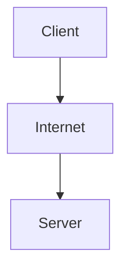

That's it. Your browser (the client) sends a request across the internet, and a server somewhere receives it, processes it, and sends back a response an HTML page, some JSON, an image, whatever you asked for.

This is the mental model most people carry around: *client talks to server, server talks back*. And for a long time, that's genuinely how the web worked, and how a lot of simple systems still work today.

But this simple picture starts cracking the moment you ask a few uncomfortable questions:

- What if the server needs to know who you are, but you don't want it to know exactly where you're browsing from?

- What if a company wants to control which websites its 10,000 employees can visit?

- What if a website becomes so popular that one server physically cannot handle the traffic?

- What if a company doesn't want the entire internet to know the IP address of their real database-facing application server?

- What if the same image is being requested by a million people, and re-generating it from scratch every single time is wasteful?

None of these problems are solvable by "client talks directly to server." That architecture has exactly one job get a request from A to B and it does that one job fine. But it has zero flexibility. There's no place to insert logic, no place to enforce rules, no place to cache, filter, monitor, or hide anything.

This is the moment where a very old and very simple idea in computer science becomes necessary: **if two parties can't (or shouldn't) talk directly, put something in between them.**

That "something in between" is a **proxy**.

Before we define it formally, sit with the intuition first: a proxy is what you get when you take the simple two-party conversation above and deliberately insert a third party whose entire job is to sit in the middle, see everything passing through, and *do something with that visibility*.

That's the seed. Everything else in this article forward proxies, reverse proxies, load balancers, CDNs is just different flavors of "a machine sitting in the middle, doing something useful with what it sees."

---

### What Is a Proxy?

A **proxy** is an intermediary a machine (or software running on a machine) that sits between two parties and relays communication between them, instead of letting them talk directly.

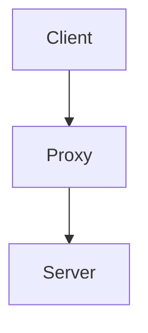

Notice something structurally important here: from the client's point of view, it's still just sending a request "to the server." From the server's point of view, it's still just receiving a request "from a client." But neither of them is talking to the other directly anymore. The proxy is physically in the middle of the wire.

Why does this matter so much? Because whoever sits in the middle of a conversation gets **power** over that conversation. Specifically, a proxy can:

1. **Inspect** the request or response (read it, log it, analyze it)
2. **Modify** the request or response (add headers, strip headers, compress, encrypt)
3. **Block** the request or response entirely (deny access, return an error)
4. **Redirect** the request somewhere else (route to a different destination)
5. **Cache** the response (so the next identical request doesn't have to go all the way to the original destination)

That's it. That's the entire superpower of a proxy the ability to intercept a conversation and act on it. Every real-world use case of a proxy is just a specific combination of those five capabilities.

Now here's the crucial branching point in understanding proxies, and it's the single biggest source of confusion for people learning this topic for the first time:

**A proxy can be inserted on either side of the conversation** near the client, or near the server. And *which side it sits on* completely changes who it represents, who configures it, and who benefits from it.

- A proxy placed near the **client**, representing the client's interests → this is a **forward proxy**.
- A proxy placed near the **server**, representing the server's interests → this is a **reverse proxy**.

Same underlying mechanism (intercept, inspect, modify, block, redirect, cache). Completely different purpose, ownership, and mental model. Let's take them one at a time.

---

### Forward Proxy

#### The problem it solves

Picture a company with 5,000 employees. The company wants to:

- Prevent employees from accessing social media or gambling sites during work hours
- Log which websites are being visited, for security auditing
- Make it look like all outbound traffic is coming from one central, trusted IP address
- Cache frequently-accessed external resources so the company doesn't re-download the same files for every employee

None of this is something the *destination servers* (Facebook, Reddit, whatever) will ever help you with. Facebook doesn't care about your company's internal policy. So if you want this kind of control, you need to insert something **on your own side** before traffic ever leaves your network that intercepts every outbound request.

That something is a **forward proxy**.

#### Where it sits, and who it represents

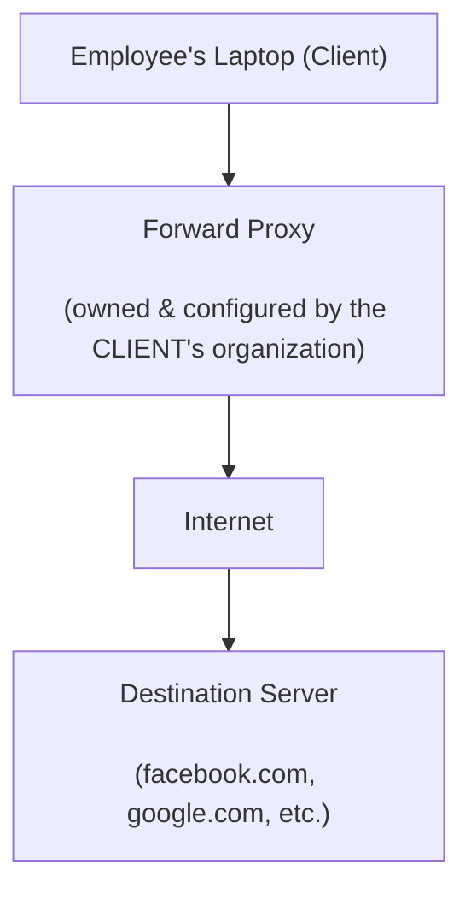

A forward proxy sits **close to the client**, and critically, it is **owned and configured by the same entity that owns the client** (the company's IT department, in this example). It represents the *client side* of the conversation.

Here's the key sentence to internalize:

> **The forward proxy speaks to the outside world *on behalf of* the client.**

This has a very concrete consequence: from the destination server's point of view, it never sees the employee's actual laptop. It only ever sees the forward proxy. The proxy's IP address is what shows up in the server's logs, not the employee's real IP address.

```
What the destination server sees:

   Request arrives FROM:  203.0.113.55  (this is the PROXY's IP)

   The server has NO IDEA that this request originated from
   an employee's laptop somewhere inside a corporate network.
```

This single fact *the server only sees the proxy, never the real client* is the source of almost every real-world forward proxy use case:

- **Anonymity / Privacy**: A VPN is, structurally, a forward proxy. It sits between you and the internet, and every website you visit sees the VPN provider's IP address, not yours.
- **Content filtering**: Schools and corporations configure forward proxies to block requests to certain domains before they ever leave the network. If the proxy sees you requesting `some-blocked-site.com`, it simply refuses to forward the request.
- **Monitoring / Auditing**: Since every outbound request passes through the proxy, the organization can log everything who visited what, when, and how often.
- **Caching for outbound traffic**: If 500 employees all request the same external JavaScript library or the same news article, the forward proxy can cache it once and serve it to everyone else internally, saving bandwidth.

#### Who configures it, who benefits

This is worth being explicit about, because it will matter a lot when we compare forward and reverse proxies later:

| Question | Answer |
|---|---|
| Who owns the forward proxy? | The client's organization (e.g., your employer, your school, your VPN provider) |
| Who configures it? | The client's organization's network administrators |
| Who benefits from it? | The client (privacy, filtering) or the client's organization (control, monitoring) |
| Does the destination server know it exists? | Not necessarily to the server, it just looks like a request from *some* IP address |

The client, in most cases, must explicitly be **configured** to use the forward proxy you set a proxy address in your browser settings or your OS network settings, or your corporate device is pre-configured to route all traffic through the proxy automatically. This is fundamentally different from what we're about to see with reverse proxies, where the client doesn't configure anything at all, and often doesn't even know a proxy exists.

---

### Reverse Proxy

#### The problem it solves

Now flip the entire scenario around. You're not a company trying to control your employees' outbound traffic anymore. You're a company like Netflix, and you have millions of *external* users hitting *your* servers.

You have problems the forward proxy scenario never touched:

- You don't want to expose the real IP addresses of your internal application servers to the public internet (security risk direct exposure means direct attack surface).
- You have many backend servers, not one, and something needs to decide which server handles which request.
- You want to terminate SSL/TLS in one central place instead of on every single backend server.
- You want to serve cached static content instantly instead of hitting a backend server every time.
- You might want to run multiple services (say, `/api`, `/images`, `/videos`) actually served by completely different backend systems, but present them to the outside world as one unified website.

Just like before none of these problems can be solved by the client. The client doesn't care and shouldn't have to care. This needs to be solved on the **server's side**, by something that sits in front of the actual backend servers and represents them to the outside world.

That something is a **reverse proxy**.

#### Where it sits, and who it represents

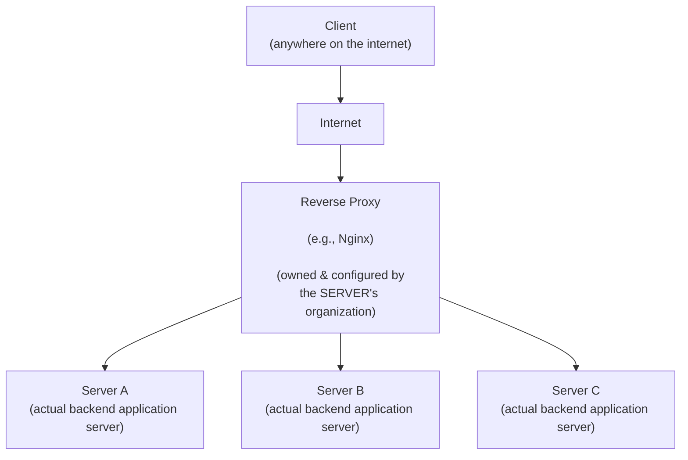

A reverse proxy sits **close to the server side**, and it is **owned and configured by the same entity that owns the backend servers**. It represents the *server side* of the conversation.

Here's the mirror-image key sentence:

> **The reverse proxy speaks to the outside world *on behalf of* the server(s).**

And the consequence mirrors the forward proxy case exactly, just flipped:

```
What the client sees:

   The client sends a request to:  netflix.com

   The client has NO IDEA that this request is actually being
   handled by one of hundreds of backend instances behind the
   reverse proxy. As far as the client is concerned, it's talking
   to "Netflix" one single entity.
```

Crucially, unlike the forward proxy, **the client does not need to configure anything.** You don't set up any special settings in your browser to talk to Netflix's reverse proxy. You just go to `netflix.com`, and the reverse proxy is silently, transparently sitting there intercepting your request. This invisibility is actually one of the defining characteristics of a reverse proxy.

#### A quick mental anchor: Nginx

**Nginx** is one of the most widely used pieces of software in the world for building reverse proxies (along with tools like HAProxy, Envoy, and Traefik). Conceptually, all you need to know right now is: Nginx is a program that sits in front of your backend servers, receives all incoming client requests, and decides what to do with each one forward it to a backend, serve a cached file, terminate SSL, compress the response, etc. We are not going to get into Nginx configuration syntax here; the point is to understand *why* something like Nginx exists in almost every production architecture, not how to write its config files.

---

### Forward Proxy vs Reverse Proxy

Before jumping to a comparison table (which is easy to memorize and easy to forget), let's build the intuition properly by asking the same five questions of each.

**Who does it represent?**
A forward proxy represents the **client**. It acts as the client's agent when talking to the outside world.
A reverse proxy represents the **server**. It acts as the server's agent when talking to the outside world.

**Who owns it?**
A forward proxy is owned by whoever owns the client a company's IT department, a school, a VPN provider, or even you personally if you run your own proxy for privacy.
A reverse proxy is owned by whoever owns the backend infrastructure the company running the website.

**Who configures it?**
A forward proxy typically requires the client to be explicitly configured to use it (browser settings, OS-level proxy settings, or corporate device policies that make this automatic).
A reverse proxy requires zero configuration on the client's side. The client doesn't even know it exists; it's fully configured and controlled by the server side.

**Who benefits from it?**
A forward proxy benefits the client or the client's organization privacy, filtering, monitoring, controlling outbound access.
A reverse proxy benefits the server or the server's organization security (hiding backend servers), scalability (load balancing), performance (caching, SSL termination).

**Who can see what?**
With a forward proxy, the destination server can only see the proxy's identity, never the real client's identity.
With a reverse proxy, the client can only see the proxy's identity (e.g., `netflix.com`), never the real backend server's identity.

This symmetry is genuinely beautiful once you see it: **forward and reverse proxies are the exact same idea, just deployed on opposite ends of the conversation, hiding the opposite party.**

Now, the comparison table, now that the intuition is already in place:

| Aspect | Forward Proxy | Reverse Proxy |
|---|---|---|
| Sits near | Client | Server |
| Represents | Client | Server |
| Owned by | Client's organization | Server's organization |
| Configured by | Client (explicitly) | Server (client unaware) |
| Hides | Client's identity from server | Server's identity from client |
| Common uses | VPNs, content filtering, monitoring, anonymity | Load balancing, SSL termination, caching, security |
| Client awareness | Client usually knows it's using a proxy | Client usually doesn't know a proxy exists |

---

### Multiple Backend Servers

Let's introduce a new wrinkle to the story. Suppose you built a website, and it launched with a single backend server:

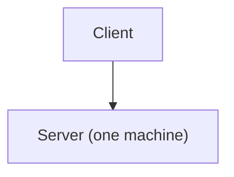

This works fine until your website becomes popular. Now thousands, then millions, of people are hitting that one machine. A single server has finite CPU, finite memory, finite network bandwidth. At some point, no matter how powerful that one machine is, it *will* run out of capacity.

You have two broad options here:

1. **Vertical scaling** make the single server bigger (more CPU, more RAM). This has a hard ceiling; eventually you run out of bigger hardware to buy, and even if you don't, a single machine is a single point of failure. If it goes down, your entire website goes down.
2. **Horizontal scaling** instead of one bigger machine, run *many* machines, each handling a portion of the traffic.

Horizontal scaling is how essentially every large-scale system on the internet handles growth. But it introduces an immediate, obvious new problem:

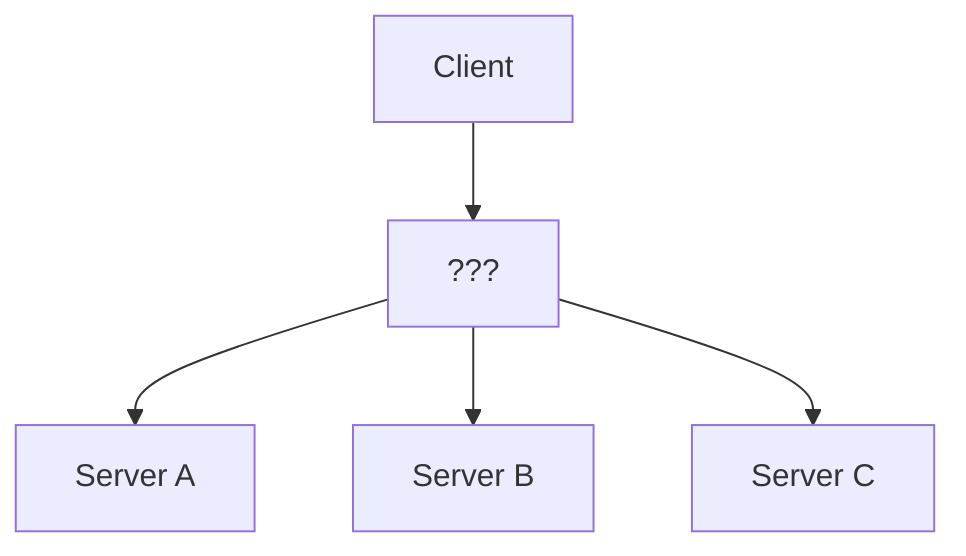

If you now have three backend servers instead of one, **which one should handle the client's request?** The client doesn't know Server A, B, or C exist and it shouldn't have to. The client just wants to talk to "the website." Something needs to sit in the gap marked `???` above, receive every incoming request, and decide which backend server actually processes it.

You should recognize this shape immediately from the earlier discussion: this is a job for a **reverse proxy.**

---

### Why Reverse Proxies Become Load Balancers

Once a reverse proxy is sitting in front of multiple backend servers, it's in the perfect position to solve the *distribution* problem too and once it starts doing that, we give it a more specific name: a **load balancer**.

#### How does it know about every backend instance?

A reverse proxy/load balancer maintains a list sometimes called an **upstream pool** or a **backend pool** of every server it's allowed to send traffic to. This list can be:

- **Statically configured** an administrator manually writes down the IP addresses of Server A, B, and C in a config file.
- **Dynamically discovered** in modern cloud environments, backend servers register themselves with a service discovery system (like Consul, etcd, or a Kubernetes service registry), and the load balancer continuously queries this system to know which servers currently exist and are healthy.

#### How does it know a server is healthy?

This is done through **health checks**. The load balancer periodically sends a small request (often to a special `/health` endpoint) to every backend server:

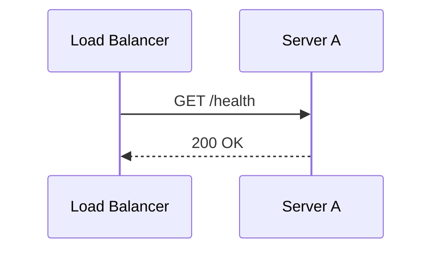

If a server responds with a healthy status within an expected time, it stays in the pool. If it fails to respond, or responds with an error, the load balancer marks it as **unhealthy** and temporarily stops sending it traffic this way, a crashed or overloaded server doesn't keep receiving requests it can't handle. This is one of the most important reasons reverse proxies are so central to production reliability: they turn "one server crashing" from "the whole website goes down" into "traffic quietly reroutes around the broken machine."

#### How does it decide which server gets the next request?

There are several common strategies, and it's worth understanding the intuition behind each:

**Round robin** the simplest strategy. Requests are handed out to servers in a strict rotating order: Server A, then B, then C, then back to A, and so on.

```
Request 1 → Server A
Request 2 → Server B
Request 3 → Server C
Request 4 → Server A   (cycle repeats)
```

This works well when all servers are roughly equal in capacity and all requests are roughly equal in cost.

**Least connections** instead of blindly rotating, the load balancer tracks how many *active* connections each server currently has, and sends the new request to whichever server currently has the fewest. This is smarter than round robin when some requests take much longer than others round robin might keep piling slow, long-running requests onto a server that's already struggling, whereas least-connections naturally routes around a server that's currently busy.

**Weighted variants** if Server A is a more powerful machine than Server B and C, you can assign it a higher "weight" so it receives proportionally more traffic.

**Failure detection in practice**: when a health check fails (or when a live request to a server times out or returns a 5xx error), the load balancer removes that server from rotation, keeps periodically re-checking it in the background, and only adds it back once it starts responding successfully again.

Put all of this together, and you can see *why* the natural evolution happens: a reverse proxy, simply by virtue of sitting in front of multiple backend servers and being the one component that sees every request, is in the ideal position to also decide *which* backend server should handle each request, and to route around failures automatically. That's the whole reason "reverse proxy" and "load balancer" are so often used almost interchangeably in casual conversation a load balancer usually *is* a reverse proxy, just one that's specifically configured to distribute traffic across multiple backends rather than just forwarding to a single one.

---

### A Common Confusion

Here's a question that trips up:

> If a forward proxy is also a proxy server sitting between a client and a destination, why can't it simply load balance requests among backend servers, the same way a reverse proxy does?

It's a completely reasonable question, and the answer reveals something important about what actually distinguishes a forward proxy from a reverse proxy.

#### The core reason: knowledge and visibility

A forward proxy, in its typical deployment, only knows one thing about the destination: a hostname, like `netflix.com`. It resolves that hostname via DNS and forwards the request there. It has **no visibility whatsoever** into Netflix's internal backend architecture it doesn't know that Netflix has Server A, B, and C behind the scenes, because Netflix has no reason to expose that information to the outside world, and the forward proxy has no business knowing it.

```
Forward Proxy's view of the world:

  "netflix.com"  →  (DNS resolves to)  →  203.0.113.10

  That's the entire picture. It has no idea there are
  hundreds of backend instances behind that IP address.
```

#### Ownership and responsibility

Beyond just visibility, there's a deeper architectural reason: **ownership**. The forward proxy is owned by the client's organization. It has no business making routing decisions on behalf of Netflix's backend infrastructure it isn't Netflix's system, it doesn't have Netflix's authorization, and it has no operational responsibility for Netflix's uptime, capacity planning, or backend health.

A reverse proxy/load balancer, by contrast, is owned by the same organization that owns the backend servers. It's *supposed* to know about every backend instance, because managing that distribution *is its job*, granted to it by the people who run those backend servers.

#### But here's the important nuance

Technically, nothing about a "forward proxy" as a piece of software prevents it from being programmed with knowledge of multiple backend servers and told to distribute requests among them. If you gave a forward proxy explicit knowledge of Server A, B, and C, and configured it to pick one intelligently, it absolutely *could* do that there's no hard technical law of computer science preventing it.

But the moment it starts doing that the moment it starts making routing decisions on behalf of backend infrastructure, representing that infrastructure to the outside world **it has stopped behaving like a forward proxy and started behaving like a reverse proxy / load balancer**, regardless of what you call it or where you physically deployed it.

This is the key insight to walk away with:

> **The distinction between forward and reverse proxy is not a hard technical limitation. It's an architectural role defined by who the proxy represents and whose interests it serves not by some fixed rule about what code a proxy is allowed to run.**

A proxy is a forward proxy *because* it acts on behalf of the client and has no authority or visibility over backend infrastructure. A proxy is a reverse proxy *because* it acts on behalf of the server and is explicitly granted visibility and authority over backend infrastructure. The moment either of those conditions flips, so does the label.

---

### Real Production Example (Netflix)

Let's walk through what actually happens, machine by machine, when someone at a company opens `https://netflix.com` in their browser.

1. **Browser creates the request**

The employee's browser prepares an HTTP request for `https://netflix.com`. At this point, nothing has left the laptop yet.

```
[Employee's Laptop]
   Browser: "I need to fetch https://netflix.com"
```

**What this machine knows:** The hostname it wants to reach (`netflix.com`) and its own configured settings (including, in this case, that a corporate forward proxy exists and must be used).

**What it does NOT know:** The actual IP address of Netflix's servers, and absolutely nothing about Netflix's internal backend architecture.

2. **Browser sends the request to the corporate forward proxy**

Because the company has configured every employee laptop to route web traffic through a forward proxy (for monitoring and filtering purposes), the browser doesn't go straight to the internet. It sends the request to the internal proxy first.

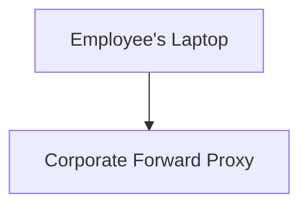

**What this machine (the proxy) knows:** The destination hostname (`netflix.com`) requested by the client, and the company's policies (is this site allowed? should this be logged?).

**What it does NOT know:** Anything about Netflix's internal infrastructure it only knows it needs to reach "netflix.com" somehow.

3. **Forward proxy performs a DNS lookup**

The forward proxy needs an actual IP address to connect to, so it performs a DNS lookup for `netflix.com`.

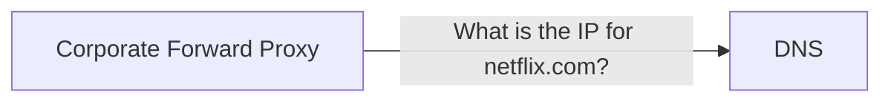

4. **DNS returns Netflix's public endpoint**

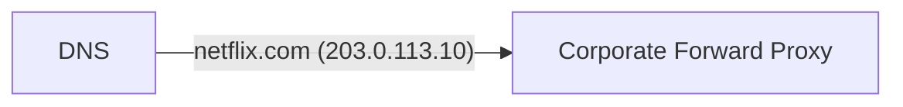

**Why it makes this decision:** DNS's entire job here is address translation turning a human-readable hostname into a machine-usable IP address. Importantly, DNS doesn't tell the proxy *which specific backend server* will handle the request; it just gives the address of Netflix's front door which, as we'll see, is itself another proxy/load balancer, not an actual application server.

5. **Forward proxy forwards the request**

Having resolved the IP, the forward proxy establishes a connection and forwards the client's request onward, out across the public internet, toward that IP address.

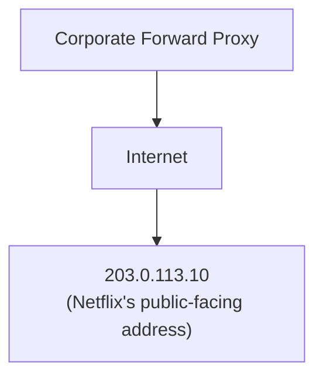

**Important detail:** From this point onward, Netflix will only ever see the corporate forward proxy's IP address as the source of the request not the employee's actual laptop.

6. **Request reaches Netflix's edge**

The request arrives at Netflix's infrastructure but critically, it does **not** land directly on an application server. It lands on Netflix's own reverse proxy / load balancer layer, sitting at the edge of their network.

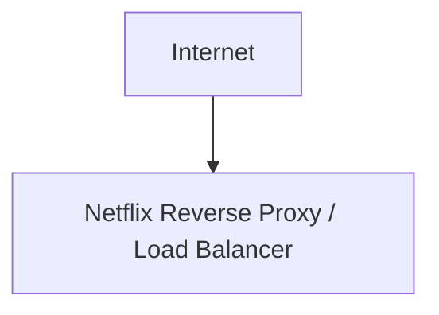

**What this machine knows:** The full pool of currently healthy backend instances that can handle this type of request, and the load-balancing strategy configured for this traffic.

**What it does NOT know (and doesn't need to):** Anything about the employee's laptop, the corporate network it came from, or why the request was made. All it sees is a well-formed HTTP request arriving from an IP address (which happens to be the corporate forward proxy's IP).

7. **Reverse proxy / Load balancer receives it**

This is the exact mechanism described previously. The load balancer checks its pool of backend instances, filters out anything currently marked unhealthy from failed health checks, and applies its selection strategy.

8. **Load balancer selects one backend instance**

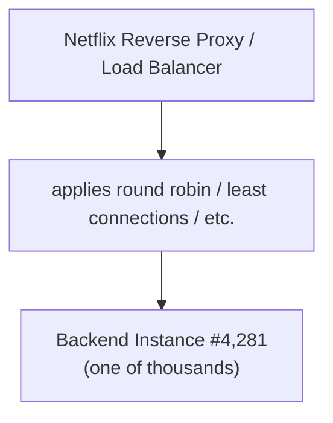

**Why it makes this decision:** Perhaps round robin says it's instance #4,281's turn, or perhaps that instance currently has the fewest active connections. Either way, the load balancer and only the load balancer makes this call. Neither the client, nor the corporate forward proxy, has any say or awareness of which specific instance is chosen.

9. **Backend processes the request**

```
[Backend Instance #4,281]
   - Authenticates the session
   - Queries databases / caches for the requested content
   - Constructs the HTTP response
```

**What this machine knows:** Everything needed to actually fulfill the request user session data, content catalogs, personalization data, etc.

**What it does NOT know:** It has no idea, and no need to know, that this request traveled through a corporate forward proxy before arriving. It also doesn't know or care which of the other thousands of backend instances exist it just does its job for the request handed to it.

10. **Response travels back**

The response now retraces the entire path in reverse:

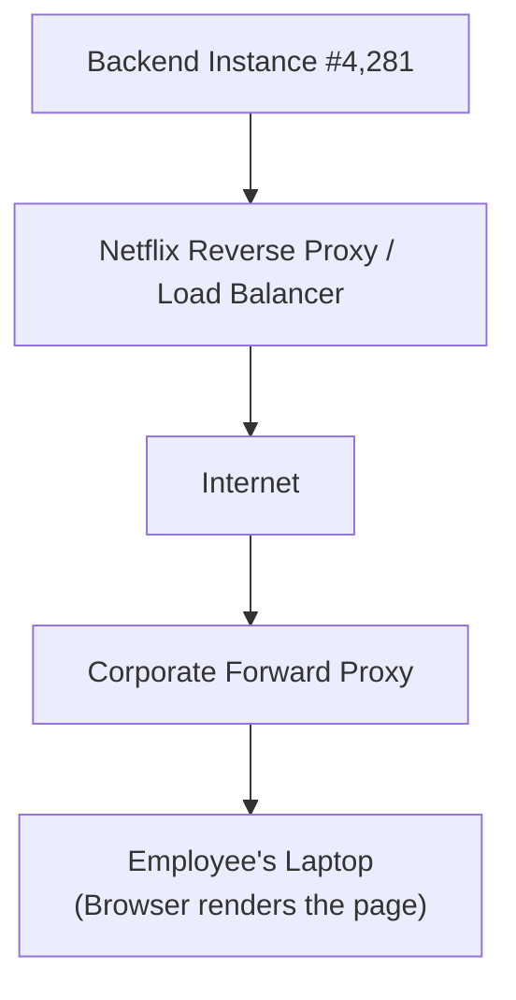

At every hop on the way back, each machine only does the minimal job required of it: the reverse proxy forwards the response back toward whoever sent the original request (the forward proxy's IP), and the forward proxy forwards it back to the actual employee laptop that originally asked for it.

#### The full picture in one diagram

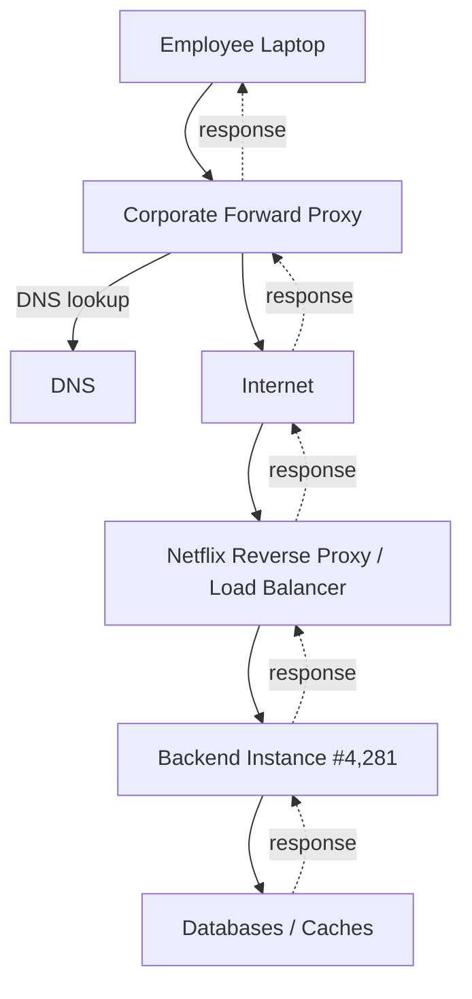

Notice the symmetry we discussed all the way back: there are *two* proxies involved in this single request, one on each end, each completely invisible to the other, each representing a different party, each with knowledge scoped strictly to its own side of the conversation.

---

### DNS and Load Balancing

A very common point of confusion, especially for people newer to system design, is mixing up DNS, load balancers, reverse proxies, and CDNs they all seem to be "in the path" of a request, so it's easy to assume they do overlapping jobs. Let's cleanly separate their responsibilities.

**DNS (Domain Name System):** its *only* job is translating a human-readable hostname (`netflix.com`) into a machine-usable IP address. That's it. DNS doesn't inspect requests, doesn't route based on content, doesn't do health checks on individual backend servers in the traditional load-balancing sense. (Note: DNS *can* do a coarse form of load distribution called DNS round robin or geo-DNS by returning different IP addresses to different clients or rotating through a list. But this is much coarser and slower to react than what an actual reverse-proxy load balancer does, because DNS results get cached by browsers, operating systems, and ISPs for periods of time, so DNS can't make split-second per-request decisions.)

**Load Balancer:** its job is to take incoming requests that have *already arrived* at a known IP address and distribute them intelligently across a pool of backend servers, using live information like health checks and current connection counts. It operates request-by-request, not just hostname-by-hostname.

**Reverse Proxy:** a broader category that a load balancer is a *type of*. A reverse proxy's job is to sit in front of backend infrastructure and represent it to the outside world; load balancing is one common thing reverse proxies do, but they can also do things unrelated to distributing traffic across multiple servers, such as SSL termination, caching, or request/response rewriting, even in front of just a single backend server.

**CDN (Content Delivery Network):** a network of geographically distributed servers whose job is to cache and serve content (especially static content like images, videos, and scripts) from a location physically close to the requesting client, so the request doesn't have to travel all the way to the origin server. A CDN node is, structurally, also a kind of reverse proxy it sits in front of the origin server and represents it but its defining feature is geographic distribution and heavy caching, aimed at reducing latency and origin load.

**Cloudflare:**, as a real-world example, actually operates across several of these categories simultaneously: it provides DNS services, it operates as a CDN with edge nodes around the world, and it also functions as a reverse proxy in front of your origin servers (adding features like DDoS protection, web application firewalls, and SSL termination at the edge).

The clean way to think about how they interact for a single request:

```
1. DNS resolves the hostname to an IP address
        (this might be a CDN edge node's IP, not the origin server's IP)

2. Request arrives at that IP often a CDN edge node

3. CDN edge node checks: "Do I already have this content cached?"
        - If yes → serve directly from cache (fast, no origin involved)
        - If no  → forward the request further upstream

4. Request reaches the origin's reverse proxy / load balancer

5. Load balancer selects a specific backend server

6. Backend server processes the request and returns a response,
   which travels back through the same chain
```

The recurring theme: **DNS answers "where do I send this?", while load balancers and reverse proxies answer "given that it arrived here, who should actually handle it?"** They're solving genuinely different problems, even though both sit somewhere in the path of a request.

---

### Production Architecture

Let's zoom out and look at a realistic, full production architecture, incorporating everything from this article, layer by layer.

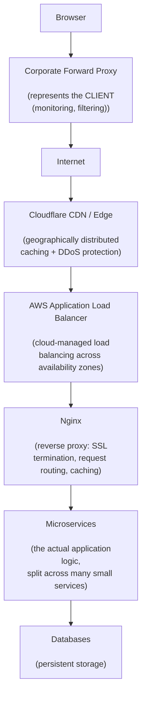

Let's walk through what each layer is responsible for, and why it exists at that specific point in the chain:

**Browser:** creates the initial request. Knows nothing about any of the infrastructure it's about to travel through.

**Corporate Forward Proxy:** exists purely for the client organization's benefit: content filtering, monitoring, and presenting a single outbound IP to the world. Has zero awareness of, or responsibility for, anything happening on the server side.

**Cloudflare CDN / Edge:** the request's first contact with infrastructure belonging to the *server's* side. Its job is to answer the question "can I serve this without bothering the origin at all?" For static, cacheable content, the answer is often yes, and the request never travels any further. It also filters out obviously malicious traffic (DDoS attempts) before it ever reaches the real infrastructure.

**AWS Application Load Balancer:** a cloud-provider-managed load balancer that typically distributes traffic across multiple availability zones (physically separate data centers) for high availability. This is often the first point where "which physical region/zone should handle this" gets decided.

**Nginx:** a reverse proxy operating *within* a specific zone/cluster, handling things like SSL/TLS termination (decrypting HTTPS so backend services don't each have to manage certificates), routing requests to the correct microservice based on the URL path (e.g., `/api/users` goes to the Users service, `/api/videos` goes to the Videos service), and sometimes caching at this layer too.

**Microservices:** the actual application logic. Notice that by the time a request reaches here, it has already been filtered, cached-checked, load-balanced across zones, decrypted, and routed to the correct service. The microservice's job is narrow and focused: do the actual business logic.

**Databases:** the persistent source of truth, queried by the microservices to read or write data.

The overarching lesson from this diagram: **in real production systems, there isn't just "a proxy" there's a whole layered chain of proxies and proxy-like components, each solving one narrow problem, each unaware of the layers far above or below it.** This layering is deliberate. It means each component can be developed, scaled, and replaced independently, without the other layers needing to know or care.

---

### Putting It All Together

Let's rebuild the entire mental model from scratch, one more time, now that every piece has been introduced.

It starts with a simple, uncomfortable observation: a direct client-to-server connection has no room for control, visibility, protection, or scale. The moment any of those become necessary, you need a machine sitting *in the middle* of the conversation a proxy.

That proxy can sit on either side. Placed near the client, representing the client's interests, hiding the client's identity from the outside world it's a **forward proxy**. Placed near the server, representing the server's interests, hiding the server's internal architecture from the outside world it's a **reverse proxy**.

Once a reverse proxy exists in front of *multiple* backend servers, it naturally takes on the responsibility of deciding which server should handle each request using health checks to know what's alive, and strategies like round robin or least connections to distribute the load intelligently. At that point, we call it a **load balancer** though really, it's just a reverse proxy that has grown a specific extra responsibility.

The distinction between forward and reverse proxy was never a hard technical wall. It's about **who a proxy represents, who owns it, and what it's authorized to know** a forward proxy could theoretically be given backend visibility, but the moment it acts on that visibility to route traffic for the server's benefit, it has crossed over into reverse-proxy territory, regardless of its label.

Walking through a real request a browser opening `netflix.com` from inside a corporate network shows this entire model in motion: a forward proxy handling the outbound leg (DNS resolution, corporate policy, hiding the employee's real identity), and a reverse proxy/load balancer handling the inbound leg on Netflix's side (selecting a healthy backend instance, hiding Netflix's internal architecture). Two proxies, two completely different owners, two completely different jobs, working together without either one knowing the other exists.

Zooming out further, DNS, CDNs, load balancers, and reverse proxies each answer a different, non-overlapping question DNS answers *where do I send this*, a CDN answers *can I avoid bothering the origin entirely*, and load balancers/reverse proxies answer *given that this arrived here, who should actually handle it, and how should it be transformed along the way*.

And in a real production system, all of this stacks into layers forward proxy, CDN, cloud load balancer, application-level reverse proxy, microservices, databases each layer solving one narrow, well-defined problem, blind to everything happening above or below it.

If you can now close your eyes and trace a single request from a browser all the way down to a database, watching it pass through each of these layers, understanding *why* each one exists and *what it does and doesn't know* at each point that's exactly the level of intuition needed to walk into a system design interview and confidently explain forward proxies, reverse proxies, and everything they enable.